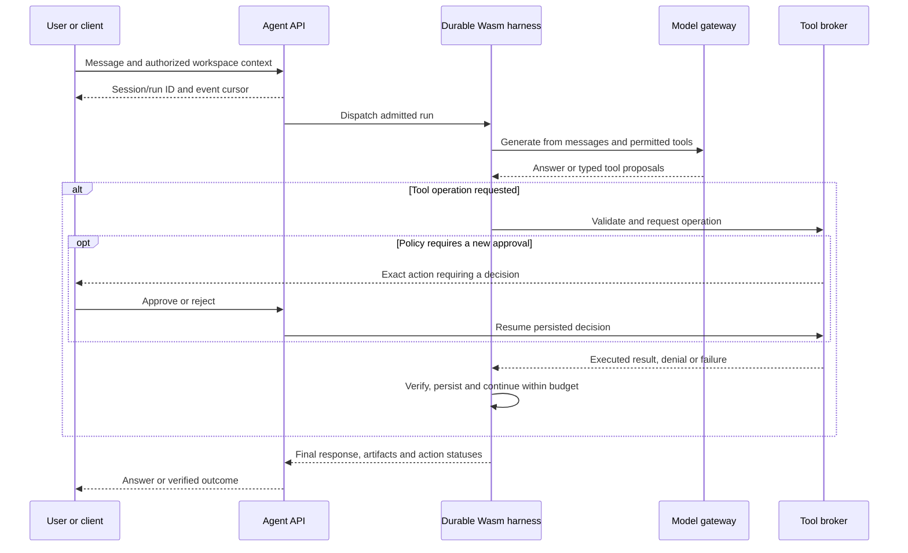
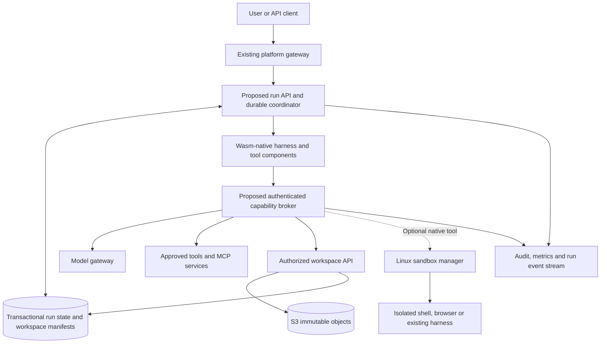
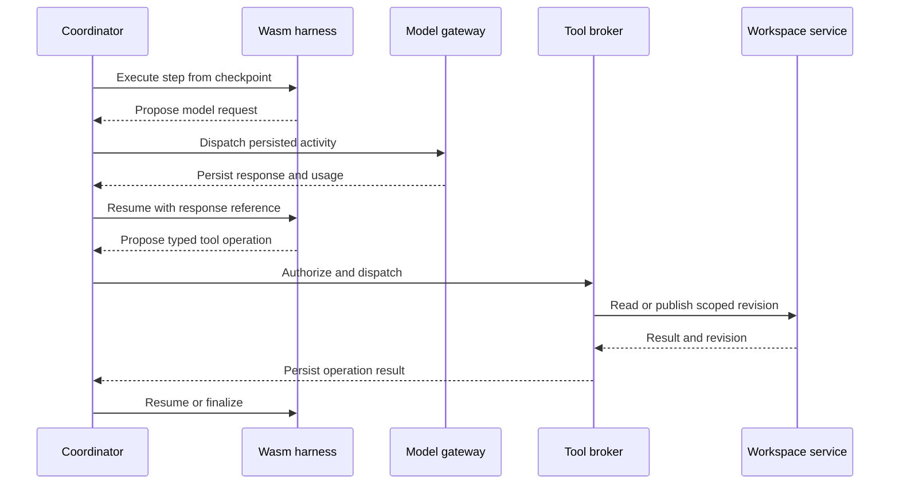
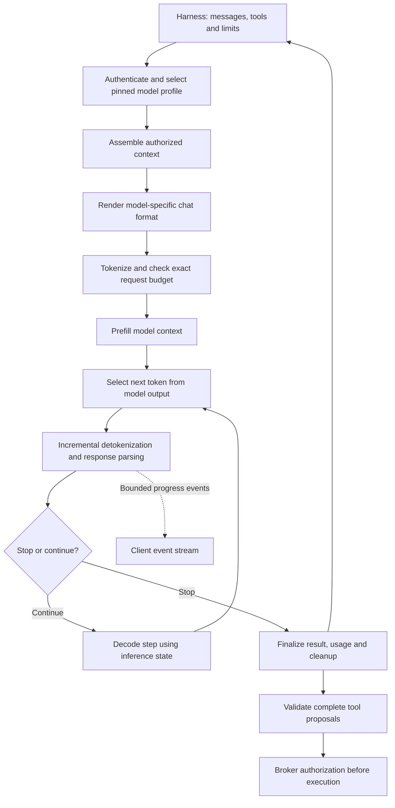
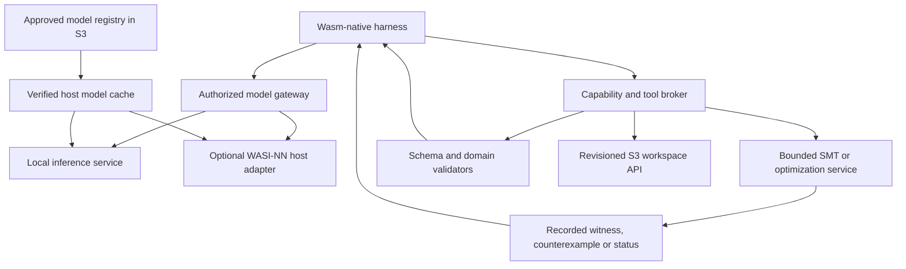

# Agent execution and harness architecture investigation

Date: 2026-10-04  
Status: Investigation and proposed architecture; not an implemented feature specification

> Repository decision (2026-10-28): agent applications, harnesses, tools,
> knowledge/skills, migrations, and agent rehearsal scripts are developed in
> `D:/dev/wasmcloud_platform_harness`. This repository supplies generic execution
> capabilities. The coordinator owns durable transitions; harnesses return
> proposals without direct database access. This decision supersedes examples
> below that assign run-state writes or database credentials to a harness.
> See [platform progress](PLATFORM_MODIFICATIONS.md#repository-boundary-and-implementation-progress).

## Executive assessment

The Wasm Cloud Platform could become a strong foundation for running agents and teams of agents. Following the design discussion, the preferred initial architecture is a **complete Wasm-native harness with an S3-backed logical workspace**, without an agent CLI or a local filesystem exposed to the guest:

- A Rust/WASI harness implementing the model/tool loop, context management, and delegation.
- An authorized workspace API backed by S3 objects for documents, generated files, and artifacts.
- A durable coordinator and transactional state store for ownership, checkpoints, approvals, and budgets.
- A model gateway and typed tool services with externally enforced capabilities.
- Optional local inference, including WASI-NN, and bounded symbolic reasoning tools such as Z3, with explicit host-resource and trust boundaries.
- Optional isolated Linux workers only for existing CLI-based harnesses or tools requiring native execution.

Codex and the Claude Agent SDK already provide access to agent harnesses. They are optional integrations, not prerequisites for building this system. Building a native Wasm harness means implementing the agent loop directly against model APIs rather than wrapping those CLIs.

Here, "no local filesystem" means no filesystem capabilities exposed to the agent guest. The host platform, database, and object-storage implementation still have their own storage requirements. S3 is used through object APIs, not mounted as a POSIX filesystem.

The current platform cannot yet promise safe execution of arbitrary agents. Its runtime explicitly supports only a **single trust domain**. This investigation also identified a separate outbound HTTP path that does not consult the platform's WASI socket policy.

The first technical priorities are unified network-policy enforcement and durable run ownership. Stronger worker isolation is required before admitting mutually untrusted tenants or arbitrary coding workloads.

## Scope and evidence limits

This investigation reviewed runtime and supervisor code, policy configuration, placement behavior, repository documentation, existing LLM studies, and official framework documentation.

It was a static source and architecture review. No agent workload was deployed, no penetration test was performed, and the outbound HTTP finding was not demonstrated with a runtime reproducer. References to existing tests or validation infrastructure do not mean those checks were executed for this investigation.

The later design refinement makes a Wasm-native harness and S3 workspace the preferred path, while preserving the earlier security findings and optional framework integrations. S3 semantics were checked against AWS documentation; no storage-provider integration was executed.

The inference and symbolic-reasoning extension below evaluates upstream interfaces and source against this platform's embedding. No WASI-NN backend, model, solver, or alternative reasoning tool was compiled, installed, benchmarked, or integrated. A project's browser/Wasm support is not evidence of compatibility with this repository's `wasm32-wasip2` component runtime.

Statements about the repository describe the checkout reviewed on the date above. External framework interfaces can change; adapters should pin and validate their actual versions. All proposed services, APIs, and workflows below require implementation unless explicitly identified as existing functionality.

## Existing platform capabilities

| Existing capability | Value for an agent system | Remaining limitation |
| --- | --- | --- |
| Wasmtime and WASI components | Execute portable code with controlled host capabilities | Existing Python, Node.js, and native agents do not automatically run as Wasm |
| Fuel and memory limits | Bound guest computation and memory growth | Do not bound model spending or all host-side resource use |
| Filesystem preopens | Expose selected directories to a guest | Workspace allocation, persistence, and detailed write controls need more work |
| Network policies | Restrict WASI socket destinations | Separate HTTP path needs enforcement; defaults permit outbound TCP and DNS |
| Gateway authentication and authorization | Authenticate users invoking agents | Each run and delegated tool call needs its own authorization |
| Secrets management | Store credentials and deliver them to applications | A credential injected into an agent is readable by that agent |
| NATS and JetStream integration | Foundation for dispatch and durable messaging | Current control-plane messaging is not an agent workflow engine |
| Local persistence | Store platform state | Does not automatically provide distributed agent checkpoints |
| Node-local mesh | Connect co-located agent services and tools | Cross-node coordination requires explicit external endpoints |
| Telemetry and audit infrastructure | Observe execution and diagnose failures | Agent-specific events, budgets, and tool decisions need instrumentation |
| Firecracker testbed scripts | Infrastructure for local validation | Do not implement an on-demand sandbox service for individual agent runs |

Repository entry points:

- [Platform overview](../../README.md)
- [Runtime executor](../../crates/runtime/src/executor.rs)
- [Runtime limits](../../crates/runtime/src/limits.rs)
- [Supervisor spawn and admission](../../crates/supervisor/src/spawn_runtime.rs)
- [Application configuration types](../../crates/common/src/types.rs)
- [NATS integration](../../crates/messaging/src/lib.rs)
- [Internal mesh contract](../../docs/internal-mesh.md)

### Agent hosting is separate from model inference

The existing [LLM streaming study](../../STUDIES/wasm_llm_streaming_architecture_guide_english.md) and [fine-tuning study](../../STUDIES/wasm_lo_ra_fine_tuning_architecture_edge_ai.md) concern inference and model workloads. They are not evidence of an implemented agent harness or GPU execution backend.

An agent harness can call a remote or locally hosted model while planning state, tool execution, authorization, and coordination remain on this infrastructure. The recommended initial design uses model APIs behind a controlled gateway; local inference and WASI-NN are additional options described below.

The supervisor currently caps an application's configured memory at 8,192 Wasm pages, or **512 MiB**, in `Supervisor::check_resource_limits`. That makes ordinary large-model inference inside guest linear memory a poor fit for the current application execution path. Host-side inference can keep weights outside that memory, but requires separate admission, accounting, cancellation, and isolation; it is not covered by the guest limit.

## Security findings and trust boundaries

### No absolute escape guarantee

The meaningful objective is to constrain capabilities and contain failures, including runtime vulnerabilities and misuse of legitimate permissions. An absolute guarantee that an agent cannot escape cannot be established by this architecture review.

Wasm provides meaningful isolation: guest interactions with the outside world pass through imported interfaces. The implementation and authorization of those interfaces remain part of the trusted computing base. Wasmtime documents defense-in-depth measures because implementation bugs can occur. See [Wasmtime security documentation](https://docs.wasmtime.dev/security.html).

### 1. Applications share the node's native process

Production validation requires `runtime.isolation_mode = "single-trust-domain"` and rejects other isolation claims. Applications share the native process, UID, address space, capabilities, and node cgroup.

Wasm memories remain isolated under normal execution. However, a runtime or host-function compromise can have a larger impact than the individual component. eBPF monitoring does not create a separate hostile-tenant isolation boundary.

Evidence:

- [Configuration validation](../../crates/config/src/validation.rs): production isolation admission and supported isolation mode.
- [eBPF documentation](../../docs/ebpf.md): explicit single-trust-domain boundary.
- [Runtime executor](../../crates/runtime/src/executor.rs): in-process stores and execution threads.

For mutually untrusted agents, isolate workers from the coordinator and credential-bearing brokers at a native process or VM boundary appropriate to the threat model. Separate Wasm components in the same process do not provide containment against compromise of that process.

Distinguish a trusted, platform-built harness processing untrusted prompts from tenant-uploaded harness binaries or generated executable code. The former can be the first single-trust-domain deployment profile with strict tool authorization. Supporting the latter requires a separate isolation admission decision even if neither profile receives a filesystem preopen.

### 2. Default outbound networking is permissive

`NetworkPolicy::default` permits outbound TCP and DNS, with empty destination allow and deny lists. Empty allowlists mean unrestricted destinations when the relevant protocol is enabled.

Agent deployments need explicit restricted policies. Default networking is insufficient for controlled tool access.

Evidence: [Policy definitions and defaults](../../crates/common/src/policy.rs).

### 3. The reviewed outgoing HTTP path bypasses the WASI socket-policy hook

Implementation update (2026-10-28): the finding below records the original
review baseline. The platform now installs a custom HTTP transport enforcing
the composed TCP/CIDR and supervisor policy before connection, with single DNS
resolution and original-hostname TLS validation. See the
[implemented contract](../../docs/deploying-applications.md#outbound-wasi-http-policy)
and [remaining prerequisites](PLATFORM_MODIFICATIONS.md#repository-boundary-and-implementation-progress).

`StoreState` implements `WasiHttpView` with `hooks: Default::default()`. In the pinned `wasmtime-wasi-http` 48.0.1 source reviewed locally, the default HTTP hooks call a host-side sender that opens a connection through `tokio::net::TcpStream::connect`. That path does not consult the platform's `socket_addr_check` callback.

Consequently, the WASI socket restrictions alone do not constrain this HTTP path. External host network controls could independently block traffic. This finding establishes a source-level enforcement gap; it is not a runtime exploit demonstration or a claim about the reachability of any particular deployed endpoint.

Evidence:

- [Runtime executor](../../crates/runtime/src/executor.rs): `build_store_state`, runtime linker construction, and `WasiHttpView for StoreState`.
- [Socket policy](../../crates/runtime/src/executor/socket_policy.rs): the separate WASI socket enforcement path.
- [Runtime dependencies](../../crates/runtime/Cargo.toml) and [workspace dependency versions](../../Cargo.toml).
- Pinned upstream [HTTP hooks](https://github.com/bytecodealliance/wasmtime/blob/v48.0.1/crates/wasi-http/src/ctx.rs) and [default HTTP sender](https://github.com/bytecodealliance/wasmtime/blob/v48.0.1/crates/wasi-http/src/default_send_request.rs).

Before relying on the runtime for untrusted agent networking, enforce policy on every exposed outgoing path. A custom HTTP hook must constrain destinations and resource use, including DNS resolution and the actual connection address. Merely checking a hostname before delegating a second resolution to an unrestricted sender is insufficient.

Handle security remediation according to [SECURITY.md](../../SECURITY.md). This investigation does not authorize public vulnerability publication.

### 4. Some declared quotas are not authoritative runtime limits

The policy-boundary table explicitly identifies gaps in filesystem write-byte and network egress-byte enforcement. DNS policy is a coarse enable/disable control, not a hostname allowlist. Filesystem activity counters are also incomplete.

Do not advertise a configured field as an enforced security guarantee without checking its actual enforcement path.

Evidence: [Policy boundary capabilities](../../crates/runtime/src/policy_boundary.rs).

### 5. Filesystem permissions are coarse

`configure_filesystem_preopens` selects read/write preopen permissions when either file creation or deletion is enabled. Those booleans should not be interpreted as independently enforced per-operation permissions.

Agent workspaces should use narrowly scoped preopens. More precise create, delete, read, and write authorization would require additional implementation and validation.

Evidence: [Runtime filesystem configuration](../../crates/runtime/src/executor.rs).

### 6. Permission misuse is distinct from sandbox escape

An agent allowed to read confidential documents and send arbitrary network requests can disclose those documents without escaping its sandbox. Tool authorization, data-access policy, and credential scoping must be enforced outside the model's decisions.

Treat repository content, retrieved documents, tool results, and peer-agent messages as untrusted data. They must not modify execution policy or grant new capabilities.

## Compatibility: what supporting any agent should mean

The realistic compatibility contract is: agents integrate through a common run protocol and supported execution backends. Universal binary or dependency compatibility is not a credible initial promise.

| Agent or workload | Recommended execution | Integration required |
| --- | --- | --- |
| Custom Rust agent calling model APIs | WASI component | Small agent loop or shared harness integration |
| Portable parsing, validation, or transformation tool | WASI component | Typed input/output and restricted imports |
| Existing OpenAI Agents SDK application | Isolated Linux worker | Lifecycle, state, tool, and event adapter |
| Existing LangGraph application | Isolated Linux worker | Checkpoint and execution-lifecycle integration |
| Codex | Isolated Linux worker | SDK/app-server adapter and workspace management |
| Claude Agent SDK | Isolated Linux worker | SDK adapter, subprocess lifecycle, and session persistence |
| Browser automation, shell commands, and compilers | Dedicated Linux sandbox | Process management, filesystem limits, and egress controls |
| Python or JavaScript compiled into Wasm | Experimental option | Package-by-package and host-API compatibility validation |
| Agent hosted elsewhere | Authenticated remote adapter | Platform controls only the resources and tools it hosts |

Official integration references:

- The [OpenAI Agents SDK](https://developers.openai.com/api/docs/guides/agents/sdk) runs application code in Python or TypeScript, with the application responsible for deployment and tool implementations.
- The [Codex SDK](https://learn.chatgpt.com/docs/codex-sdk) provides programmatic control of local Codex agents.
- [Claude Agent SDK hosting](https://code.claude.com/docs/en/agent-sdk/hosting) describes a native CLI subprocess, working directory, and session files.
- [LangGraph persistence](https://docs.langchain.com/oss/python/langgraph/persistence) provides checkpoint and persistent-store abstractions that an adapter can reuse.

These integration choices are architectural recommendations. Compatibility with this platform has not been demonstrated by this investigation. Every adapter must declare required runtime versions, local tools, filesystem behavior, network endpoints, and supported recovery semantics.

## OpenCode-style experience: ask, answer, and act

### Product goal and architectural reference

The user-facing goal is simple: submit a natural-language request, receive useful progress, and obtain an answer, an artifact, or a verified action result. The complexity of storage, model execution, and durable orchestration should stay behind that interface.

OpenCode is a useful architectural reference. Its terminal interface acts as a client to a server, and `opencode serve` exposes a headless HTTP API. Its documented APIs include sessions, messages, events, and permission responses. Its SDK supports connecting to an existing server. Sources: [OpenCode server](https://opencode.ai/docs/server/) and [OpenCode SDK](https://opencode.ai/docs/sdk/).

This shows that a CLI is one possible client, not a prerequisite for the agent's execution. A web chat, a thin terminal client, or another application can submit the same request to this platform's agent API.

### Three adaptation choices

| Approach | Work required | Fit for the preferred direction |
| --- | --- | --- |
| Host OpenCode unchanged behind an adapter | Operate its server in a compatible isolated environment; map platform runs, credentials, workspaces, events, permissions, and cancellation | Useful optional integration, but retains the existing runtime and local-tool assumptions |
| Port OpenCode's implementation to WASI | Replace runtime dependencies, storage, filesystem/process tools, extensions, and relevant native integrations; validate its behavior and upstream maintenance strategy | Substantial porting project, not a build-target switch |
| Build a similar experience on the native Wasm harness | Implement the session interface and agent loop with S3 workspace tools and platform action adapters | Recommended for the no-agent-CLI, object-workspace design |

The reviewed upstream package uses TypeScript and Bun-oriented build/runtime integration, while its built-in tools include filesystem operations and shell execution. That does not establish a WASIp2 deployment path. See [OpenCode package source](https://github.com/anomalyco/opencode/blob/dev/packages/opencode/package.json) and [tool documentation](https://opencode.ai/docs/tools/). These are upstream references, not a pinned release compatibility test.

Reusing an OpenCode client would require implementing the exact server schema, events, session behavior, and any project/path assumptions that client uses. A similar chat experience does not require wire compatibility. Start with a small client for this platform's own API; add a compatibility facade only if retaining a particular external client is a real requirement.

### Map the useful concepts into this platform

| User-visible or harness concept | Platform-native implementation |
| --- | --- |
| Conversation/session | Authorized message history linking several durable runs |
| User prompt | Idempotent message admission followed by queued execution |
| Agent loop | Wasm step execution, model activity, tool proposals, results, continuation |
| File read/write/edit | Workspace API over revisioned S3 objects |
| File search | Authorized manifest lookup or revision-aware search index |
| Shell command | Disabled in the API-only profile; optional isolated native tool |
| Tool or MCP connector | Registered operation behind the capability broker |
| Permission prompt | Durable operation-specific approval when policy requires it |
| Progress display | Ordered events with reconnect/replay support |
| Subagent | Child run with reduced capabilities and a reserved budget |
| Final answer | Committed message with evidence and artifact references |
| Completed action | Recorded result plus verification of the requested effect |

OpenCode documents allow, deny, and ask permission decisions. This platform can expose similar choices while enforcing them at the broker and runtime boundaries. Do not inherit a permissive default or treat a UI permission setting as an OS sandbox. See [OpenCode permissions](https://opencode.ai/docs/permissions/).

### A complete request path



Admission records authenticated identity, selected agent definition, workspace revision, effective capabilities, and limits. Model interpretation cannot expand that authority. Execute actions already allowed by the request and policy without redundant approval prompts; ask when a decision or additional authorization is actually required.

Some requests need only one model call. Others need retrieval and several tools. Use one agent by default; multiple agents are optional when decomposition improves the outcome. WASI-NN, local GPU serving, and symbolic solvers are also optional capabilities rather than prerequisites for a useful ask/answer/action flow.

### Define action success precisely

Expose application operations rather than unrestricted execution, for example:

```text
documents.search(query, scope)
workspace.read(path, revision)
workspace.write(path, content, expected_revision)
tasks.create(project_id, title, details)
```

These names are proposed tool contracts. Each requires an implementation, authorization policy, input schema, timeout, result schema, idempotency behavior, and verification rule. A model cannot perform an action for which the platform has no enabled tool.

For "summarize these documents," return an answer linked to the source revisions. For "save the summary," publish a workspace revision and return its reference. For "create a task from the summary," call the authorized task adapter, record its returned identifier, and verify according to that integration's contract before claiming success.

Distinguish proposed, awaiting approval, accepted by a downstream service, completed, failed, partially completed, and outcome-unknown states. A downstream acknowledgement may represent only queued work. Do not claim an external action succeeded because the language model says it did. If an action may have succeeded before a connection failed, reconcile using its operation ID rather than retrying blindly.

The final user response should state what was answered or changed, link relevant artifacts or resource IDs, and identify any incomplete part. It need not expose model-cache details, solver internals, or infrastructure implementation choices unless those affect the result.

### Minimal implementation sequence

1. Define a conversation/session record associated with existing proposed run IDs, messages, and event cursors. Start with one active run per session to keep follow-up ordering clear.
2. Expose run creation, status/events, follow-up input, approval responses, and cancellation through the agent API already proposed in this document.
3. Implement one reusable Rust/WASI agent loop and one model gateway adapter.
4. Provide authorized S3 read/search and write tools, plus one narrowly scoped business-action adapter.
5. Implement durable operations, lease fencing, bounded retries, budgets, and effect verification.
6. Add a thin client that submits messages, displays progress, handles required decisions, and shows final results.
7. Demonstrate restart recovery, reconnect, denied tools, and duplicate-request handling before adding more agents or providers.

There is currently no frontend package manifest in this repository. A future client would be a new scoped implementation; this investigation does not create a frontend or install dependencies. An API client is sufficient to validate the initial flow.

The first acceptance scenario should use the same interface for a question and an action: "summarize the approved documents" followed by "save that summary and create a task." Both should retain conversation context, obey the caller's permissions, and report observable results. Native shell execution and wholesale OpenCode compatibility can remain outside this initial scope.

## Proposed architecture

The primary path below requires no Linux agent worker. The optional execution branch is added only when a tool or imported framework requires it. Every new component is proposed functionality.



The capability broker must be an enforcement boundary. Runtime and host network policy must prevent workers from bypassing it. Sensitive brokers and the coordinator should remain outside the native process or VM trust boundary of untrusted workers.

### Wasm execution backend

Implement the complete harness in Rust/WASI and expose bounded execution steps through the existing HTTP component model. The harness can read object-backed documents, call model APIs, invoke typed tools, produce artifacts, and coordinate child agents without an agent CLI. Persist logical run state outside each component instance and configure no filesystem preopens for this profile.

The current runtime recognizes CLI and HTTP execution models. A custom WIT interface such as `agent:run/step` would require linker and executor changes; declaring it in a manifest would not make it executable.

### Optional Linux execution backend

Use isolated Linux workers only when needed for SDKs, native binaries, subprocess trees, browsers, or tools expecting an OS filesystem. A Wasm agent can produce source files in S3 without such a worker, but running an ordinary native compiler against them needs a compatible execution service. Firecracker is a reasonable candidate, but a new sandbox-management service is needed for allocation, images, credentials, workspace lifecycle, networking, and cleanup.

Firecracker leaves network filtering to the host and recommends its jailer for production. See [Firecracker design](https://github.com/firecracker-microvm/firecracker/blob/main/docs/design.md).

Running a whole platform node inside a microVM protects an outer host boundary. It does not create an individual VM boundary for every agent on that node.

### Keep platform ownership separate from framework internals

The Wasm-native path owns its own agent loop. For optional existing-framework integrations, build a shared orchestration and execution contract while allowing those frameworks to own their internal loops. This orchestration layer should not be confused with the framework's harness.

A LangGraph adapter can retain its own checkpoints. A Codex adapter can retain a session identifier and workspace snapshot. The coordinator records how to resume each adapter. Do not assume framework state can be converted losslessly into one universal format.

## Harness responsibilities

| Responsibility | Required behavior |
| --- | --- |
| Agent definitions | Version prompts, model settings, tools, runtime requirements, and policies |
| Run lifecycle | Create, dispatch, pause, resume, cancel, and complete runs |
| Context management | Store messages, bound context size, and record summaries |
| Model execution | Authenticate calls, stream results, handle failures, and account for usage |
| Tool execution | Validate arguments, authorize actions, enforce timeouts, and record results |
| Persistence | Checkpoint progress and recover after worker or node loss |
| Approvals | Persist decisions and bind approval to the exact intended action |
| Delegation | Create child runs with bounded budgets and narrower permissions |
| Workspaces | Authorize object-backed logical workspaces; optionally allocate native filesystems for tools that need them |
| Observability | Correlate model calls, tool calls, policy decisions, and failures |

Agent definitions should be versioned independently from runs. A running task should retain the definition and policy versions under which it started, with explicit handling of policy revocation or required upgrades.

## S3-backed logical workspace

### Use object operations rather than a filesystem mount

The harness can operate entirely through a workspace API. It does not need a FUSE mount, filesystem preopens, or a CLI to manipulate documents and artifacts. Guest memory is transient; durable content lives in objects and durable references.

The baseline assumes general-purpose S3 object operations. An S3-compatible provider must be tested for the required consistency, conditional-write, versioning, signing, and multipart behavior; compatibility should not be inferred from its product label.

| Agent operation | Proposed implementation | Semantic boundary |
| --- | --- | --- |
| Read a file | Resolve a logical path at a workspace revision, then fetch the referenced object | Enforce authorization before returning content |
| Write a file | Upload a new immutable blob and publish a manifest revision | Replaces logical content; no in-place POSIX write |
| Apply a patch | Read a pinned base revision, apply a bounded patch, publish conditionally | Reject a stale base instead of overwriting newer work |
| List files | Paginate the authorized workspace manifest | A bucket listing is not the authorization model |
| Rename a file | Change the logical path mapping in a manifest transaction | Does not require renaming the underlying immutable blob |
| Delete a file | Remove the mapping in a new revision | Physical reclamation happens later under retention policy |
| Search content | Query a tenant-filtered index tied to source revisions | Index results must be reauthorized; indexing may lag |
| Export a workspace | Produce an archive or materialize a selected revision in an optional tool service | Native execution remains a separate capability |

S3 provides strong consistency for its documented object operations, but that does not create a transaction spanning several object keys and a database. Design explicit workspace publication semantics. See [Amazon S3's consistency model](https://docs.aws.amazon.com/AmazonS3/latest/userguide/Welcome.html#ConsistencyModel).

General-purpose object APIs should not be assumed to provide atomic filesystem renames. AWS has a separate rename operation for supported S3 Express directory-bucket objects; this baseline does not depend on it. See [directory-bucket rename behavior](https://docs.aws.amazon.com/AmazonS3/latest/userguide/directory-buckets-objects-rename.html).

### Separate blobs, workspace revisions, and run state

Use three distinct records:

1. **Immutable blobs in S3:** document bodies, generated source, attachments, model/tool payloads selected for retention, and final artifacts.
2. **Workspace manifests in PostgreSQL:** logical paths mapped to authorized blob references, sizes, content types, digests, and revisions.
3. **Execution state in PostgreSQL:** run status, ownership leases, checkpoints, approvals, tool operations, budgets, and event sequence numbers.

A proposed key layout, with opaque server-generated identifiers, is:

```text
tenants/{tenant_id}/blobs/{blob_id}
tenants/{tenant_id}/exports/{export_id}
```

Logical names such as `sources/specification.md` belong to the manifest. The service derives tenant and workspace ownership from verified identity rather than accepting arbitrary bucket names or object keys from the model.

Define canonical logical paths: reject absolute paths, parent traversal, ambiguous separators, and reserved names; define case and Unicode normalization behavior. This is an API namespace contract even when no operating-system filesystem is involved.

Use application-computed content digests for integrity and explicit revision IDs for identity. Do not assume an S3 ETag is always a content checksum. Deduplication, if added, should stay within an authorized scope to avoid cross-tenant existence disclosures.

### Publish a revision without pretending there is a distributed transaction

Recommended write protocol:

1. Authenticate the run and check its lease, resource scope, expected workspace revision, and remaining quota.
2. Reserve upload capacity and allocate a unique immutable object key.
3. Upload and verify size and integrity; retain an operation ID for retry reconciliation.
4. In a database transaction, recheck the lease, policy, and expected revision; register the blob reference, advance the workspace head, settle quota, and append an outbox event.
5. Return the committed revision. A retry with the same operation ID returns the committed result.

If upload succeeds but the database transaction fails, the object is unreferenced and eligible for delayed cleanup. If the database commit succeeds but the response is lost, the operation record resolves the retry. Never publish a manifest reference before verifying the object is available.

Garbage collection must account for retained revisions, exports, in-flight uploads, active readers, and recovery checkpoints. Fence cleanup against new references and apply a grace period. Bucket versioning is optional protection, not a replacement for application revisions, retention, or backups.

S3 conditional writes can prevent overwriting an existing object or replacing one whose ETag has changed. They are useful for immutable-key creation and object-based compare-and-swap designs, but they do not solve the database/object-store commit boundary. See [S3 conditional writes](https://docs.aws.amazon.com/AmazonS3/latest/userguide/conditional-writes.html).

### Concurrent agents and branches

Give child agents private branches based on an explicit workspace revision. A branch is a manifest head, not a copied bucket or full duplicate of every file. Reuse immutable blobs and store only changed mappings.

Merge by comparing the base, parent head, and proposed branch. Non-overlapping edits can be merged under policy; conflicting edits require explicit resolution. Approval binds to the resulting revision or artifact digest so a later edit cannot replace approved content unnoticed.

For the first implementation, one serialized writer per workspace is simpler. Add branching only when parallel editing is required. A read-only reviewer should inspect the exact revision being proposed for publication.

### Access modes

| Mode | Advantages | Tradeoffs |
| --- | --- | --- |
| Workspace service proxies all reads/writes | Central authorization, revocation checks, auditing, and byte limits | Service carries data traffic and needs backpressure |
| Service issues narrowly scoped presigned URLs | Offloads large transfers | URL possession grants access; revocation and upload limits need careful design |
| Agent receives scoped storage credentials | Direct object access | Larger credential and policy surface; agent must implement the required S3 client behavior |

Start with proxied operations and streamed, bounded transfers. Later use presigned URLs for specific bulk operations if needed. Keep URLs out of prompts, logs, and user-visible artifacts unless deliberately shared. They are bearer credentials and are not inherently single-use. Expiry is checked when a request starts; an already-running transfer can continue. See [S3 presigned URL behavior](https://docs.aws.amazon.com/AmazonS3/latest/userguide/using-presigned-url.html).

For direct uploads, require unique staging keys, verified size/checksum, and server-controlled publication. Treat client-declared metadata as untrusted. Expired or cancelled runs must not be able to publish staged content.

### Performance and lifecycle

- Stream large objects and cap reads, patches, decompression, and outputs; do not load a whole workspace into the guest's limited memory.
- Use ranges where the tool supports them; batch small related reads to reduce request overhead.
- Cache immutable revisions with tenant-aware authorization; never use a global cache key that ignores access scope.
- Avoid one S3 upload per streamed model token. Buffer bounded chunks and persist durable events at a deliberate granularity.
- Account for storage bytes, request volume, transfer costs, and index growth as well as model tokens.
- Define retention for abandoned uploads, branches, conversation payloads, and deleted workspace references.
- Keep objects referenced by live checkpoints retrievable; archival and deletion policies must respect recovery requirements.
- Test restoration of the database together with matching object references. Separate backups without a reconciliation strategy can restore broken manifests.

### What this removes, and what remains

The API-only agent profile needs no guest filesystem access and no per-run Linux workspace. The model can still use familiar file tools, implemented through the workspace service.

S3 does not execute commands. Native builds, browsers, package managers, and filesystem-dependent binaries need a compatible remote service or optional Linux worker. The platform's existing shared-process trust boundary and HTTP policy gap also remain relevant; replacing storage does not repair runtime isolation.

## Full Wasm-native harness design

### Implement a resumable step function

The complete logical harness can run across many bounded Wasm invocations rather than remaining in one process for the whole task. A proposed step contract is:

```text
input:  run_id, expected_checkpoint, authenticated lease, incoming event references
output: next checkpoint proposal plus one of
        request_model | request_tools | delegate | wait | complete | fail
```

The coordinator validates and commits the proposal; model-generated text cannot directly change trusted run state. The step loads the relevant checkpoint, assembles context, interprets a recorded model response if present, validates tool proposals, and chooses the next action.

Long provider calls can be dispatched as asynchronous activities by the model gateway. Persist the request intent before dispatch and persist the result before scheduling the next step. This avoids holding a WASI HTTP invocation open for an entire model generation or approval wait. Provider timeouts with unknown outcomes need reconciliation or a bounded retry policy; inference may be charged more than once even if the logical step is deduplicated.



The boundary between harness and coordinator can initially be modules in one trusted service, but the durability and authorization responsibilities should remain explicit. A host-side dispatcher or validated service worker must drive queued activities; a per-request Wasm component does not wake itself after its request ends.

### Model-provider contract

Use one provider first, with an internal schema for user/assistant messages, tool calls, tool results, text or artifact output, usage, and finish conditions. Preserve provider-specific fields required for continuation rather than flattening them away.

Before adding another provider, define a capability matrix for tool calling, structured output, streaming, multimodal input, context limits, and cancellation. Fail explicitly or choose a tested fallback when a requested capability is unsupported. Do not silently change models during a run if it changes data policy, cost, or behavior.

Validate generated tool names and arguments against versioned schemas. Bound repair attempts for malformed output and detect repeated calls or loops. A model's completion message is not sufficient evidence that an external task succeeded; verify the relevant artifact or tool result.

The guest does not need a provider SDK if a typed HTTP interface suffices. Keep provider credentials in the gateway. Verify Rust/WASI HTTP and serialization dependencies with explicit target builds; do not assume an ordinary native SDK compiles for WASI.

### Context and memory

| Information | Recommended storage and scope |
| --- | --- |
| Active conversation and pending operations | Run checkpoints and ordered event references |
| Large messages and tool outputs | S3 blobs with bounded excerpts in context |
| Workspace documents | Revisioned workspace manifests and objects |
| Long-term user or team knowledge | Separate authorized memory records with provenance and retention |
| Retrieval index | Derived index referencing immutable source revisions |
| Instructions and skills | Versioned agent-definition artifacts, reviewed before activation |

Allocate context by priority: current task and constraints, pending operations, relevant recent results, retrieved evidence, and summaries. Keep original evidence retrievable when summarizing; a summary is lossy and should retain source references and revision IDs.

Memory promotion should be deliberate. Untrusted tool output must not silently become permanent trusted instructions. Record who created a memory, its source, scope, confidence where useful, expiry, and deletion policy. Retrieval must filter by tenant and authorization before returning snippets; deleting a document should also invalidate its searchable derivatives.

Begin with path lookup and metadata or text search. Add embeddings and semantic retrieval only when measured tasks need them. S3 stores source content; it is not, by itself, the proposed full-text or semantic search engine.

### Tool and skill registry

Every registered tool should declare:

- Stable name and version, input/output schemas, and supported execution backend.
- Required capabilities, resource scopes, and data destinations.
- Whether it is read-only, reversible, externally mutating, or requires approval.
- Timeout, response-size limit, cost class, and concurrency limit.
- Idempotency behavior, cancellation semantics, and retry classification.
- Artifact output types and a strategy for oversized results.

Enforce these declarations server-side; they are not just descriptions for the model. Validate MCP tools against the same registry and policy boundary. Freeze or explicitly approve tool-definition changes during active runs.

Skills can be versioned instruction bundles with supporting reference artifacts. They do not grant capabilities. Pin their revisions in an agent definition, preserve their origin, and test behavior before promotion. An agent may propose an improved skill, but activation is a controlled change.

Pure data transformations can run as separate Wasm tool components with no network or filesystem imports. Running agent-generated Wasm requires a new controlled execution path with import allowlists, compilation limits, metering, and a threat-model-appropriate isolation boundary. It is not implied by the ordinary workspace write API.

## Local inference: WASI-NN and alternatives

### Distinguish where the computation runs

"A Wasm harness using a local model" can mean three different designs:

| Execution path | Location of inference | Implication for this platform |
| --- | --- | --- |
| Pure Wasm inference library | Guest Wasm code and linear memory | Small compatible models may fit; memory, operators, fuel overhead, and target support need measurement |
| WASI-NN or custom host interface | A host backend invoked by the guest | Keeps the harness portable at an interface boundary, but native backend work needs separate controls |
| Local inference service | A separately managed CPU/GPU service accessed through the model gateway | Reuses HTTP integration and separates model lifecycle from the Wasm node |

All three can keep the agent free of a coding-agent CLI. A native inference service is infrastructure; it does not require adopting Codex or Claude Code as the harness.

### WASI-NN semantics and current platform gap

[WASI-NN](https://github.com/WebAssembly/wasi-nn) is a proposed WASI interface for inference using graphs, tensors, execution contexts, and host backends. The proposal does not require every host to provide every model format or backend. Treat its interface revision and backend contract as pinned dependencies, not a universal inference ABI.

The repository currently links WASI and WASI HTTP, but does not declare or register `wasmtime-wasi-nn` in the reviewed runtime. Supporting WASI Preview 2 alone does not expose neural-network imports. Evidence: [runtime dependencies](../../crates/runtime/Cargo.toml) and [linker construction](../../crates/runtime/src/executor.rs).

The upstream Wasmtime 48.0.1 crate offers selectable OpenVINO, ONNX, and PyTorch backends, among others. Its implementation has a graph registry and host execution contexts. Those upstream capabilities are not enabled in this repository. See the version-pinned [crate features](https://github.com/bytecodealliance/wasmtime/blob/v48.0.1/crates/wasi-nn/Cargo.toml) and [registry/backend API](https://github.com/bytecodealliance/wasmtime/blob/v48.0.1/crates/wasi-nn/src/lib.rs).

Required implementation work would include:

1. Select and validate one backend, model format, device type, and matching WIT interface revision.
2. Add compatible host bindings and graph/context state to the embedding, covering each enabled execution model.
3. Admit only authorized model IDs and approved model artifacts; deny guest-selected host paths and arbitrary backend configuration.
4. Enforce tensor shape, element-count, byte-size, concurrency, and host-allocation limits before calling native code.
5. Define execution deadlines, interruption behavior, cleanup, and accounting independently of guest fuel.
6. Test numerical results, cancellation, backend faults, and cross-run isolation on the actual target hardware.

Start with embeddings or a small classifier to establish the interface and resource contract. A successful classification demo is not evidence that a large autoregressive model, its tokenizer, and its streaming behavior are supported.

WASI-NN is not a complete chat protocol. Tokenization, chat templates, decoding, tool-call formatting, context windows, streaming, and KV-cache lifecycle still need a model-specific implementation or service adapter. Backend-specific extensions must be identified explicitly rather than presented as portable standard behavior.

The [model execution layer](#model-execution-layer-components-versus-agent-roles) below develops the missing blocks, their contracts, deployment boundaries, and division of responsibility with specialist agents.

### Other initiatives worth evaluating

The suitability column is a recommendation for this project, not a compatibility certification.

| Initiative | Relevant capability | Suggested evaluation path |
| --- | --- | --- |
| [Wasmtime WASI-NN](https://github.com/bytecodealliance/wasmtime/tree/v48.0.1/crates/wasi-nn) | Host inference through the runtime already used here | First choice for a bounded host-interface experiment |
| [WasmEdge WASI-NN plugins](https://github.com/WasmEdge/docs/blob/main/docs/contribute/source/plugin/wasi_nn.md) | Backend integrations including a llama.cpp-based GGML backend and speech tools | Compare backend behavior; WasmEdge plugins cannot simply be loaded into Wasmtime |
| [llama.cpp server](https://github.com/ggml-org/llama.cpp/blob/master/tools/server/README.md) | Local CPU/GPU model serving, including quantized models and HTTP APIs | Practical first local generation backend behind the model gateway |
| [Candle](https://github.com/huggingface/candle) | Rust inference framework with native acceleration and browser Wasm examples | Evaluate a selected CPU model and dependencies for WASI; browser demos do not prove WASIp2 support |
| [Tract](https://github.com/sonos/tract) | Inference engine with ONNX/NNEF and WebAssembly paths | Candidate for smaller inference components after operator and target validation |
| [WebNN](https://www.w3.org/TR/webnn/) | Web API for neural-network execution | Relevant to a future browser client; not a WASI-NN import or server-side Wasmtime integration |

Choose based on an actual workload: text generation, embeddings, reranking, OCR-related model inference, speech recognition, or classification. Avoid choosing an engine solely because it mentions Wasm. Pin the model, tokenizer, template, quantization, and backend versions together. Check redistribution permissions before bundling any model weights.

### Load models from S3 without giving the agent a filesystem

Use a model registry distinct from the agent's editable workspace:

```text
Approved model manifest in registry
    -> exact object versions and digests in S3
    -> authorized model-loader service
    -> verified host cache or backend memory
    -> authorized inference handle returned to the harness
```

The model manifest should identify all shards, tokenizer files, templates, format, expected memory footprint, permitted backends, and access policy. Load by an opaque authorized model ID where the selected backend supports it; otherwise implement a controlled registry adapter. Do not pass multi-gigabyte model blobs through guest memory merely to satisfy a byte-loading API.

The Wasmtime preload helper reviewed above loads graph directories on the host. S3 staging and registry authorization would therefore be new integration work. Host-local caching is compatible with **no guest filesystem access**. If the requirement is also no host disk cache, select and validate a backend that supports the required memory-loading path; do not assume memory mapping can operate directly over an S3 object.

Stage and verify a complete model revision before making it available. Deduplicate simultaneous downloads, bound cache usage, pin active revisions, and evict only models that are no longer in use. Do not reload weights for every request. Model-registry changes must not silently alter an in-progress run.

### GPU and native backend trust boundary

Guest fuel does not meter native CPU inference or GPU kernels. Guest linear-memory limits do not constrain model weights, native allocations, device buffers, or KV caches. An async timeout can stop waiting without stopping the underlying computation.

Require independent limits for model residency, active sequences, context length, generated tokens, tensor sizes, host RAM, device memory, queue depth, and execution time. Test whether backend cancellation actually releases work and memory. When hard termination is required, a dedicated process boundary may be needed.

Native model parsers, inference engines, and device drivers extend the trusted computing base. Allowing arbitrary uploaded models is a different risk profile from serving a curated registry. Keep tenant-specific contexts isolated, clear sensitive state before reuse, and avoid assuming that a shared model's weights imply safely shareable mutable session state.

The existing Firecracker testbed does not establish GPU access or passthrough support. A GPU inference service may need a separate suitable host. Use its explicitly authenticated external endpoint; do not change the node-local `.internal` mesh contract to reach it. Local inference also does not imply fully offline operation unless model acquisition, telemetry, retrieval, and every tool destination are controlled accordingly.

## Model execution layer: components versus agent roles

### Software blocks are not necessarily autonomous agents

The architecture needs additional software blocks around inference, but a separate reasoning agent is not appropriate for every block. Tokenization, format conversion, bounds checks, and tool-call validation should be explicit code with testable contracts. Assigning these mechanical operations to a model would introduce avoidable uncertainty and extra inference calls.

Use agents where interpretation, planning, or judgment is useful. Use ordinary code where a precise rule or algorithm defines the result. Sampling is ordinary generation code even when it intentionally uses randomness; "deterministic component" here describes an explicit programmatic responsibility, not a guarantee that model output is bit-identical across devices or runs.

| Responsibility | Recommended owner | Why |
| --- | --- | --- |
| Convert text to token IDs and back | Model-compatible tokenizer library | Must match the vocabulary, special tokens, and normalization contract |
| Render role delimiters and generation prefix | Versioned template renderer | The model expects a specific message serialization |
| Account for context and output allowance | Trusted counters and admission code | Limits must not depend on a model's estimate |
| Execute tensor operations | Selected inference backend | Numerical execution belongs to an engine |
| Select tokens and enforce stopping | Generation code, sometimes already inside the backend | Precise sampling parameters and limits |
| Allocate and release KV/session state | Inference runtime | Memory ownership, capacity, and cleanup |
| Parse tool proposals | Model-specific parser and schema validator | Generated output is untrusted input |
| Authorize actual tool execution | Capability broker | Authority must remain outside model control |
| Choose useful context | Retrieval and ranking logic, optionally assisted by a specialist agent | Relevance can require semantic judgment |
| Summarize old conversation | Optional bounded model activity | Compression is semantic and potentially lossy |
| Plan, research, review, or resolve ambiguity | Specialist agent roles | These tasks benefit from reasoning over evidence |

An agent may recommend a model or ask for more context, but policy code selects from approved profiles and enforces the final limits. A summarizer's output cannot delete a pending approval or become a higher-priority instruction.

### End-to-end data path

The following is a proposed logical decomposition for autoregressive text generation. An existing inference engine may already implement several of these blocks internally.



For a raw tensor backend, the adapter owns the prefill/decode orchestration and interprets model-specific tensor inputs and outputs. For a higher-level generation backend, the adapter delegates generation as a whole and normalizes its events. Do not run a second sampling loop over an engine that already emits selected tokens.

The diagram is a logical data flow, not a requirement for an HTTP hop between every block. Keep the per-token loop close to model state and device memory.

### Input preparation and exact context accounting

Represent conversation messages structurally, preserving roles, ordered content parts, tool-call identifiers, tool results, and source references. Resolve only authorized artifact content, cap its size, and retain provenance when extracting excerpts.

Apply the template associated with the exact model profile, including the supported representation of tool definitions and tool results. Do not concatenate role names using a generic format and assume every chat model interprets it correctly. Avoid adding special tokens twice when template rendering and tokenization are separate. These concerns are documented in [Hugging Face's chat template guide](https://huggingface.co/docs/transformers/en/chat_templating).

Count the fully rendered and tokenized request, including instructions, tool schemas, formatting overhead, and selected history. For a basic text model enforce:

```text
serialized_input_tokens + reserved_output_tokens <= admitted_context_limit
```

The admitted limit is bounded by the model's validated support, the backend configuration, and the run's policy. Some architectures and multimodal models require additional accounting; the text formula is not a universal resource model. Provider-side request limits and actual backend acceptance still apply.

If the request does not fit, return a structured context-limit result or apply an approved compaction procedure. Preserve trusted instructions, active constraints, pending tool relationships, and approvals. After retrieval or summarization changes content, render and count again. Never silently remove important constraints to fit.

A future context specialist may select relevant documents or propose a summary, but it should not be a synchronous dependency for every tokenization request. Its own model calls require budgets, deadlines, and durable activity tracking.

### Generation, sampling, and stopping

In a conventional autoregressive implementation, prefill processes the prompt and generation repeatedly selects a token and advances the model. Some backends expose this loop; others encapsulate it behind a generation operation.

Record the selected generation strategy and its supported parameters, such as greedy selection or bounded sampling settings. Distinguish token selection from detokenization: selecting a token chooses a vocabulary ID, while detokenization converts IDs into output text. See [generation strategies](https://huggingface.co/docs/transformers/en/generation_strategies).

Define stop behavior for end-of-sequence markers, model-specific message boundaries, configured stop sequences, maximum generated tokens, cancellation, and deadlines. Stop sequences may cross output chunks; hold enough parser state to recognize them. Do not expose incomplete control markers as final answer content.

Constrained generation, when supported, can reduce malformed JSON or tool syntax. It does not establish argument correctness, permission to act, or truthfulness. Keep schema checks and broker authorization after generation.

A random seed is useful run metadata, but not a cross-hardware reproducibility guarantee. Reproducibility claims must identify the model, template, tokenizer, backend, precision, settings, and actual validation conditions.

### KV-cache and inference-session ownership

For models that use an attention KV cache, caching avoids recomputing prior attention state during generation. This is an inference optimization, not durable conversation memory. See [KV-cache explanation](https://huggingface.co/docs/transformers/en/cache_explanation).

The runtime should own opaque session handles scoped to a tenant, run, profile revision, and active lease. Admission must reserve expected capacity for the sequence and enforce actual allocation limits. Context expansion, parallel sequences, and batch size can increase memory even when weights are shared.

Define lifecycle transitions such as `allocated -> prefilled -> generating -> completed/cancelled -> released`. Waiting for a user or a long-running tool should normally release expensive inference state and reconstruct it from durable messages later. Keeping a warm session is an optimization with an explicit TTL and budget.

Do not persist native pointers or device addresses as checkpoints. If cache export is later supported, define compatibility, integrity, encryption, retention, and tenant isolation before using it. A restart can reconstruct context without resuming at precisely the same next token; the recovery contract should say whether an interrupted attempt restarts generation or supports validated continuation.

Shared prefix caching, if introduced, must respect data scope and backend isolation. Cache keys need the relevant profile revision and token prefix, with authorization checks on reuse. A cache hit must not become an observable cross-tenant disclosure mechanism.

### Streaming and tool-call boundaries

Stream bounded application events instead of assuming one token equals one complete text character or one transport message. Incremental decoding must handle Unicode and partial encodings correctly. Tool-call names, IDs, and JSON arguments may arrive in fragments.

Maintain a per-request parser that distinguishes user-visible text, structured tool proposals, and model-specific control output. Execute a tool only after its proposal is complete, schema-valid, associated with a committed activity, and authorized. A partial JSON prefix or an optimistic UI preview is not an executable action.

Apply backpressure and output-size limits. Define whether a slow or disconnected client cancels generation or whether generation continues with bounded durable buffering; do not allow an unbounded queue to grow behind the event stream.

Persist attempt IDs and event sequence numbers. On a generation failure, previously displayed text can remain a marked partial result while a new attempt receives a distinct ID. Never silently append a restarted generation to the previous attempt as if it were one continuous answer. Finalization must settle usage, close the stream, release resources, and record whether any outcome remains uncertain.

### Proposed stable generation contract

The harness should depend on a typed model interface rather than backend-specific token tensors. The following is illustrative design notation, not an implemented API:

```text
GenerateRequest:
  run_id, activity_id, attempt_id
  model_profile_id, model_profile_revision
  messages, authorized_artifact_references, tool_definitions
  output_contract, requested_generation_settings
  max_output_tokens, deadline

GenerateEvent:
  sequence, attempt_id
  accepted | text_delta | tool_call_delta | usage | completed | failed

GenerateResult:
  complete_text, complete_tool_proposals
  finish_reason, measured_usage, profile_revision
  retained_artifact_references
```

Credentials and policy are verified out of band; request fields do not grant authority. The service derives effective limits from caller authorization and budget reservations, clamping or rejecting unsupported settings. Generation acceptance should return the actual admitted profile and settings.

Define cancellation as a separate authenticated operation on the activity/attempt. Every attempt has one logical terminal state even when transport events are redelivered. Usage reports may be provisional until settlement; reconcile ambiguous attempts rather than counting only successful answers.

The adapter must advertise capabilities such as text generation, tool proposals, structured output, embeddings, streaming, and effective cancellation. Embeddings and reranking should have their own typed operations rather than being forced into the text-generation contract. Unsupported capabilities fail explicitly; they should not be silently simulated by a prompt when the caller requires stronger behavior.

### Pin a complete model profile

A proposed profile binds the components needed to interpret a model correctly:

| Profile field group | Information to pin or constrain |
| --- | --- |
| Model assets | Registry ID, immutable weights/shards, digests, format, quantization, approved license metadata |
| Tokenizer | Vocabulary, normalization, special-token configuration, implementation/version and artifact digests |
| Conversation format | Template revision, tool schema serialization, generation prefix, supported message roles |
| Response interpretation | Tool parser version, output-channel handling, stop markers and supported output schemas |
| Inference | Backend/version, device/precision compatibility, required inputs/outputs, cache behavior |
| Admission defaults | Validated context limit, output limits, tensor limits, concurrency and memory constraints |
| Validation evidence | Token fixtures, generation smoke tests, tool-call tests, numerical/task benchmarks |

Promote the profile as a unit. Updating weights while retaining an incompatible tokenizer, template, or tool parser can yield plausible but incorrect behavior. An alias such as `local-default` should resolve to an immutable profile revision when a run is admitted.

The profile is an operator-controlled registry entry, not editable workspace content. A user or agent can request an approved profile; it cannot provide arbitrary host library paths or executable template extensions. Treat template rendering as bounded data processing with controlled features.

### Decide what to build and what to reuse

| Backend contract available | Work owned by the platform adapter |
| --- | --- |
| Chat/generation HTTP service | Authenticate, select profile, map messages/tools, enforce policy, normalize events, track usage and cancellation |
| Backend exposing selected tokens or generated text | Supply any required preprocessing; normalize output and tool proposals; avoid duplicate sampling or formatting |
| WASI-NN tensor graph | Add model-specific tokenization, input construction, generation/state loop, output interpretation, and independent resource control where not supplied |
| Pure Wasm inference library | Same missing generation responsibilities, plus fit model and runtime allocations into measured guest budgets |

WASI-NN is an interface to a backend, not a mandate to rebuild every block. Document each chosen backend's actual ownership. Reuse proven tokenizers and generation engines where target compatibility permits, while retaining authorization and lifecycle control.

For a first deployment, use a model gateway with one local generation engine and a pinned profile. The engine can handle tokenization, generation, and caching internally; the Wasm harness remains independent of those details. Evaluate a WASI-NN implementation behind the same logical model contract as a separate experiment.

If a per-token host call is required, benchmark its tensor copying and transition overhead. Keep GPU-resident caches and large tensors in the backend where possible. A separate network request for every token is not a good default design.

These blocks can initially be modules in one trusted inference service. Split deployment when hardware requirements, resource accounting, failure containment, or independent scaling justify it. Do not create a microservice or autonomous agent solely because a responsibility has a name.

### Where specialist agents remain useful

A context curator can choose relevant authorized evidence; a planner can decompose work; a researcher can retrieve sources; a critic can challenge a proposed answer; and a solver-assisted agent can turn a task into a candidate formal problem. All use the same model interface and bounded tool contracts.

Their outputs are proposals. Deterministic code still checks token limits, artifact access, solver schemas, budgets, and action permissions. Avoid recursive delegation in foundational operations: tokenization, policy checks, and session cleanup must not require asking another agent for permission or interpretation.

## Symbolic reasoning: Z3 and complementary tools

### How a solver improves an agent

A model can propose a plan; a solver can check a precise formalization of its constraints or search for a feasible assignment. Useful cases include resource allocation, scheduling, dependency compatibility, configuration validation, and counterexample generation.

This complements language-model reasoning. It does not make the model's understanding of a natural-language task correct automatically. If the agent omits a requirement or encodes it incorrectly, the solver answers the wrong problem accurately.

[Z3](https://github.com/Z3Prover/z3) is an SMT solver. Treat it as a typed reasoning tool, not as a model-inference backend. Start with a small approved theory fragment and application-defined schemas instead of accepting arbitrary generated programs.

### Three Z3 integration options

| Option | Benefit | Cost or limitation |
| --- | --- | --- |
| A solver port packaged as a WASI component | Fits a restricted tool component and can accept problem bytes without a filesystem | Requires a validated build, imports, resource limits, and adapter; not established here |
| A custom host interface wrapping native Z3 | Direct typed calls without a network hop | Native solver work is outside guest fuel; increases node-process failure and trust surface |
| A dedicated solver service | Stable tool API, independent concurrency/resource control, process-level termination | Additional service to operate; still requires authorization and bounded inputs |

Z3's official JavaScript package includes a Wasm artifact but also uses Emscripten initialization and worker threads. It is not a drop-in `wasm32-wasip2` component. A Rust binding that links native Z3 is likewise not proof of a WASI-compatible solver. See [Z3 JavaScript/Wasm packaging](https://github.com/Z3Prover/z3/blob/master/src/api/js/PUBLISHED_README.md).

For the first implementation, a bounded solver service is the lowest integration-risk option. It can receive requests from the Wasm harness without exposing a shell or local filesystem to that harness. In parallel, a WASI solver port can be assessed with a concrete build-and-run spike if eliminating that service is a priority.

### Preserve solver outcomes and evidence

A proposed tool request should include a problem-schema version, supported logic/theories, named constraints, operation ID, limits, and the exact source/workspace revision. The service validates the schema and constructs the solver expression through a controlled adapter.

Return distinct outcomes:

- `sat`: constraints admit an assignment; include a bounded witness where useful.
- `unsat`: no assignment satisfies the supplied constraints; optionally return an unsat core when supported and enabled.
- `unknown`: the solver did not establish either result; never interpret this as approval.
- `timeout`, `cancelled`, or `error`: service-level outcomes, also not approval.

Optimization requires additional outcome detail: a feasible candidate is not necessarily a proven optimum. Record objective values, bounds or gaps where applicable, and whether optimality was established. Some theories and queries are incomplete or expensive; a larger time limit does not guarantee an answer.

Persist the normalized problem digest, source revision, solver/version/options, result, limits, and any proof or witness references. An unsat core identifies a conflicting subset, not necessarily a minimum explanation. A solver result is not automatically an independently checked proof; add proof production and a supported checker only if that stronger assurance is required.

### Example: validate an allocation proposal

Suppose an agent proposes `x` research tasks and `y` validation tasks. The application defines:

```text
x and y are integers
x >= 1
y >= 1
x + y <= 4               # available execution slots
3*x + 2*y <= 10          # reserved cost units
```

The assignment `x = 2, y = 1` is feasible. The proposal `x = 3, y = 2` violates both limits. The service should combine immutable application constraints with the candidate proposal; the agent must not be allowed to delete the budget constraint to obtain `sat`.

For a safety property P under constraints C, first establish that C is satisfiable, then ask whether `C AND NOT P` is satisfiable. A satisfying assignment is a counterexample; an unsatisfiable result establishes P only within the encoded model. Checking C first avoids treating inconsistent assumptions as a meaningful safety proof. Preserve `unknown` and timeout results explicitly.

The broker must still authorize the resulting action and reserve real resources transactionally. A plan that was feasible against a snapshot may be stale by execution time. Solving is advisory or a prerequisite check, not a replacement for access control, leases, or admission.

### Alternatives and adjacent tools

These tools solve different problems; they are not interchangeable alternatives to Z3. None is integrated or confirmed as a WASIp2 component here.

| Tool family and candidate | Useful agent capability | Initial integration recommendation |
| --- | --- | --- |
| SMT: [cvc5](https://github.com/cvc5/cvc5) | Alternative SMT engine for supported theories; compare results on critical encodings | Service adapter with pinned logic and options |
| Specialized SMT: [Bitwuzla](https://github.com/bitwuzla/bitwuzla) | Bit-vectors, floating-point constraints, arrays, and uninterpreted functions | Use when the domain matches those theories |
| Constraint programming: [OR-Tools CP-SAT](https://developers.google.com/optimization/cp/cp_example) | Integer scheduling, assignment, and discrete optimization | Typed service for application-specific planning problems |
| Mathematical optimization: [HiGHS](https://github.com/ERGO-Code/HiGHS) | Linear, mixed-integer linear, and convex quadratic optimization | Bounded optimization service; report tolerances and optimality status |
| Computer algebra: [SymPy](https://github.com/sympy/sympy) | Symbolic simplification, algebra, and equation manipulation | Restricted expression service; never execute arbitrary generated Python |
| Policy evaluation: [OPA compiled to Wasm](https://www.openpolicyagent.org/docs/wasm) | Evaluate reviewed authorization or business rules deterministically | Broker-owned policy engine; verify ABI and required host built-ins |
| Proof checking: [Lean](https://lean-lang.org/) | Check formal proofs for narrowly specified high-value tasks | Separate restricted checking service with approved imports and axioms |

Policy engines belong to trusted enforcement: an agent may query a decision but must not replace the active policy. OPA's compiled Wasm ABI is also distinct from this platform's supported HTTP component entry point, so it needs an embedding or service wrapper.

Other useful first tools need no general solver: JSON/schema validators, decimal arithmetic and unit conversion, bounded graph algorithms for dependency cycles, structured diff checks, and deterministic domain-specific rules. Prefer these when they fully express the requirement; they are often easier to audit and meter.

### Bound symbolic workloads

Limit input bytes, variable and constraint counts, expression depth, theory selection, output size, memory, execution time, and concurrent solves. Disable unneeded file, process, dynamic-library, and network facilities. A small constraint string can still trigger expensive search, so syntax-size limits alone are insufficient.

Use separate solver contexts per authorized session, with bounded incremental state. A checkpoint should retain a replayable formal problem, not an undocumented native pointer. Cancel and dispose of contexts reliably; use a worker process if the backend cannot honor a hard interruption.

## Combining local models, object workspaces, and formal tools



This diagram describes options rather than requiring both inference paths. A portable gateway may use HTTP for its model service; an actual WASI-NN import requires the explicit host integration described above. Keep the public harness contract stable while testing those alternatives.

A useful expanded demonstration would:

1. Read a requirements document from an authorized S3 workspace revision.
2. Use a local model to propose a structured allocation or schedule.
3. Construct constraints using a reviewed application schema and immutable policy bounds.
4. Call Z3 or CP-SAT, preserving inconclusive outcomes.
5. Feed a bounded counterexample or conflict explanation back for at most a fixed number of revisions.
6. Validate the accepted candidate independently where practical and reserve actual resources.
7. Store the source revision, candidate, formal problem, result, and final report as linked artifacts.

The intended benefit is a division of work: language models interpret and propose, formal tools check explicit constraints, and the platform authorizes and executes. This does not prove that the original natural-language requirements were formalized completely.

## Additional capabilities for a complete agent system

### Triggers, scheduling, and human interaction

Support explicit user requests first. Later add authenticated webhooks, schedules, and application events through a common run-creation path with deduplication keys, ownership, quotas, and recorded provenance. An incoming event must not select arbitrary privileged agent definitions.

Store durable timers and waiting states instead of keeping a guest alive while idle. Human input and approval should survive disconnects and redeployments. Distinguish clarification from authorization. Show the intended action, affected resources, cost implications where known, and exact artifact revision at approval time.

Mid-run user messages should be ordered relative to steps. Record which checkpoint consumed each message so an update is neither ignored nor applied twice. Cancellation should revoke future dispatch and capabilities, with an explicit status for actions that cannot be interrupted or undone.

### Workflows and agent teams

Combine deterministic steps with agent decisions. Prefer a known sequence such as retrieve, draft, validate, review, publish when the business process is known. Delegate open-ended work only where it adds value.

Support bounded parallel tasks, dependency graphs, fan-in, deadlines, and partial failures. Distinguish an application replica from a logical agent: deploy reusable harness services and create runs as records rather than deploying a new application for every turn.

A reviewer is useful but is not a security boundary or proof of correctness. Use schema checks, deterministic validators, source evidence, and human approval where required. Compare team performance against a single-agent baseline before accepting the additional cost and failure modes.

### Data model and versioning

Proposed logical entities include:

| Entity | Core purpose |
| --- | --- |
| AgentDefinitionVersion | Pin harness artifact, instructions, tool versions, model profile, and policy |
| Run and RunCheckpoint | Track lifecycle, parent relationship, state version, and resumable context |
| Activity and ToolOperation | Persist dispatch intent, attempts, idempotency key, and results |
| RunLease | Establish current ownership and fencing generation |
| WorkspaceRevision and BlobReference | Publish logical files and verified immutable content |
| Approval | Bind a decision to a particular operation and revision |
| BudgetReservation and UsageEntry | Authorize concurrent spending and settle actual usage |
| RunEvent and OutboxEntry | Provide ordered client history and reliable dispatch notifications |

Define uniqueness and foreign-key constraints around tenant scope and operation identity. Version checkpoint schemas and require migrations or a compatible old worker when upgrading long-lived runs. Pin the harness artifact and tools so a resumed run does not accidentally execute an incompatible implementation.

### Observability and evaluation

Use a correlation chain from tenant/run to step, activity, model call, tool operation, and artifact revision. Record selected inputs and outputs under explicit retention policy, usage, latency, retries, denials, and checkpoint transitions. Logs must redact secrets and signed URLs; full prompts need not be retained by default. Do not require private model reasoning to explain a run: record observable actions, evidence, and decision summaries.

Measure useful outcomes rather than only token throughput: successful tasks, validated output quality, human corrections, duplicated side effects, recovery success, time to completion, and cost per accepted result.

Maintain representative evaluation datasets and adversarial cases. Use deterministic model/tool fixtures for recovery tests, plus separately budgeted live-model evaluations for quality. Replaying recorded outputs validates orchestration; it does not establish that fresh model sampling is deterministic. Gate prompt, model, tool, and harness upgrades with regression comparisons and a rollback path.

### Operations and economic controls

Add per-tenant admission, fair scheduling, bounded queue depth, provider concurrency limits, retry backoff, and outage circuit breakers. Reserve resources before dispatch and settle usage afterward. Treat guest fuel, provider tokens, tool-service compute, object traffic, and retained storage as different cost dimensions.

Keep model calls out of tight retry loops during provider outages. Preserve queued work and provide explicit degraded states. Define recovery objectives for the database and object store, test restore procedures, and reconcile orphaned activities and artifacts after recovery.

Capabilities worth postponing until measured need include autonomous skill modification, unrestricted recursive delegation, broad web browsing, arbitrary code execution, and many model providers. They add substantial policy and operational surface. The core system should first demonstrate durable, bounded, observable work with a small trusted tool set.

## Durable run execution

### Existing lifetime constraints

The `wasi:http` path creates a new store for each request. Its configured epoch deadline corresponds nominally to approximately 30 seconds of elapsed epoch ticks. Long-lived CLI services renew epoch deadlines while remaining fuel-limited.

Neither behavior provides agent checkpoints. Epoch interruption also must not be treated as a universal deadline for pending host I/O. Explicit host-operation deadlines and cancellation are needed.

Evidence: [Runtime limits](../../crates/runtime/src/limits.rs), [epoch ticker](../../crates/runtime/src/lib.rs), and [HTTP request execution](../../crates/runtime/src/executor.rs).

An agent can work for minutes, wait hours for approval, and resume after a deployment. Its logical lifetime must be independent of an HTTP request or worker instance.

### Proposed state machine

```text
queued -> running -> waiting_for_tool -> running -> completed
                  -> waiting_for_approval -> queued
                  -> retry_scheduled -> queued
                  -> failed
                  -> cancelling -> cancelled
```

Persist transitions and their causes. Cancellation should revoke further authority and terminate outstanding worker activity where possible; it cannot undo an external action already completed.

### Proposed API

These endpoints are proposed, not implemented:

```text
POST /agent-runs
GET  /agent-runs/{id}
GET  /agent-runs/{id}/events
POST /agent-runs/{id}/messages
POST /agent-runs/{id}/approvals/{approval_id}
POST /agent-runs/{id}/cancel
```

Run creation persists the request and returns a run ID promptly. Polling or a reconnectable event stream reports progress independently of the execution request. Event retention and replay offsets must be explicit so client disconnection does not lose the logical run.

### Storage and dispatch

Start with PostgreSQL for run state, leases, approvals, and budget reservations, plus object storage for larger artifacts. PostgreSQL-backed job claiming may be sufficient for the first version.

JetStream can later deliver work notifications through a separate account or tightly restricted subjects. Agents must never receive platform control-plane credentials. If both a database and a queue are used, a transactional outbox avoids losing dispatch notifications between commits and publication.

Node-local platform persistence is useful infrastructure but should not be assumed to provide distributed agent state or cross-node recovery automatically.

### Recovery and side effects

Required semantics:

1. A worker acquires a lease with a fencing token.
2. It checkpoints at meaningful execution boundaries.
3. Tool calls receive stable operation IDs.
4. An expired worker cannot commit state or use revoked capabilities.
5. Duplicate deliveries do not create duplicate logical steps.
6. An external action with an ambiguous outcome is reconciled before retrying.

A queue cannot guarantee exactly-once effects in another service. Payments, emails, repository writes, and deployments require downstream idempotency support or explicit reconciliation. Automatic retries must account for the possibility that an operation succeeded before its result was checkpointed.

## Capability and credential model

Platform namespace and application identity are useful, but insufficient when an application serves multiple users and concurrent agents.

The broker should authenticate a run-scoped identity containing, or resolving to:

```text
tenant
user
run
agent role
parent run
allowed operations
allowed resources
expiry
policy version
```

A worker must not gain authority by changing a `run_id` or tenant field in a request body. Identity must be bound to an authenticated credential and verified server-side.

Prefer narrow operations over broad credentials. For a coding agent, examples include:

```text
repository.read(approved_repository, path)
workspace.apply_patch(assigned_workspace, patch)
tests.run(assigned_workspace, approved_profile)
pull_request.create(approved_repository, approved_branch, content)
```

Each operation can apply resource restrictions, limits, and an approval policy. A shell tool is broader and must execute inside the Linux sandbox, with controls covering all child processes.

Provider credentials should normally remain in a model gateway or tool broker. Short-lived, narrowly scoped credentials are an alternative where a framework requires direct access. Injecting a secret into an agent environment does not hide it from that agent.

Approvals should be bound to the operation, arguments or artifact digest, resource, and policy version. Revalidate authority when an approved run resumes; approval of one action must not authorize a changed action.

### Budgets

Model and workflow limits are separate from Wasm fuel:

- Maximum input and output tokens.
- Maximum model calls and spending.
- Tool-call count and execution time.
- Maximum child agents and delegation depth.
- Workspace and artifact quotas.
- Overall run deadline.

Parallel children need atomic budget reservations to avoid spending the same remaining allowance concurrently. Release or reconcile reservations after completion and failure.

### MCP integration

MCP is useful as a tool integration protocol. HTTP transport fits remote tool services; stdio servers fit inside Linux workers or an explicitly managed bridge. Authentication and authorization still require platform enforcement. See [MCP transports](https://modelcontextprotocol.io/specification/2026-07-28/basic/transports).

Supporting an MCP transport does not imply permission to invoke every discovered tool. Pin protocol compatibility and authorize tool operations and resources explicitly.

## Multi-agent coordination

Start with a supervisor and a bounded set of specialists. Represent delegated tasks as durable child runs.

```text
Planner
  |-- Researcher: reads documentation and approved sources
  `-- Implementer: edits an isolated workspace
          |
       Test worker
          |
       Reviewer
          |
       Authorized publication step
```

Each role receives its own context and permissions. A reviewer can read a patch without permission to publish it. A child's authority should be the intersection of its role policy and its parent's delegable permissions.

Coordination requirements:

- Stable task IDs and explicit completion conditions.
- Bounded fan-out and delegation depth.
- Timeouts and cancellation propagation.
- Versioned artifacts exchanged between agents.
- Separate workspaces or branches for concurrent writers.
- Explicit handling of conflicting results.
- Peer messages treated as untrusted data rather than authority.

### Preserve the node-local mesh contract

The platform deliberately resolves `.internal` services only on the local node. Cooperating services should use `placement.policy = "every_node"` and the required same-namespace `local_dependencies`.

Cross-node coordination must use explicit authenticated external endpoints. Do not add remote-node lookup or forwarding fallback for `.internal` as part of the agent project.

Replicating services on every node must not cause every replica to execute the same task. Durable claiming and fencing prevent duplicate ownership.

Evidence: [Internal mesh documentation](../../docs/internal-mesh.md) and [application placement types](../../crates/common/src/types.rs).

## Deployment paths

### Custom Wasm agent

1. Package agent logic as a supported WASI component.
2. Expose bounded execution steps through HTTP, or implement a dedicated job interface.
3. Compile for `wasm32-wasip2` and validate its actual dependency paths.
4. Deploy with explicit resource and capability policies after enforcing every relevant host path.
5. Connect it to the run coordinator, model gateway, and authorized S3 workspace service; configure no guest filesystem preopens for the API-only profile.
6. Persist logical state and workspace revisions outside the component between steps.

Use the existing [application deployment flow](../../docs/deploying-applications.md) for component packaging and admission. Agent lifecycle is additional application functionality, not an existing manifest feature.

### Existing framework or coding agent

1. Build a pinned Linux worker image containing the framework and dependencies.
2. Implement start, resume, cancel, event, and artifact adapter operations.
3. Allocate an isolated workspace and execution environment through the sandbox manager.
4. Issue run-scoped credentials and enforce permitted network destinations.
5. Persist framework sessions and selected workspace state.
6. Revoke credentials and release precisely recorded resources when the run ends.

Adapters must declare provider-specific networking, local tools, plugins, and persistence requirements. Supporting an SDK does not automatically support every plugin or tool configuration.

## Implementation roadmap

| Stage | Deliverable | Evidence required before proceeding |
| --- | --- | --- |
| 1. Establish containment | Unified socket and HTTP enforcement, restricted agent policies, explicit isolation profiles | Disallowed destinations fail through every exposed networking path |
| 2. Object workspace | Authorized workspace API, immutable S3 blobs, transactional manifests, quotas | Conflict-safe publication, tenant isolation, and recovery across database/object-store failures |
| 3. One durable Wasm agent | Rust/WASI loop, run API, one model adapter, typed tools, budgets, cancellation; no filesystem preopens | Recovery after worker loss without duplicating committed effects or requiring a CLI |
| 4. Agent teams | Child runs, bounded delegation, artifact exchange, shared budgets | Parallel execution respects ownership, permissions, and total budget |
| 5. Operational readiness | Recovery procedures, isolation tests, evaluations, capacity measurements | Repeatable evidence under failures and adversarial inputs |
| Optional local inference | One locally hosted model through the gateway; separately assess a WASI-NN embedding | Model integrity, target/backend compatibility, numerical or task quality, host/device accounting, and effective cancellation |
| Optional formal reasoning | One bounded Z3 or CP-SAT tool, followed by alternatives only when a workload needs them | Correct encodings, explicit inconclusive outcomes, resource limits, and reproducible evidence |
| Optional native integration | Linux sandbox manager and one existing-framework or native-tool adapter | Workspace isolation, session recovery, and process-tree termination |

The first demonstration should read approved documents from an S3-backed workspace, call a model, invoke one read-only HTTP tool, and produce a versioned report. Kill the worker between steps, resume it, and verify that the published report and budget ledger are consistent. A second Wasm agent can review the exact report revision before publication.

This demonstrates the complete API-driven workflow without an agent CLI, host filesystem access, or Linux worker. A later coding demonstration can produce a patch in the same workspace and invoke an optional native build service. Publication remains a separately authorized operation.

For the inference/reasoning extension, start with a local HTTP model service and a bounded solver service so their contracts can be tested without first modifying the runtime embedding. Then compare WASI-NN for a small model and a solver WASI port as independent experiments. Keep or replace those service boundaries based on compatibility, isolation, cancellation, and measured performance, rather than assuming that all-Wasm execution is always preferable.

### Suggested implementation boundaries

These are proposed responsibilities, not existing crate or service names:

- Agent API and coordinator: definitions, runs, leases, state transitions, event replay.
- Capability broker: identities, policy decisions, approvals, tool authorization, revocation.
- Model gateway: provider adapters, request limits, credential custody, usage accounting.
- Model execution layer: pinned tokenizer/template/parser profiles, generation adapters, streaming normalization, inference-session lifecycle, and backend capability checks; reuse backend-provided blocks where available.
- Wasm harness: model/tool loop, context assembly, structured results, and checkpoint integration.
- Optional worker adapters: framework-specific Linux execution or native build/browser tools.
- Optional sandbox manager: images, allocation, workspace mounts, networking, lifecycle, exact cleanup records.
- Workspace service: scoped reads and writes, immutable S3 objects, transactional manifests, retention, and revisions.
- Optional model registry and loader: approved model revisions, verified S3 staging, cache admission, backend/device compatibility, and residency limits.
- Optional reasoning service: typed formal problems, solver isolation, timeout handling, and evidence artifacts.

Keep the initial implementation small. These responsibilities do not all need separate deployable services, but trusted control functionality must stay outside untrusted worker boundaries.

## Acceptance tests

### Containment and policy

- Denied networking through both WASI sockets and `wasi:http`.
- IPv4, IPv6, DNS resolution, address changes, and redirect behavior wherever redirects are followed.
- Attempts to reach node administration, platform NATS, metadata services, and another tenant's resources.
- Filesystem traversal, symlink behavior, and cross-workspace access.
- Attempts to bypass the broker through direct provider or tool access.
- Secret leakage through logs, artifacts, or model requests.
- Malicious repository or tool content attempting to change permissions.

### Durability and ownership

- Worker loss after an external action succeeds but before its result is checkpointed.
- Duplicate queue delivery and competing job claims.
- Expired workers attempting to commit state or invoke tools.
- Resume after deployment, database interruption, and node loss.
- Client event-stream disconnection and replay.
- Approval resume after the action or policy has changed.

### Object workspace

- Concurrent publication against the same base revision: one succeeds and the stale writer receives a conflict.
- Upload succeeds but database commit fails; retry reconciliation and delayed orphan cleanup are correct.
- Database commit succeeds but the response is lost; retry returns the original result.
- A cancelled or fenced worker cannot publish its previously uploaded staging objects.
- Cross-tenant object references, path normalization ambiguities, and unapproved listing are rejected.
- Logical rename, deletion, branching, and merge preserve referenced content and approval bindings.
- Large and compressed objects cannot exceed guest memory, tool-output, or transfer budgets.
- Garbage collection does not remove objects needed by retained revisions, active readers, or recovery checkpoints.
- Retrieval results cannot reveal deleted or unauthorized source content through stale indexes.
- Presigned URL leakage, reuse, expiration, and in-flight transfer behavior are understood if that access mode is enabled.
- Backup restoration preserves or reconciles database references and object availability.
- The chosen S3-compatible provider passes the actual consistency and conditional-operation contract.

### Harness behavior and quality

- The API-only demonstration runs with no guest filesystem preopens and no agent CLI dependency.
- Malformed or repeated model tool calls terminate or repair within a bounded attempt budget.
- Tool descriptions, retrieved content, and memory entries cannot grant new capabilities.
- Context compaction retains current constraints, pending approvals, and artifact provenance.
- Checkpoint migration or version pinning supports resumption after a harness deployment.
- Provider outages, long model calls, and client disconnects do not require keeping a Wasm request alive indefinitely.
- Recorded-fixture replay verifies orchestration separately from live-model quality evaluations.

### Resource control and teams

- Cancellation during model calls, tool execution, and subprocess activity.
- Concurrent child agents exhausting a shared budget.
- Delegation limits and cancellation propagation.
- Concurrent workspace changes and conflicting artifacts.
- Long-running operation, backpressure, and infrastructure-outage recovery.
- Host-side resource consumption as well as guest fuel and memory.

### Local inference and symbolic tools

- Profile fixtures produce the expected token IDs and role/control boundaries for representative messages, Unicode text, tool definitions, and tool results.
- Tokenization and templating do not duplicate special tokens; unsupported message patterns fail explicitly.
- Exact context admission includes serialized tool schemas and reserved output capacity; compaction preserves active constraints and is recounted.
- Incremental decoding handles split characters, stop markers, and fragmented tool arguments without executing incomplete proposals.
- Sampling, stop conditions, maximum output, and cancellation match the admitted settings; record the backend conditions for any reproducibility claim.
- A lost generation connection cannot splice a restarted attempt into a prior stream or dispatch a duplicate tool operation.
- KV/session handles are scoped, released after failure and cancellation, and reconstructed safely after restart; no checkpoint depends on a native pointer.
- Backend adapters pass the same generation-contract tests, and unsupported capabilities are reported rather than silently emulated.

- A model cannot select arbitrary host files, registry entries, backend options, or unauthorized model artifacts.
- S3 model staging rejects partial downloads, incorrect digests, missing shards, and incompatible tokenizer/template revisions.
- Compare a fixed inference corpus with a native reference using appropriate numerical tolerances or task-level metrics; measure cold load, warm latency, throughput, and peak memory.
- Verify actual CPU/GPU backend selection and fail clearly if the requested device or format is unavailable.
- Native inference and solver cancellation stop underlying work or trigger the documented process-termination path; an expired HTTP wait alone is insufficient.
- Host RAM, device memory, KV-cache growth, tensor sizes, and concurrent residency remain bounded independently of guest fuel.
- Reused inference and solver contexts do not expose another run's state.
- Solver fixtures include satisfiable, unsatisfiable, inconclusive, timeout, malformed, and resource-exhausting problems.
- Application constraints cannot be weakened by generated input; check base consistency before claiming a safety property.
- A feasible optimization result is never reported as a proven optimum without the corresponding backend status.
- Persisted formal problems can be replayed with the recorded solver/version/options; stale witnesses cannot bypass current resource admission.
- Browser/Emscripten artifacts are not marked supported until built or adapted to the exact runtime ABI and exercised in the platform.

No performance or containment guarantee should be inferred from the proposed design alone. Record measured evidence for the chosen execution backend and deployment environment.

## Local rehearsal and production boundaries

Local validation should follow the repository's canonical microVM workflows. Before provisioning, obtain the desired platform-node count; the separate NATS VM is not included in that count. Preserve exact state-file ownership across provisioning, deployment, and teardown.

For a production-like local rehearsal, use at least three platform nodes and the prescribed HAProxy front door. This remains local validation, not a production guarantee. Leave interactive environments running until teardown is explicitly requested.

Do not treat testbed scripts as a production sandbox manager. Production planning remains subject to the [platform deployment checklist](../process/PLATFORM_PRODUCTION_DEPLOYMENT_CHECKLIST.md), which is an operator gate rather than authorization to mutate production systems.

Implementation must follow repository checks: Rust builds and tests in Linux or WSL2, the pinned toolchain, formatting and Clippy checks, native workspace checks with the documented exclusions, and explicit WASI builds. Refresh maintained platform documentation when implementation changes behavior.

## Recommended decision

Build a complete Rust/WASI harness using direct model APIs and an S3-backed logical workspace. Keep run ownership, approvals, workspace publication, and budget reservations in a transactional control service. Start without guest filesystem access or an agent CLI.

Retain Linux execution and framework adapters as optional extensions for native tools and existing harnesses. They are not requirements for the initial agent system. Reuse existing framework loops only when choosing that integration path.

Extend the same harness with local model serving, an optional WASI-NN backend, and typed symbolic tools. Start with a small inference workload and one solver-backed application problem. Preserve the distinction between Wasm guest execution, native host computation, and independently isolated services when describing security or resource guarantees.

Address the outgoing HTTP enforcement gap and durable run ownership first. Add the stronger isolation backend before claiming support for arbitrary untrusted agents or mutually untrusted tenants.

The decision to host harnesses on the platform rather than under a separate orchestrator, its rationale, and the enablement plan are recorded in [PLATFORM_HOSTED_HARNESS.md](PLATFORM_HOSTED_HARNESS.md).
