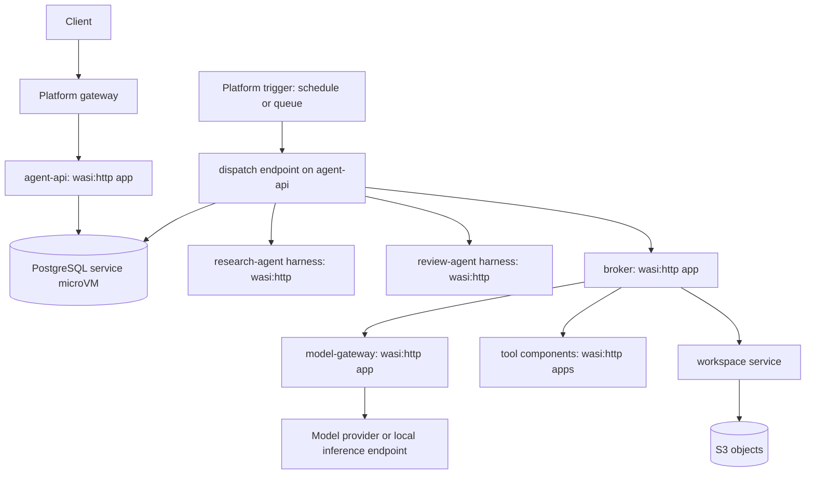

# Platform-hosted agent harness: decision review and enablement guidance

Date: 2026-10-28  
Status: Design guidance; nothing described here as proposed is implemented  
Companion to: [INVESTIGATION.md](INVESTIGATION.md), [TOOL_CATALOG.md](TOOL_CATALOG.md), [PLATFORM_MODIFICATIONS.md](PLATFORM_MODIFICATIONS.md)

> Repository decision (2026-10-28): agent applications, harnesses, tools,
> knowledge/skills, migrations, and agent rehearsal scripts are developed in
> `D:/dev/wasmcloud_platform_harness`. This repository supplies generic execution
> capabilities. The coordinator owns durable transitions; harnesses return
> proposals without direct database access. This decision supersedes examples
> below that assign run-state writes or database credentials to a harness.
> See [platform progress](PLATFORM_MODIFICATIONS.md#repository-boundary-and-implementation-progress).

## Purpose

This document records the review of the [agent investigation](INVESTIGATION.md), the resulting decision to run agent loops on the platform itself, and the concrete work required to make that possible.

It does not replace the investigation. Security findings, S3 workspace semantics, inference, and symbolic-reasoning material remain there.

## Decision

**Run agent harnesses as Wasm applications on the platform. Do not introduce a second orchestrator for them.**

### Why

The platform is intended to replace Kubernetes or a comparable orchestrator. If agent loops ran as native services outside it, a second system would be needed to deploy, scale, restart, place, and observe them. That duplicates the platform's own job and creates two operational models.

Running the loops on the platform means:

- Agents are deployed, versioned, scaled, and observed like any other application.
- Several agent types (research, review, coding, and so on) coexist as separate deployments with separate policies.
- The platform is exercised by its own workloads, so gaps in the runtime surface early.
- The same path later supports tenant-supplied harnesses once stronger isolation exists.

### Alternative considered and rejected

| Option | Description | Outcome |
| --- | --- | --- |
| A. Harness as Wasm on the platform | The agent loop is a `wasm32-wasip2` component; tools are Wasm components | **Chosen** |
| B. Native coordinator and harness; tools in Wasm | The loop runs as an ordinary Rust service | Rejected: it needs a separate orchestrator, which contradicts the platform's purpose |

Option B has lower initial effort, and a trusted harness gains limited security from Wasm sandboxing alone. Neither argument outweighs the cost of operating a second orchestration system. The security value of Wasm is concentrated in tools and in future untrusted harnesses; the operational value of Option A applies immediately.

## Review of the investigation

### Strengths to preserve

- **Authority stays outside the model.** Brokers enforce capabilities, approvals bind to exact operations or artifact digests, and tool output and peer messages are untrusted data.
- **S3 workspace publication** separates immutable blobs, PostgreSQL manifests, and execution state, with operation IDs for retry reconciliation and fenced orphan cleanup.
- **Explicit action states**: accepted, completed, failed, partially completed, and outcome-unknown are distinct. Success is verified, never inferred from model text.
- **Solver outcomes**: `unknown` and timeouts are never treated as approval.
- **Honest scoping**: proposed work is labelled, and the node-local `.internal` contract is respected.

### Gaps to address

1. **The rationale for the Wasm harness was missing.** It is now the [decision above](#decision).
2. **No build-versus-reuse evaluation for durable execution.** Leases, fencing, durable activities, timers, an outbox, and event replay together form a workflow engine. Before writing one, assess reusing a library or pattern (for example PostgreSQL `FOR UPDATE SKIP LOCKED` claiming, an existing outbox implementation) in the coordinator, while keeping the coordinator itself deployed on the platform.
3. **Scope.** Inference and solver material is optional per the roadmap and could move to a separate appendix document so the core design stays readable.
4. **Model providers as an egress path.** Data sent to a model gateway leaves the trust boundary. The broker should enforce which data classifications may reach which model profile, the same way it enforces tool destinations.
5. **Milestone sizing.** Roadmap stage 3 contains the run API, coordinator, leases, gateway, broker, workspace service, and budgets. A thinner first slice is defined [below](#first-milestone).
6. **Disclosure hygiene.** The investigation describes the `wasi:http` egress gap in detail. Follow [SECURITY.md](../../SECURITY.md): fix it before that text is pushed anywhere public, or keep that section out of public commits.

## Platform facts this design depends on

Verified against the checkout on the date above.

| Fact | Evidence | Consequence |
| --- | --- | --- |
| `wasi:http` stores have a 30 s wall-clock ceiling (3,000 epoch ticks of 10 ms) | `crates/runtime/src/limits.rs`, `configure_store` | A harness step must finish well within 30 s; long waits happen between steps |
| `wasi:cli` service stores renew their epoch deadline indefinitely | `crates/runtime/src/limits.rs`, `configure_service_store` | Long-lived Wasm services are possible |
| Service fuel is set **once** at store creation and never refilled | `configure_fuel` called only from store setup | A long-lived Wasm service has a finite lifetime CPU budget and eventually traps |
| Trapped or exited `wasi:cli` instances are logged; automatic restart was not confirmed | `crates/supervisor/src/spawn_runtime.rs`, instance thread exit handling | A long-lived dispatcher cannot yet be assumed to self-heal |
| Guest memory is capped at 8,192 pages (512 MiB) | `crates/supervisor/src/spawn_runtime.rs` | Context assembly and tool output must be streamed and bounded |
| Wasm guests can reach PostgreSQL | `apps/postgres-app` using `wasi-pg-client` on `wasm32-wasip2` | The coordinator can read and commit run state; harnesses receive bounded inputs |
| `wasi:http` outbound requests use a platform policy hook | `crates/runtime/src/executor/http_policy.rs` | DNS toggle, composed TCP/CIDR and supervisor checks, original-hostname TLS validation, HTTP wire quotas, and fixed host caps apply; see [step 0](#step-0-unify-egress-enforcement-platform) |
| `NetworkPolicy::default` permits outbound TCP and DNS to any destination | `crates/common/src/policy.rs` | Agent deployments must declare restrictive policies explicitly |

## Target topology



Every box except PostgreSQL, S3, and the model provider is an ordinary platform application.

- **One deployment per agent type, not per run.** A run is a database record. One `research-agent` deployment with N replicas serves many concurrent runs.
- **Co-location.** Services that call each other through `<app>.<namespace>.internal` use `placement.policy = "every_node"` and same-namespace `local_dependencies`. Anything off-node, including PostgreSQL, S3, and model providers, is reached through explicit external endpoints with their own security policy. Do not add remote-node `.internal` lookup.
- **Credential custody.** Provider keys live only in `model-gateway`; storage credentials only in the workspace service. Harnesses receive neither.

## Execution model

### The harness is a step function

Each HTTP request to a harness executes exactly one bounded step:

```text
POST /step   { run_id, lease_generation, checkpoint_version, checkpoint, inputs, harness_revision }

1. Receive checkpoint N and bounded inputs from the coordinator
2. Check the supported contract and pinned harness revision
3. Interpret recorded results supplied by the coordinator
4. Decide the next action:
   request_model | request_tools | delegate | wait | complete | fail
5. Return the proposed checkpoint N+1 and action intent
6. Coordinator validates and atomically commits both under the current lease
```

The step never waits for a model generation, a tool, or a human inside the request. It returns a proposal; the coordinator records the validated intent. A separate activity executes the intent, persists the result, and marks the run ready for its next step.

Write the step logic as a pure function over `(checkpoint, inputs) -> (next checkpoint, action)` with I/O at the edges. That keeps it testable with recorded fixtures and independent of the transport.

### Something must wake the loops

A `wasi:http` component runs only while serving a request. Nothing inside it fires after the response. Options:

| Option | How it works | Status |
| --- | --- | --- |
| 1. Long-lived `wasi:cli` dispatcher | A Wasm service polls PostgreSQL and calls `/step` on ready runs | Blocked by the finite service fuel budget and unconfirmed restart; needs a platform change (refill or restart policy) |
| 2. **Platform trigger for `wasi:http` apps** | The node invokes a configured route on a schedule or on a NATS subject | **Recommended.** New platform feature, generally useful beyond agents |
| 3. Self-chaining | Each step calls the next before returning | Not recommended: fragile, unbounded fan-out on bugs, and still needs a sweeper for stalled runs |

**Recommendation: implement option 2 as a platform capability**, the equivalent of an orchestrator's cron jobs and queue-driven scaling. The trigger invokes `POST /dispatch` on `agent-api`, which claims ready runs and forwards one step each. Triggers must be leader-elected or idempotent so that `every_node` replicas do not multiply invocations; the database claim below makes duplicate dispatch safe even when they are not.

Implementation update (2026-10-28): fixed-interval schedule triggers are now
implemented. The concrete handler route is
`POST /_platform/triggers/<manifest-trigger-id>`, invoked through a native
in-memory runtime capability; ordinary HTTP cannot reach it. Every eligible
node fires and the coordinator database must deduplicate/lease claims. NATS
message triggers remain unimplemented. See the
[platform manual](../../docs/deploying-applications.md#periodic-triggers) for
bounds, restart semantics, cold-start timing, and the manifest contract. The
application/coordinator implementation belongs to the separate harness project.


Option 1 can serve as a short-lived spike if a refill or restart policy is added first.

### Run ownership with leases and fencing

Replicas, duplicate triggers, and retries all mean two workers can try to advance the same run. Use a generation number as a fencing token.

Claim:

```sql
UPDATE agent_runs r
SET    lease_owner      = $worker,
       lease_generation = r.lease_generation + 1,
       lease_expires_at = now() + interval '45 seconds',
       state            = 'running'
WHERE  r.id = (
         SELECT id FROM agent_runs
         WHERE  state = 'queued'
           AND  ready_at <= now()
           AND  (lease_expires_at IS NULL OR lease_expires_at < now())
         ORDER  BY ready_at
         FOR UPDATE SKIP LOCKED
         LIMIT  1)
RETURNING r.id, r.lease_generation;
```

Commit a step only while still owning the lease:

```sql
UPDATE agent_runs
SET    checkpoint_version = checkpoint_version + 1, state = $next_state, ...
WHERE  id = $run_id
  AND  lease_generation = $generation
  AND  lease_owner = $worker
  AND  lease_expires_at > now()
  AND  state = 'running'
  AND  checkpoint_version = $expected_version;
-- zero rows updated: lease lost or stale checkpoint; discard the step
```

A recovery sweep must requeue expired running work under fencing; the claim
above alone only selects queued work. The coordinator owns these database
operations. Checkpoint, action intent, and outbox writes share one transaction;
long-running activities use separate leases and stable operation IDs.

The step lease must outlast the configured step invocation deadline. Every downstream call (broker, tools, workspace publication) carries the run ID and generation, and those services reject stale generations. That makes fencing effective beyond the database.

### Long operations

| Operation | Handling |
| --- | --- |
| Model generation | Step records a `request_model` activity; the gateway executes it and persists the response; the run becomes ready |
| Tool call | Step records a tool operation with a stable operation ID; the broker executes and persists the result |
| Human approval or input | Run enters `waiting_for_approval` / `waiting_for_input`; the API writes the decision and requeues the run |
| Timers and retries | `ready_at` in the future; the trigger picks the run up when due |

Model generations can exceed 30 s. The gateway therefore needs its own asynchronous execution: accept, return an activity ID, and complete in the background. That itself needs a long-lived executor or an external inference endpoint with asynchronous completion, so it is another consumer of the trigger or long-lived-service capability above.

## Enablement plan

Ordered by dependency. Each step lists whether it is a **platform** change (runtime, supervisor, node) or **application** work (apps deployed on the platform).

### Step 0: unify egress enforcement (platform)

Implementation update (2026-10-28): the platform HTTP transport replaces the
default hook and enforces the composed address policy, single resolution, TLS
hostname verification, HTTP wire egress limits, and fixed host caps. The steps
below preserve the original design requirements. Raw P2 TCP/UDP payloads now
share the HTTP byte budget, with conservative TCP reservations. Raw socket
host deadlines and resource-lifecycle connection accounting are implemented
in M5; microVM validation remains separate work. See the
[platform progress](PLATFORM_MODIFICATIONS.md#repository-boundary-and-implementation-progress).

Prerequisite for everything else: an agent's network policy is only as strong as its least-enforced outbound path.

- Replace `hooks: Default::default()` in `WasiHttpView for StoreState` with a platform hook implementing outbound `send_request`. Check the exact trait and signature in the pinned `wasmtime-wasi-http` version.
- In the hook: resolve the authority **once**, evaluate every resolved address with the same composed check used for WASI sockets (`compose_socket_addr_check`), connect to an address that passed, and use the original hostname for TLS SNI and certificate validation. Do not check a name and then let an unrestricted sender resolve it again.
- Apply connect, first-byte, and total timeouts plus response-size limits there, and feed the egress counters that `policy_boundary.rs` currently reports as unenforced.
- Redirects: the default sender does not follow them; the guest issues a new request, which passes through the hook again. Keep it that way.
- Tests: denied IPv4 and IPv6 destinations, DNS names resolving to denied addresses, mixed allowed and denied resolution results, metadata and node-admin addresses, and platform NATS. Each must fail through both WASI sockets and `wasi:http`.

### Step 1: agent network profiles (platform configuration)

Implementation update (2026-10-28): generic restrictive profiles and operator
protected-namespace admission are implemented. Harnesses can use `mesh-only` or
`isolated`; a coordinator needing PostgreSQL must explicitly declare its raw
TCP endpoint. Model HTTP egress uses exact names and resolved CIDRs. Configure
operator deny ranges for platform control-plane destinations before deploying.
See the [implemented profile contract](../../docs/deploying-applications.md#restrictive-network-profiles).
The original requirements below remain useful acceptance guidance.

- Define a restrictive policy template for agent apps: no direct outbound access only for explicitly required dependencies; the baseline harness receives its inputs from the coordinator and needs no direct broker or database access.
- Only `model-gateway`, the workspace service, and specific tool apps receive egress to their external endpoints.
- Validation should reject agent deployments relying on `NetworkPolicy::default`.

### Step 2: wake-up mechanism (platform)

- Implement the [platform trigger](#something-must-wake-the-loops): schedule- and NATS-subject-driven invocation of a `wasi:http` route, with bounded concurrency and its own audit trail.
- Independently decide the fuel policy for long-lived services (periodic refill, per-interval budget, or supervised restart with backoff). Long-lived Wasm workloads need this regardless of agents.

### Step 3: run state and ownership (application)

- Schema: `agent_runs`, `run_checkpoints`, `activities`, `tool_operations`, `approvals`, `run_events`, `budget_reservations`, `usage_entries`, `outbox`. See the investigation's data-model table.
- Leases and fencing as shown above, with uniqueness on `(run_id, checkpoint_version)` and `(run_id, operation_id)`.
- Migrations run like the existing OIDC hub rehearsal.

### Step 4: agent API and one harness (application)

- `agent-api`: `POST /agent-runs`, `GET /agent-runs/{id}`, `GET /agent-runs/{id}/events`, `POST /agent-runs/{id}/messages`, `POST /agent-runs/{id}/approvals/{approval_id}`, `POST /agent-runs/{id}/cancel`, plus the internal `/dispatch`.
- One `wasm32-wasip2` harness exposing `/step`. Build it explicitly for the WASI target; native workspace checks do not cover its dependency paths.

### Step 5: model gateway and broker (application)

- `model-gateway`: one provider, typed request and response schema, credential custody, usage accounting, asynchronous completion.
- `broker`: run-scoped identity verified server-side (never trust `run_id` or tenant from a request body alone), tool registry with schemas, lease-generation checks, approval binding, budget reservation.

### Step 6: workspace service (application)

- Implements the investigation's S3 publication protocol: immutable blobs, manifest revisions in PostgreSQL, conditional publication, operation-ID retries.

### Platform versus application work

| Work item | Platform | Application |
| --- | --- | --- |
| `wasi:http` egress hook | ✔ | |
| Agent network policy profile and validation | ✔ | |
| Schedule and queue triggers for `wasi:http` apps | ✔ | |
| Long-lived service fuel and restart policy | ✔ | |
| Run schema, leases, fencing | | ✔ |
| Agent API, harness, broker, gateway, workspace service | | ✔ |
| Custom `agent:run/step` WIT interface | Not needed initially: plain HTTP `/step` suffices | |

Keeping most of the work at the application level proves the platform can host this class of system without agent-specific runtime features. The platform additions above are general-purpose.

## First milestone

The smallest slice that demonstrates durable agent execution on the platform:

1. Step 0 egress fix, merged with its tests.
2. `agent-api` and one harness deployed with a restrictive network policy.
3. A run that makes one model call through `model-gateway` and one read-only tool call through the broker, then completes with a stored report.
4. A trigger, or for the spike a manual `POST /dispatch` loop, drives steps.

Acceptance:

- Kill the node, or the harness instance, between steps. The run resumes and completes with exactly one report and a consistent usage ledger.
- Deliver the same step twice concurrently. Exactly one commits; the other is rejected on lease generation.
- From the harness, attempt a direct connection to the model provider, platform NATS, and a metadata address over both WASI sockets and `wasi:http`. All fail.
- A model call longer than 30 s completes without holding a harness request open.

Validate in the local microVM testbed with `--preset production-like` and at least three nodes. Ask for the node count before provisioning; the NATS microVM is not counted. Local validation is not a production guarantee.

## Open questions

- Fuel policy for long-lived services: refill per interval, or restart with backoff? This affects every long-lived Wasm workload, not only agents.
- Trigger placement: leader-elected single invocation, or every node with database claiming as the only deduplication?
- Should model calls longer than 30 s use an external inference endpoint with asynchronous completion, or a long-lived Wasm gateway once the fuel policy exists?
- Durable execution: implement the minimal lease and outbox pattern directly, or adopt an existing library inside the coordinator?
- Isolation roadmap: what admission decision and backend are required before tenant-supplied harnesses run in the same node process?
