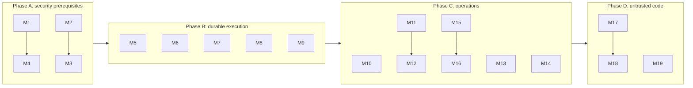

# Platform modifications required for a full agentic system

Date: 2026-10-28  
Status: Change plan with implementation progress recorded below; remaining proposals are not implemented
Companions: [INVESTIGATION.md](INVESTIGATION.md), [PLATFORM_HOSTED_HARNESS.md](PLATFORM_HOSTED_HARNESS.md), [TOOL_CATALOG.md](TOOL_CATALOG.md)

## Purpose and scope

This document lists the changes to the **platform itself** (runtime, supervisor, node, gateways, policy, configuration, testbed) needed to host a full agent system as ordinary platform applications.

It excludes application-level work: the agent API, coordinator, harnesses, broker, model gateway, workspace service, and tools are applications deployed on the platform, described in the companion documents.

Design principle: **prefer general-purpose platform capabilities over agent-specific features.** Every modification below should also benefit non-agent workloads. The platform should not gain an "agent" concept in its runtime.

### How to read each entry

- **Current state**: what the checkout does today, with the source location reviewed.
- **Why agents need it**
- **Change**: the proposed modification.
- **Acceptance**: evidence required before it is considered done.

Priority:

| Priority | Meaning |
| --- | --- |
| P0 | Security prerequisite. Do not run agent workloads without it |
| P1 | Required for durable agent execution |
| P2 | Required for operating a multi-agent system well |
| P3 | Required only for untrusted or tenant-supplied harnesses and code |

### Evidence limits

Current-state descriptions come from a static review of the checkout on the date above. Items marked **verify** could not be confirmed by source search alone and need a test before being treated as a defect or as safe behavior.

## Repository boundary and implementation progress

Operator rollout follow-up (2026-10-30): the separate harness checkout now runs
an operator-only WASI entry point alongside the private coordinator on the
preserved one-node testbed. Actual Hub grants exercise launch/read, exact-intent
approval, refusal and cancellation. Definition revision 3 explicitly selects
`loop-receipt-v1`, which completes directly from the successful source-tool
receipt while the coordinator still enforces its immutable output contract.
Run `d3a250fe-c7e2-49ef-9016-b85b6d916f46` completed at checkpoint 3 with one
model activity and one approved tool activity; the final key/hash equal the SQL
receipt and the downloaded 30-byte RustFS content. Refusal/cancellation created
no object; a deliberately incompatible final policy produced `invalid_output`.
Real 401/403/404/409 boundaries, operator-instance replacement, old pin/report
preservation and zero remaining active runs were verified. Two earlier loop-v2
failures remain recorded. The existing coordinator caller allowlist is unchanged;
no platform Rust change, database migration or VM restart was needed. All four
recorded microVMs remain healthy/running. Exact artifacts, deployment ordering,
tests and local validation limits are in the harness repository's
`docs/platform-operator-validation.md` and `docs/operator-api.md`.

Initial native operator API increment (2026-10-30): the separate harness checkout
adds `/api/operator/v1` to its coordinator component for task-based `loop-v2`
launch with exact definition/harness pins, progress, final output, cancellation
and approval review/decisions. All routes require the existing coordinator OIDC
audience and `agentic:operate`; worker and dispatcher scopes remain separate.
New immutable definition revisions can opt into an output schema and equality
with a persisted successful same-run tool receipt. Invalid completion becomes
terminal `failed` with `invalid_output`; old definitions retain their behavior.
Native HTTP/PostgreSQL tests exercise these contracts and the real loop with
deterministic model decisions. Explicit WASI builds pass. At that point the
increment had not been rolled out to the preserved microVMs or changed their gateway
caller allowlists. No platform runtime change or database migration is needed.
See the harness repository's `docs/operator-api.md` for activation and limits.

Real approval follow-up (2026-10-30): migration V5 and the approval-aware
applications now run on the preserved one-node microVM testbed with the actual
Hub and OpenRouter. The real operator approved an exact immutable result intent.
After RustFS had created the object, a targeted worker stop left generation 2
unsettled; natural lease expiry allowed generation 3 to reconcile the same
object and complete run `80e4e5fd-e05b-4ec4-902f-7f9427b3b23a` at checkpoint 4.
Its final model receipt matches the durable tool result; content, ETag and
Last-Modified were unchanged. Dedicated result-only IAM, 401/403/409 refusals,
zero remaining active runs and old report preservation were checked. Other
completed samples had weak model reports and remain recorded. Node clock drift
required a preserved offline restart and continuous Chrony step configuration;
the current-state disk was later expanded offline to 4 GiB to remove its capacity
warning. No platform Rust runtime change was needed. See the harness repository's
`docs/platform-approval-validation.md` for exact pins, failed test attempts,
repair evidence and the limits of this local rehearsal.

Application approval increment (2026-10-30): the separate harness checkout now
records exact tool/argument/definition/contract approvals in PostgreSQL, separates
operator decisions from worker authorization, and suspends claims during human
review. Its first effect tool creates immutable RustFS results with conditional
PUT and byte-checked reconciliation. Disposable PostgreSQL/RustFS tests cover
interrupted execution before and after writing, expiry, refusal, cancellation
and stale leases. The actual P2 worker was also exercised under Wasmtime through
the coordinator HTTP API, including reconciliation of an existing object.
These tests use deterministic model decisions and local test identity keys;
they do not upgrade or replace the existing real-Hub/model microVM evidence.
Migration V5 and explicit worker storage configuration are required before a
future rollout. No platform runtime change is needed. See the harness
repository's `docs/durable-approvals.md` for the protocol, activation and limits.

General-loop rehearsal (2026-10-29): the separate harness checkout deployed its
registered tool broker and versioned `loop-v2` implementation on the existing
one-platform-node microVM testbed. The real OpenRouter model selected text
statistics, then text search, then completed a report at checkpoint 6 with five
consumed activities (`39ce638d-56b7-48e9-9711-fb5ad871d4a3`). A targeted worker
interruption left a live generation-1 activity without a result; after lease
expiry, its replacement settled the same operation at generation 2 and completed
the report (`be69b4b2-5ca4-49db-8ddb-0fea4f4e1d00`). Native scheduler v4 drove both
runs. Earlier model-format, duplicate-call and budget failures remain recorded,
as does a stop attempt that missed the recovery window. Existing harness pins
and the stored-document report were preserved. No platform Rust change was
needed. See the harness repository's `docs/platform-agent-loop-validation.md`
for exact artifacts, scope refusals, operator-selected JSON mode and limits.
This is local workflow recovery evidence, not exactly-once provider inference,
durable effect approval, aggregate spend reservation or production availability.

P3 compatibility increment (2026-10-29): the current OIDC Hub exports the WASI
0.3 async HTTP handler. The platform now links that service contract alongside
P2 and retains the shared outgoing HTTP policy transport. Outbound P3 TCP is
guarded for PostgreSQL; UDP, raw bind, unsupported socket options and P3 native
schedule triggers fail closed. The agent scheduler remains P2. See the bounded
[P3 hosting contract](../../crates/runtime/README.md#p3-http-services).
Real P3 probe tests pass for HTTP/header isolation, TCP slot reuse and PostgreSQL
with an enforced egress quota. The 104 existing runtime unit tests and a separate
old-P2-artifact compatibility regression pass. Hub microVM and real-provider
validation are separate from these host-runtime checks.

The subsequent single-node rehearsal also runs the actual P3 Hub backend with
PostgreSQL and P2 agent applications using OpenRouter. The real Hub issued
separate EdDSA operator/dispatch/activity grants; the coordinator accepted
discovered public keys, and the document workflow completed at checkpoint 4
with three activities (`943fe824-885a-4254-8316-a4ba35804e43`). A real-provider
fault run recovered an activity at generation 2, then correctly failed closed
on an out-of-range model tool proposal
(`2a796c08-4b93-4237-88b5-2334ddc57506`). This does not prove a completed report
after expired-lease recovery with that provider. Other stop attempts completed
at generation 1 and are not counted as lease-recovery evidence. A dispatcher
requesting operator scope received 400; a forged HTTP trigger against P3 received
403. The platform's 10B fuel admission ceiling remains unchanged; complete
realm RSA-key creation under that ceiling was not validated. Detailed evidence
and limits are in the harness repository's `docs/platform-live-validation.md`.

Follow-up on 2026-10-29: application definition revision 2 pins the separate
`agents/document-harness:v1` / `document-v2` implementation with explicit actual
document bounds. A normal run (`711250a6-23e9-4823-b427-75b4a0a64ea9`) and a
worker-stop recovery run (`c8dd60f3-b92e-4be4-8fe5-f1635bbe8583`) both completed
at checkpoint 4 with three consumed activities. In the recovery run, the first
model activity settled at lease generation 2 after the targeted worker kill.
This follow-up supplies the previously missing completed-report evidence; it
does not change the recorded v1 failure. Provider acceptance of the interrupted
call and exactly-once external inference are not established. No further
platform Rust changes were needed. See the harness repository's
`docs/document-v2-validation.md` for pins, fault timing and limits.

Application-side storage increment (2026-10-29): the harness checkout now owns
an owner-scoped text-document WASI API, PostgreSQL metadata migration and RustFS
S3 adapter using the repository's `wasi-object-storage` skill. This does not
change the platform runtime or the existing inline document harness pins.
The next application increment adds expiring run/document/reader grants, a
dedicated worker OIDC reader client and an opt-in stored-document harness.
The subsequent real-Hub/OpenRouter microVM rehearsal completed stored-document
run `79f982fb-3d64-43c0-9200-80a499778bc7` at checkpoint 4 with three consumed
activities. The document was imported into the separate RustFS service VM and
read through the grant-bound WASI worker/document path; the final source SHA
matches the actual S3 object. Owner/reader audiences, owner-to-reader denial,
reader scope-escalation denial, S3 prefix permissions and grant revocation were
verified. The first model activity settled at generation 2; this was not a
controlled crash drill. Remove-based scheduler quiescence was not established:
both legacy v3 and v4 emitters appeared during the run. The final mitigation
leaves v3 isolated and triggerless, with only v4 in subsequent native audit
samples. See its `docs/platform-stored-document-validation.md` for exact
artifacts, limits and retained evidence; no platform runtime Rust change was
needed for this storage integration.

Lifecycle hardening follow-up (2026-10-29): the platform now serializes
Supervisor cold-start admissions and undeploy per exact application revision.
Removal persists its admission fence before awaiting an in-progress start,
reaps that instance, and refuses to forget any still-tracked timed-out guest.
Durable NATS consumers request one message per batch and send processing
acknowledgements during slow handlers. Node deployment/removal handling records
the broker stream epoch and sequence in redb before side effects; completed
duplicates and older intents are ignored, pending failures can retry, and a
removal's undeploy marker is committed atomically with that intent. These
cursors survive artifact GC and process restart. Event payloads and the storage
schema version are unchanged. This does not make independent route/config
streams atomic or provide exactly-once external inference.

The local upgrade rehearsal also exposed the original test image's ephemeral
`key_source=generate` configuration. A disk backup preserves encrypted bundles,
but cannot recover a lost in-memory KEK. The six current application bundles
were reprovisioned from their retained private source files in a backed-up
offline copy; other redb state and external PostgreSQL/RustFS data were retained.
The test node now uses a private persistent file seal key. Kernel mesh identity
requires the node binary's `ebpf` feature as in the original test image. See
the [secret persistence contract](../../docs/deploying-applications.md#secrets)
and [local restart semantics](../../crates/vm-testbed/README.md).

The follow-up microVM run `c49cf5c7-d663-4fe8-8b25-496646f90e98` remained
`ready` at checkpoint 0 throughout five snapshots spanning 20 seconds after
removing scheduler v4. Redeploying the same scheduler manifest resumed it
without an HTTP tick: it completed at checkpoint 4 with three consumed
activities, all at lease generation 1 (model, stored-document read, model).
The final source covers 127 characters with SHA-256
`e01d6c04ce0ae51f9632d589677dc01ef879ee8f16f057e434011f73c2f8cc5d`.
Its reader grant was revoked afterward and its completed report remained
identical. The earlier completed report and its original S3 object were also
verified unchanged after restart. Scheduler v3 remains isolated and triggerless.

RustFS's unsynchronized guest clock initially prevented the new signed S3
upload after the node clock was corrected. Its service was restarted from a
backed-up copy preserving data and IAM, with BusyBox NTP synchronization before
startup and a continuing NTP client. The canonical image builder now includes
that behavior and validates the required applets; syntax checks and the live
service boot/HTTP Date/signed object round trip pass. No original live RustFS
image was rebuilt or overwritten.

Final WSL checks: formatting, strict workspace Clippy, required native all-target
workspace check and explicit `wasm32-wasip2` HTTP/gRPC fixture builds pass.
There are 238 passing ordinary tests across messaging (16), node library (34),
node binary (85), storage (56) and supervisor (47), plus the explicitly enabled
real-WASI scheduler lifecycle integration. That integration passed on its final
rerun; another pass during heavy disk-image I/O had exceeded its time bound.
This is a local one-platform-node rehearsal, not production qualification or
exactly-once provider execution. The final node reports healthy, including
kernel eBPF, and the four recorded microVMs remain running. See the harness
validation document for retained private evidence and the exact node binary pin.

Decision recorded 2026-10-28: this repository owns general-purpose execution
capabilities. The separate `D:/dev/wasmcloud_platform_harness` project owns the
agent API, coordinator, harness contracts and implementations, agent definitions,
broker, tools, model gateway, knowledge/skills, workspace protocol, migrations,
fake provider, and agent-system acceptance scenarios. They deploy as ordinary
platform applications. The coordinator owns durable transitions; a harness
receives a checkpoint and returns a proposal, without database credentials.
Agent definitions pin the harness revision and step contract for each run.

- M2: identity sanitization and verified user-header injection are implemented
  in the working tree, with regression tests. See the canonical
  [identity contract](../../docs/gateway/oidc-setup.md#upstream-identity-contract).
- M3: authoritative caller forwarding and `gateway.allowed_callers` are
  implemented. Exact qualified caller IDs are checked before cold start;
  configured lists close edge access and direct app-port access. Target policy
  uses the actual registered version instead of reconstructing `v1`.
- M16: the agent-specific rehearsal belongs in the harness repository and uses
  this repository's generic testbed scripts. M15 remains generic testbed work.
- M1: a policy-controlled HTTP transport is implemented; see the
  [host caps and policy contract](../../docs/deploying-applications.md#outbound-wasi-http-policy).
  It also implements the HTTP portion of M5 (wire egress quota, connection
  lifetime, and deadlines). Explicit `ExtendedLimitsConfig` network ceilings
  now intersect with policy ceilings for HTTP wire bytes and raw TCP/HTTP
  connection counts. Raw P2 TCP/UDP payload metering is also implemented, with
  conservative TCP reservations. M5 is implemented: fixed raw host-I/O
  deadlines, resource-owned connection slots and per-instance metrics complete
  the runtime work; see the closure record below for scope and validation.
- M6 (partial): periodic triggers are implemented via a native runtime channel,
  durable node cursors, bounded concurrency/deadlines, and audit/metrics.
  Each eligible node fires; applications coordinate database leases. NATS
  message triggers and reconnect validation remain open.
- M4: restrictive `isolated`, `mesh-only`, and `egress-allowlist` profiles,
  exact HTTP hostname and raw TCP endpoint permissions, protected-namespace
  admission, operator deny CIDRs, and `ctl policy explain` are implemented.
  Operators must configure actual control-plane deny ranges and protected
  namespaces before deploying agents. Legacy defaults remain permissive.
  This progress does not establish complete agent containment.

The current-state paragraphs below preserve the initial review baseline; the
progress notes above supersede the M1/M2/M3/M4/M5/M6 observations where implementation has
changed. Validation on 2026-10-28: gateway regression tests pass (13 internal gateway,
122 proxy; one existing NATS reconnect test excluded after hanging), workspace
Clippy with warnings denied and native workspace checks pass in WSL with the
pinned toolchain. Explicit `wasm32-wasip2` builds pass for `hello-axum`,
`echo-service`, `postgres-app`, `http-hello-component`, and `wasi-grpc-echo`.
The separate native `grpc-echo` fixture rejects that target via its existing
`compile_error!`; it is excluded from the successful WASI build.
HTTP/1 and HTTP/2 forwarding are exercised using loopback test
servers and a test workload map; this is not kernel-eBPF or microVM validation.
MicroVM/kernel-eBPF validation of the new admission paths and production validation remain open.

### Single-node application rehearsal (2026-10-29)

A local Firecracker rehearsal now exercises the separate harness project's
coordinator, research harness, worker and native schedule driver on one platform
node, with separate NATS and PostgreSQL microVMs. The coordinator uses an explicit
PostgreSQL TCP exception; the worker and scheduler use `mesh-only`, and the pure
harness uses `isolated`. Scoped OIDC grants and model responses come from an
opt-in disposable WASI fixture, not the real Hub or OpenRouter.

Native schedule delivery completed a document run at checkpoint 4 with three
persisted activities, each at lease generation 1. Killing the worker while an
activity held generation 1 led to automatic recovery and completion with three
activities and maximum generation 2. An ordinary HTTP request with forged
trigger headers to the reserved route returned 403. This is local single-node
evidence, not multi-node or production containment validation.

The rehearsal exposed missing guest secret resolution. The supervisor now
resolves only declared keys through the application-scoped secret provider at
spawn, fails closed on missing values, and keeps plaintext out of persisted
AppConfig. Ambient node `DATABASE_URL` injection now requires explicit database
opt-in and never overrides an application value or declared secret. See the
[secret contract](../../docs/deploying-applications.md) for compatibility details.
Full scenario evidence and fixture ownership remain in the harness repository's
`docs/platform-schedule-validation.md`.

### Caller and network-profile implementation (2026-10-28)

The canonical [profile contract](../../docs/deploying-applications.md#restrictive-network-profiles)
and [mesh caller contract](../../docs/internal-mesh.md) describe the implemented
fields, migration behavior, and operator configuration. The platform remains
agent-agnostic; no harness, run, model, or broker concept was added to its runtime.

Restrictive profiles disable raw WASI DNS/UDP. HTTP egress resolves only approved
names, while qualified `.internal` HTTP names map directly to the local gateway.
Egress requires explicit CIDRs and HTTP names or exact raw TCP IP/port exceptions
(for example coordinator-to-PostgreSQL). A raw exception grants endpoint authority
without hostname binding. Raw TCP payloads now consume the shared byte budget;
raw host-I/O deadlines are now implemented in the M5 closure below.
Operator CIDR denies cannot be overridden by an application manifest.

Protected-namespace validation runs through supervisor admission before deploy,
config update, restore, and spawn. Namespace/qualified-ID mismatches are rejected;
`AppConfig::default_for` now derives its namespace from its qualified ID.
The effective-policy admin API reports the resolved declaration and operator
CIDRs, with bind ports explicitly identified as spawn-time templates.

`allowed_callers = []` denies all callers; omission preserves legacy admission.
Configured lists reject edge requests and are additional to namespace and user
authentication policy. Registered endpoint ownership retains target versions;
ambiguous cold targets return 409 rather than selecting a version arbitrarily.
The direct-port interceptor consults current stored policy for both loopback and
registered non-loopback local targets.

### Caller/profile validation (2026-10-28)

Formatting, workspace Clippy with warnings denied, and the required native
workspace check pass in WSL using the pinned toolchain. Final unique test counts:
common 95, config 54, ctl 27, internal gateway 16, runtime 87, storage 54,
supervisor 45, proxy 122, node library 33, node binary 83, real WASI component 1,
and real CLI HTTP client 1: **618 passing tests**. The existing proxy
`health_events::tests::test_health_transition_retries_after_publish_failure`
remains explicitly excluded after its previously recorded hang; the storage
JetStream replay tests and full node NATS tests pass in this run.

Explicit builds pass for `http-hello-component` and `wasi-grpc-echo` on
`wasm32-wasip2`. The real component verifies TCP/CIDR/supervisor denial and the
three restrictive profiles. Unit regressions cover exact host/CIDR intersections,
raw TCP exceptions, protected admission, manifest round trips, version-aware
caller lists, forged headers, denied cold starts, stale endpoint ownership, and
direct-port refusal. The CLI test launches the actual `wasm-ctl` executable with
an unreachable NATS URL and verifies authenticated HTTP plus escaped app IDs.
Policy inspection now dispatches before NATS connection setup.

These are local runtime, loopback HTTP, and disposable NATS-container tests.
They are not a Firecracker/kernel-eBPF admission rehearsal or production evidence.
No dependency version or lockfile changed in this lot; the advisory failures
recorded below remain outstanding.

### HTTP transport validation (2026-10-28)

WSL checks pass: formatting, workspace Clippy with warnings denied, native
workspace checks, runtime tests, explicit `wasm32-wasip2` builds of the HTTP and
WASI gRPC fixtures, and the explicit real-component outgoing-handler test.
The final pass includes 84 runtime unit tests, seven runtime integration tests,
one explicit real-component test, and one supervisor close-accounting regression.
The real component reaches a local HTTP server only when TCP, CIDR policy, and
the supervisor extra gate all allow it. Unit tests use deterministic resolvers
and local HTTP/TLS servers for single-resolution/mixed-address behavior,
DNS-disabled policy, IPv4/IPv6/mapped-address denials, certificate/name failures,
redirect rechecking, transport slot cleanup, wire-byte caps, response-size caps,
and host deadlines. A supervisor regression injects a delayed kernel-close
notification for an HTTP-owned socket and checks that another raw socket's slot
is preserved. No microVM or kernel-eBPF validation is claimed.

`cargo audit --deny warnings` reports 52 vulnerabilities and 22 denied warnings;
a scan of the unmodified `HEAD` lockfile reports the identical advisory IDs and
crate/version entries. `cargo deny check advisories bans sources` also fails
advisories while bans and sources pass. No advisory exceptions were added.
The lockfile changes only add the runtime's explicit edges to its existing
Rustls, Tokio-Rustls, and WebPKI packages; no package version changed. Dependency
advisory remediation remains separate required work before a release.

### Explicit network resource ceilings (2026-10-28)

At this increment M5 was partially implemented. `AppConfig::resolve_instance_policy` combines the
network policy with explicitly supplied `extended_limits.max_net_egress_bytes`
and `max_outbound_connections`. The stricter ceiling wins; omitted fields retain
the resolved policy rather than introducing the numeric `ExtendedLimits`
defaults. Zero bytes adds no ceiling and cannot disable an existing finite
budget; zero connections denies outbound TCP/HTTP. The runtime, supervisor
effective-policy API, and manifest deploy validation use this shared resolution.

The HTTP byte budget is shared across request stores of one adapter instance;
a new request does not reset it. An instance restart starts fresh counters.
Raw TCP and HTTP share the active connection ceiling. Disconnect accounting
uses checked atomic decrements so concurrent duplicate closes do not publish
an underflow or release another store's slot.

Previously ignored explicit network fields in persisted configurations now
take effect on the updated runtime. Review those fields before rollout and
update every node before relying on the ceilings. This is not aggregate
application/tenant budgeting. At this increment raw socket byte metering and
raw host-I/O deadlines remained open; the subsequent socket increment below
supersedes the byte-metering limitation. The later M5 closure also supersedes
the deadline limitation. The canonical semantics and
migration note are in [the deployment manual](../../docs/deploying-applications.md#outbound-wasi-http-policy).

Validation for this increment: **260 tests pass** in WSL with the pinned
toolchain (common 96, runtime library 90, supervisor 45, CLI 27, real CLI HTTP
client 1, real WASI outgoing-handler component 1). The component covers eight
policy cases, including zero outbound connections via `ExtendedLimitsConfig`.
The runtime tests exercise actual HTTP wire writes, budgets shared across
request stores, and raw/HTTP connection contention; the common regression
covers 28 combinations of policy and explicit ceilings. Formatting, workspace
Clippy with warnings denied, native workspace checks with the required WASI
exclusions, and explicit `wasm32-wasip2` builds of `http-hello-component` and
`wasi-grpc-echo` pass. Cargo metadata and `git diff --check` pass. No dependency
or lockfile changed; previous advisory evidence is preserved. No microVM or
kernel-eBPF validation is claimed for this increment.

### Raw socket payload budgets (2026-10-28)

M5 now covers P2 raw socket payloads as well as outgoing HTTP wire bytes.
`executor/socket_egress.rs` replaces only the TCP `finish-connect`/`accept`
host methods' returned output streams and the UDP datagram send host method.
Both CLI synchronous and HTTP asynchronous linkers install the wrappers.
Resource handles, parent ownership, Wasmtime address checks, and close
accounting remain intact. No dependency upgrade was required.

TCP writes reserve bytes atomically before delegation, including zero-filled,
blocking, and spliced writes. Charges remain on delegated failure because
Wasmtime can send a prefix or queue background writes. UDP reserves the whole
batch, charges the accepted prefix, and refunds its unsent suffix. Quota
failure is a stream `last-operation-failed` for TCP and socket `access-denied`
for UDP. Raw payload charges share the same per-instance counter with outgoing
HTTP/TLS wire writes and the resolved explicit ExtendedLimits ceiling.

This is conservative guest-I/O accounting rather than total NIC traffic:
packet overhead, retransmissions, host DNS, and host-served incoming HTTP
responses are excluded. CLI accepted TCP responses are included. Existing
finite budgets now constrain raw socket clients and CLI response writers,
including the restrictive profiles' default 16 MiB lifetime budget; review
those configurations before rollout. The admin policy explanation reports
socket metering and its accounting model. At this increment raw host-I/O
deadlines remained open; the M5 closure below supersedes that partial status. See the
[canonical accounting contract](../../docs/deploying-applications.md#raw-socket-byte-accounting).

Validation for the socket increment: **356 passing test executions** in WSL
with the pinned toolchain (common 96, runtime library 96, supervisor 45, node
library 33, node binary 83, real outgoing HTTP component 1, real socket
component tests 2). TCP/UDP guest probes cover bounded and unlimited budgets;
the CLI echo fixture covers accepted TCP response streams in the synchronous
linker. Unit tests cover zeroes, blocking writes, splice, parent ownership,
concurrent writers, raw/HTTP budget sharing with actual HTTP wire writes, UDP
batch denial, and accepted-prefix refunds including error/trap paths.

The first parallel node run failed one test because Podman returned
`database is locked` while creating a NATS container. The full node library
and binary suites then passed with `--test-threads=1`, without exclusions.
Formatting, workspace Clippy with warnings denied, native workspace checks
with the required exclusions, Cargo metadata, and `git diff --check` pass.
Explicit `wasm32-wasip2` builds pass for `http-hello-component`,
`wasi-grpc-echo`, and `echo-service`. No dependency or lockfile changed.
Earlier validation/advisory evidence is preserved. These are local runtime,
loopback, and disposable NATS-container checks, not microVM/kernel-eBPF or
production validation.

### M5 closure: network quotas, host deadlines and instance metrics (2026-10-28)

The M5 runtime implementation is complete for the supported P2 guest outbound network
paths. Earlier partial-status notes and validation records above are preserved
as implementation history. The canonical contracts are in
[deployment](../../docs/deploying-applications.md#socket-host-deadlines) and
[observability](../../docs/observability.md#network-policy-and-host-io-metrics).

- Raw TCP and UDP payload commitments and outgoing HTTP/TLS wire writes share
  the resolved per-instance byte ceiling; explicit ExtendedLimits ceilings
  intersect with policy ceilings.
- Raw TCP reserves at `start-connect` and releases on terminal failure,
  socket-resource destruction or store teardown. HTTP transport slots remain
  RAII-owned. Kernel close notifications cannot decrement host-owned slots a
  second time. Slot reuse works without an eBPF observer.
- Raw connect and name-resolution waits have a 10-second host deadline. Pending
  TCP/UDP readiness, blocking stream reads/writes/zeroes/flush/splice and stream
  destruction have 30-second host caps in both linkers. Absolute pending
  deadlines survive poll cancellation and clock-only polling. Idle listening
  sockets do not start deadlines.
- Expiration traps the CLI invocation or HTTP request store and releases its
  resources. Other request stores on the HTTP adapter continue serving. A CLI
  service is one invocation, so its instance exits on a host deadline.
- Prometheus exports byte usage, active reservations, denials and expirations
  with app/instance labels. Live-instance series are removed on exit; node
  aggregate timeout and denial counters retain their totals. HTTP body and
  transport timeouts count at most once per outgoing request.

Scope remains guest-I/O commitments rather than total NIC traffic. The byte
exclusions and conservative TCP accounting above still apply. A cancelled
system resolver wait does not promise cancellation of an already-running native
resolver job. Configurable request deadlines are M8, and service fuel/refill
and restart semantics are M7. This completion does not certify microVM,
kernel-eBPF identity, cross-node behavior, or production operation.

Final closure validation: **170 passing test executions** in WSL with the
pinned toolchain: runtime 104, metrics 12, supervisor 45, real outgoing HTTP
component 1, socket quota component tests 2, and socket deadline component tests
6. The latter exercise CLI and HTTP connect/policy-gate stalls, TCP read stalls,
UDP receive stalls, write backpressure, a CLI listener idle beyond 30 seconds,
request-store recovery after timeout, and sequential one-slot TCP connections
using local name resolution without a kernel observer. Unit regressions cover
clock-only/mixed polling, cancellation, already-expired ready results, completed
readiness, blocking streams, distinct reservation owners, per-instance metric
export/delta deduplication, and label removal at exit.

The final library suites run with `--test-threads=1` and no exclusions. An
earlier parallel pass hit the existing 25 ms setup assumption in the HTTP
total-body-deadline test before headers arrived; the serial full pass succeeds
without changing that test's limits. Formatting, workspace Clippy with warnings
denied, the required native workspace check, Cargo metadata, and
`git diff --check` pass. Explicit `wasm32-wasip2` builds pass for
`http-hello-component`, `echo-service`, and `wasi-grpc-echo`. No dependency or
toolchain change was made in this increment. Historical validation and advisory
records above are retained; no new microVM or kernel-eBPF rehearsal is claimed.

### M6 schedule increment (2026-10-28)

Periodic `wasi:http` triggers are implemented in the manifest/config contract,
node scheduler, Supervisor, runtime native channel, durable redb high-water
marks, bounded metrics, and audit events. **M6 remains partial:** NATS message
triggers, restricted account/subject configuration, and reconnect validation
are still open. No application/harness/coordinator knowledge was added to the
platform or to the separate harness repository.

The implemented schedule contract uses an explicit ID, fixed integer durations,
POST, and the reserved `/_platform/triggers/<id>` route. Unlike the original
arbitrary `/dispatch` proposal, network callers cannot reach these handlers.
A native in-memory capability delivers on the instance's registered thread;
no scheduler credential or forged mesh/user identity crosses HTTP. Native
calls share Supervisor admission, application node rate limits/circuit breakers,
and ordinary fresh-Store policy/fuel/memory counters. HTTP-specific user auth,
endpoint/distributed rate limits, CORS, and transforms do not apply to this
native entry point. See the complete [manual contract](../../docs/deploying-applications.md#periodic-triggers)
and [telemetry](../../docs/observability.md#schedule-telemetry).

Every eligible node fires independently. IDs exclude node identity so application
DB leases/deduplication can coordinate replicas. Cursor commit precedes dispatch;
missed buckets are counted, not replayed, with no exactly-once or durable-delivery
guarantee. Timeout cancels guest execution/response draining after cold start;
cold starts complete Supervisor ownership before cancellation or node shutdown.
Declaration removal/undeploy/drain cancel delivery; trigger changes require a
new revision or instance restart. Draining is process-local; undeploy retired
revisions for restart persistence.

Validation completed in WSL with the pinned toolchain and
`CARGO_TARGET_DIR=/tmp/wasm-cloud-platform-target`:

- 483 library/CLI regression tests passed across common (99), ctl (28), internal
  gateway (16), metrics (12), proxy (124), runtime (104), storage (55), and
  supervisor (45). The supervisor real-component scenario is ignored by default
  and was then executed explicitly.
- All three real-WASI scenarios passed: native identity/HTTP forgery/stale
  declaration; timeout/cancellation/concurrency release; and scheduler cold start,
  bounded concurrency, declaration removal, undeploy/redeploy, drain, and terminal
  scheduler shutdown. The final path-normalization unit tests also passed,
  preserving ordinary public encodings such as `%20` and `%25`.
- One common doctest passed; runtime and supervisor have no runnable doctests.
- `cargo fmt --all -- --check`,
  `cargo clippy --workspace --all-targets -- -D warnings`, and the required native
  workspace/all-target check excluding the two WASI-only components passed.
- Explicit `wasm32-wasip2` builds passed for `http-hello-component`,
  `wasi-grpc-echo`, and `echo-service`. Locked Cargo metadata and
  `git diff --check` passed. No dependency/toolchain change was made.

Reproduction commands are in the [runtime guide](../../crates/runtime/README.md#native-periodic-invocations).
No new microVM or kernel-eBPF rehearsal is claimed. Historical M1-M5 validation
and advisory records remain unchanged.

## Summary

| ID | Modification | Area | Priority |
| --- | --- | --- | --- |
| M1 | Enforce network policy on `wasi:http` outbound requests | runtime | P0 |
| M2 | Strip client- and app-supplied identity headers | proxy, internal gateway | P0 (verify) |
| M3 | Authoritative caller-application identity on mesh calls | internal gateway | P0 |
| M4 | Deny-by-default network profiles and validation | policy, config | P0 |
| M5 | Enforce egress byte and connection limits; host I/O deadlines | runtime | P1 |
| M6 | Schedule and message triggers for `wasi:http` apps | node, supervisor | P1 |
| M7 | Fuel and lifecycle model for long-lived services | runtime, supervisor | P1 |
| M8 | Configurable per-app request deadline | runtime, config | P1 |
| M9 | Long-lived responses and streaming through the gateways | proxy, internal gateway | P1 (verify) |
| M10 | Secret reference scoping | config, secrets | P2 |
| M11 | Scoped read-only platform API for agent tools | node, proxy, ctl | P2 |
| M12 | Deployment plan with digest-bound apply | deploy path | P2 |
| M13 | Trace propagation and application audit events | metrics, gateways | P2 |
| M14 | Application-reported usage for billing | billing | P2 |
| M15 | S3-compatible object-storage service microVM | testbed | P2 |
| M16 | Agent-system rehearsal script | testbed | P2 |
| M17 | Process or VM isolation per trust domain | runtime, supervisor | P3 |
| M18 | Controlled execution of generated Wasm | runtime, deploy path | P3 |
| M19 | Native job runner service microVM | testbed, service microVMs | P2 |

Not required (see [explicitly not needed](#explicitly-not-needed)): a custom `agent:run/step` WIT interface, WASI-NN, remote-node `.internal` resolution, a singleton placement policy, or a larger memory cap.



---

## Phase A: security prerequisites

### M1. Enforce network policy on `wasi:http` outbound requests (P0)

**Initial review baseline (superseded by the implementation above).** `impl WasiHttpView for StoreState` in `crates/runtime/src/executor.rs` sets `hooks: Default::default()`. The default `wasmtime-wasi-http` sender opens its own TCP connection and never consults the `socket_addr_check` composed in `build_store_state` (`compose_socket_addr_check` in `crates/runtime/src/executor/socket_policy.rs`). WASI socket restrictions therefore do not apply to outbound HTTP.

**Why agents need it.** Agent harnesses and tools primarily use outbound HTTP. Without this, their network policy, and the requirement that only the broker and model gateway reach external services, is unenforced.

**Change.**
- Implement a platform outbound-request hook replacing the default hooks. Confirm the exact trait and signature in the pinned `wasmtime-wasi-http` version.
- Resolve the authority once; evaluate every resolved address with the same composed socket check; connect only to an address that passed; keep the original hostname for TLS SNI and certificate validation. Never check a name and then let an unrestricted sender resolve it again.
- Apply connect, first-byte, and total timeouts plus response-size limits inside the hook (see M5).
- Keep redirects guest-driven, so each hop re-enters the hook.
- Count outbound connections and bytes into the existing policy counters.

**Acceptance.**
- Denied IPv4, IPv6, and CIDR destinations fail over both WASI sockets and `wasi:http`.
- Names that resolve to denied addresses, and names with mixed allowed and denied results, fail or connect only to allowed addresses.
- Metadata addresses, node administration ports, and platform NATS are unreachable from a restricted app.
- Allowed HTTPS destinations still validate certificates against the requested hostname.

Handle per [SECURITY.md](../../SECURITY.md); fix before publishing detailed descriptions of the gap.

### M2. Strip client- and app-supplied identity headers (P0, verify)

**Current state.**
- The edge gateway inserts `X-User-Id`, `X-User-Email`, and `X-User-Roles` after authentication (`crates/proxy/src/gateway/transform.rs`).
- `remove_untrusted_platform_headers` in `crates/proxy/src/service/forwarding.rs` removes `x-app-id`, `x-trace-id`, `traceparent`, and `tracestate`, but not the `X-User-*` headers.
- The internal gateway strips `x-namespace`, `x-source-app`, and `x-source-tid` (`strip_internal_identity_headers` in `crates/internal_gateway/src/lib.rs`) and inserts `X-User-*` only when it resolved an identity itself.

A static search found no removal of caller-supplied `X-User-*` headers. Consequences to verify:
- On a route with `AuthPolicy::None`, a client could send `X-User-Id` directly.
- On an authenticated route, `insert` overwrites `X-User-Id`, but a client-supplied `X-User-Email` or `X-User-Roles` could survive when the token has no email or no roles.
- An application calling another over the mesh could forward its own `X-User-*` values.

**Why agents need it.** The agent API and broker derive the user and tenant from these headers. A prompt-injected agent able to set `X-User-Roles` on a mesh call to the broker could escalate privileges.

**Change.**
- Remove all `X-User-*` headers (case-insensitive, all duplicates) from every inbound request at the edge and at the internal gateway before inserting authoritative values.
- Document the authoritative header set in one place and test it as a contract.

**Acceptance.** Requests carrying forged `X-User-Id`, `X-User-Email`, or `X-User-Roles`, including duplicates and mixed case, arrive upstream with only gateway-written values or none, on authenticated and unauthenticated routes, at the edge and over the mesh.

### M3. Authoritative caller-application identity on mesh calls (P0)

**Current state.** The internal gateway resolves the calling application through the eBPF namespace map (`resolve_caller_identity`) and denies cross-namespace calls by default. Incoming `x-source-app` headers are stripped. Whether the resolved caller identity is forwarded to the target as a trusted header was not confirmed.

**Why agents need it.** The broker, model gateway, and workspace service must know which application is calling (for example `research-agent` versus `ops-assistant`) to apply per-agent tool registries. Today that would rely on application-supplied claims.

**Change.**
- After stripping, the internal gateway writes authoritative `X-Source-App` and `X-Source-Namespace` headers from the resolved identity.
- Targets can opt into an allowlist of caller applications per route (a mesh-level `allowed_callers`), enforced by the internal gateway.

Run-scoped identity (which run, which lease generation) remains application-level: the coordinator issues short-lived signed run tokens, and the broker verifies them. The platform supplies the application identity those tokens are bound to.

**Acceptance.** A target sees the true caller app regardless of headers the caller sends; calls from apps outside `allowed_callers` are rejected at the gateway; behavior when eBPF identity is unavailable remains deny-by-default.

### M4. Deny-by-default network profiles and validation (P0)

**Current state.** `NetworkPolicy::default` in `crates/common/src/policy.rs` allows outbound TCP and DNS, with empty CIDR lists meaning any destination, and `max_egress_bytes: 0` meaning unlimited. DNS policy is an on/off switch, not a hostname allowlist.

**Why agents need it.** Most agent components (harnesses, pure tools) should reach only the mesh. Only a few (model gateway, workspace service, specific egress tools) need external endpoints.

**Change.**
- Named policy profiles in configuration: for example `isolated` (no outbound, no DNS), `mesh-only` (internal gateway only), and `egress-allowlist` (explicit destinations).
- A hostname allowlist for outbound HTTP, enforced in the M1 hook after resolution: the requested name must match, and the resolved address must also pass CIDR rules. Default-deny link-local, metadata, loopback outside the mesh port, and platform-internal ranges for every profile.
- Configuration validation option: reject deployments in designated namespaces that rely on `NetworkPolicy::default`, or that declare unbounded egress.
- An effective-policy view (`ctl policy explain <app>`) for operators and for the M11 API.

**Acceptance.** Apps under `isolated` cannot open any outbound connection; `mesh-only` apps reach only the internal gateway; `egress-allowlist` apps reach only listed hosts; validation rejects permissive manifests in protected namespaces.

---

## Phase B: durable execution

### M5. Enforce egress limits and host I/O deadlines (P1)

**Current state.** `ExtendedLimits` declares `max_net_egress_bytes` and `max_outbound_connections` (`crates/common/src/types.rs`), but `crates/runtime/src/policy_boundary.rs` reports network egress-byte enforcement as a gap. Epoch interruption does not bound time spent in pending host I/O.

**Why agents need it.** A looping agent or a malicious fetched page can exhaust bandwidth, connection slots, or worker time. Agent budgets assume these limits are real.

**Change.**
- Enforce egress bytes and connection counts on both socket and HTTP paths, with clear trap or error semantics.
- Host-side deadlines on outbound connect, read, and write, independent of epoch ticks.
- Expose the counters per instance in metrics.

**Acceptance.** Exceeding byte or connection limits fails deterministically and is visible in metrics; a stalled remote server cannot hold an invocation beyond its host deadline.

### M6. Schedule and message triggers for `wasi:http` apps (P1)

**Initial review baseline (partially superseded by the schedule increment below).** Applications ran only when a request arrived. Instances were cold-started on demand and stopped after `idle_timeout_secs` (`crates/supervisor/src/health_runtime.rs`). Periodic triggers are now implemented; message triggers remain open.

**Why agents need it.** A `wasi:http` harness executes only while serving a request, so nothing advances queued runs, fires durable timers, or sweeps expired leases. Without triggers, a second orchestrator or an external cron would be needed, which defeats the purpose of hosting agents on the platform.

**Change.** A general trigger capability declared in the application manifest:

```toml
[[triggers]]
kind     = "schedule"          # nats is not implemented yet
id       = "dispatch"
every    = "2s"                # fixed integer interval; no cron yet
route    = "/_platform/triggers/dispatch"
method   = "POST"
max_concurrency = 4
timeout  = "25s"
```

- The node invokes the route through the same admission, policy, and metering path as an ordinary request.
- Triggers carry an authoritative `X-Trigger-Id` and are distinguishable from client traffic; the target route can be closed to external callers.
- Fan-out across `every_node` replicas: either one node fires per interval (leader election through the existing cluster state), or every node fires and applications deduplicate. Document which; applications must remain correct under duplicates in both cases.
- NATS triggers use a separate account or tightly restricted subjects. Applications never receive platform control-plane credentials.
- Trigger invocations, failures, and skipped intervals are audited and exported as metrics.

**Acceptance.** Scheduled routes fire at the declared interval within tolerance; missed intervals during node restarts are reported, not silently doubled; concurrency limits hold; NATS-triggered invocations survive reconnection; external clients cannot invoke trigger-only routes.

### M7. Fuel and lifecycle model for long-lived services (P1)

**Current state.** `AppConfig.fuel_quota` is documented as "per execution". For `wasi:cli` services, `configure_service_store` (`crates/runtime/src/limits.rs`) sets fuel once and renews only the epoch deadline, so a long-lived service has a finite lifetime CPU budget. When the instance traps or exits, the supervisor logs it (`crates/supervisor/src/spawn_runtime.rs`); automatic restart was not confirmed (verify).

**Why agents need it.** A model gateway that holds streaming provider connections, or a long-lived dispatcher, eventually stops. Any long-lived Wasm workload has the same problem.

**Change.**
- Explicit fuel semantics for services, configurable per app:
  - `per_interval`: refill to the quota every N seconds; trap only if one interval's budget is exceeded;
  - `lifetime`: today's behavior, documented.
- Restart policy for services: `on_failure` with exponential backoff and a crash-loop limit, plus a health signal when the limit is reached.
- Decide how `idle_timeout_secs` applies to services that do not receive requests (exempt, or kept alive by M6 triggers).

**Acceptance.** A service consuming steady CPU runs indefinitely under `per_interval` and is stopped when it exceeds a single interval's budget; crashed services restart with backoff and stop after the crash-loop limit; behavior is visible in metrics and audit.

### M8. Configurable per-app request deadline (P1)

**Current state.** Every `wasi:http` request store has a fixed 30-second wall-clock ceiling (`EPOCH_DEADLINE_TICKS = 3_000` at 10 ms, `crates/runtime/src/limits.rs`).

**Why agents need it.** Harness steps fit within 30 seconds by design. Some components (model gateway relaying a generation, document conversion, solver calls) legitimately need longer, and others should be much shorter.

**Change.** A per-app `request_timeout` in the manifest, bounded by a node-level maximum set by the operator, applied to the epoch deadline, and recorded in metrics. Fuel remains the CPU limit.

**Acceptance.** Apps honor their configured deadline within epoch granularity; values above the node maximum are rejected at validation.

### M9. Long-lived responses and streaming through the gateways (P1, verify)

**Current state.** Not reviewed in depth. Server-sent events, chunked streaming, and long polling through the edge proxy, the internal gateway, and the HAProxy front door depend on their timeouts and buffering.

**Why agents need it.** `GET /agent-runs/{id}/events` streams progress to clients; the model gateway may stream generation deltas.

**Change.**
- Verify end-to-end streaming without whole-body buffering through every hop.
- Make idle and total timeouts configurable per route (in `GatewayRouteConfig`).
- Document the recorded HAProxy settings needed for streaming routes.

**Acceptance.** An SSE route delivers events incrementally across edge, mesh, and the production-like HAProxy front door, and reconnects cleanly with `Last-Event-ID`.

---

## Phase C: operations

### M10. Secret reference scoping (P2)

**Current state.** Apps list `secret_keys`; values are injected into the app (`crates/supervisor/src/config_validator.rs` checks existence and reserved names). The local provider already looks up bundles by `AppId` (`crates/secrets/src/local_provider.rs`); it is not a global key lookup. Audit provisioning/deployment authority and each supported provider before deciding what additional namespace/application binding policy is required.

**Why agents need it.** Model-provider and storage credentials must reach only the model gateway and workspace service. A misconfigured or compromised harness deployment must not be able to request them.

**Change.** Secret access policy: each secret declares which namespaces and applications may reference it; admission rejects other references. Add an audit event whenever a secret is bound to an app.

**Acceptance.** Deploying a harness that references the provider key fails validation; the model gateway receives it; bindings are audited.

### M11. Scoped read-only platform API for agent tools (P2)

**Current state.** Operators use `ctl` (`crates/ctl/src/cmds/`: apps, status, logs, policy, routes, deploy, billing, and more) against administrative endpoints.

**Why agents need it.** The `platform.*` tools in the [tool catalogue](TOOL_CATALOG.md) let agents diagnose and propose changes. They must not hold administrative or control-plane credentials.

**Change.**
- A read-only API surface covering app list, status, effective configuration with secrets redacted, effective policy, logs, metrics queries, alerts, audit, and usage.
- Access through namespace-scoped, short-lived tokens with explicit scopes (for example `apps:read`, `logs:read`), issued to a designated application such as the broker.
- Bounded responses: pagination, time windows, size caps, and redaction of credentials and signed URLs in logs.

**Acceptance.** A scoped token reads only its namespaces; mutation endpoints are unreachable with it; log output passes a redaction scan.

### M12. Deployment plan with digest-bound apply (P2)

**Current state.** Not reviewed in depth (verify). The deploy path includes signed ingress (`crates/deploy-ingress`) and deploy intents.

**Why agents need it.** A change agent proposes a deployment; a human approves the exact change. Approval must bind to that content, not to "whatever is deployed next".

**Change.**
- `plan(manifest)` returns a deterministic diff and a digest without side effects.
- `apply(plan_digest)` succeeds only if the current state still matches the plan's base; otherwise it requires a new plan.
- Apply is available only to scoped, approval-gated identities, and audited with the approving principal.

**Acceptance.** Applying a stale plan fails; applying with a digest different from the approved one fails; every apply links to its plan and approval in audit.

### M13. Trace propagation and application audit events (P2)

**Current state.** The edge proxy removes caller trace headers and injects its own trace context. Telemetry, logging, and audit infrastructure exist (see `INFRA_IMPL/process/PRODUCTION_TELEMETRY_VALIDATION.md`). Propagation across mesh hops and any API for applications to emit audit events were not confirmed.

**Why agents need it.** One user request becomes many steps, model calls, and tool calls across apps. Operators need one trace per run and durable records of approvals and external actions.

**Change.**
- Propagate W3C trace context through the internal gateway on app-to-app calls.
- Provide a documented way for applications to emit structured audit events (an endpoint or log channel with schema validation), attributed to the authoritative caller identity from M3.

**Acceptance.** A run's trace spans edge, harness, broker, tool, and gateway hops; application audit events appear in the audit pipeline with verified app identity.

### M14. Application-reported usage for billing (P2)

**Current state.** Billing collects platform resource usage per tenant (`crates/billing`, `AppConfig.tenant_id`).

**Why agents need it.** The dominant agent costs are model tokens, tool-service time, and storage, which the platform does not observe directly.

**Change.** Let designated applications (model gateway, workspace service) report usage records with tenant attribution and idempotency keys, validated and stored alongside platform usage.

**Acceptance.** Reported usage appears in billing exports per tenant; duplicate reports with the same key are counted once; only designated apps may report.

### M15. S3-compatible object-storage service microVM (P2)

**Current state.** The local testbed provisions PostgreSQL and Vault service microVMs and a disposable observability stack, recorded in the state file. No object-storage service exists.

**Why agents need it.** The workspace service needs an object store for local rehearsal.

**Change.**
- `scripts/vm/build-objectstore-rootfs.sh` and `scripts/vm/provision-objectstore-service.sh`, following the PostgreSQL and Vault patterns: separate service microVM, TLS, credentials in the state-scoped runtime directory, lifecycle recorded in the same state file, removal by the canonical teardown.
- A validation script that checks the conditional-write, consistency, and multipart behavior the workspace protocol relies on. Do not assume S3 compatibility from a product label.

**Acceptance.** Provisioning is idempotent; teardown removes exactly the recorded resources; the conditional-write checks pass or the provider is rejected.

### M16. Agent-system rehearsal script (P2)

**Change.** An agent-system rehearsal script in the separate harness repository, modelled on `scripts/vm/deploy-oidc-hub-test.sh`:
- runs migrations;
- deploys the agent API, one harness, broker, model gateway (with a deterministic fake provider), and workspace service with their network profiles;
- configures triggers and routes;
- runs the first-milestone acceptance tests from [PLATFORM_HOSTED_HARNESS.md](PLATFORM_HOSTED_HARNESS.md#first-milestone), including node kill between steps and duplicate dispatch.

Use `--preset production-like` with at least three nodes. Ask for the node count before provisioning; the NATS microVM is not counted. Local validation is not a production guarantee.

---

## Phase D: untrusted code

### M17. Process or VM isolation per trust domain (P3)

**Current state.** Production validation admits only `runtime.isolation_mode = "single-trust-domain"` (`crates/config/src/validation.rs`). All applications on a node share one native process, UID, address space, and cgroup.

**Why agents need it.** Platform-built harnesses processing untrusted prompts fit the single trust domain. Tenant-uploaded harnesses, third-party tools, and mutually untrusted tenants do not: a runtime or host-function compromise would expose every co-located app and the node's credentials.

**Change.**
- A second isolation mode running designated namespaces in separate worker processes (distinct UID, cgroup, seccomp) or separate microVMs, with the supervisor and credential-bearing services outside that boundary.
- Admission validation that places untrusted namespaces only on that backend.
- Mesh and gateway paths unchanged from the application's perspective; identity still resolved by the platform.

**Acceptance.** A deliberately crashing or misbehaving worker cannot read other apps' memory, node credentials, or platform state; resource exhaustion is contained to its cgroup; isolation claims are validated by tests, not by configuration labels.

### M18. Controlled execution of generated Wasm (P3)

**Why agents need it.** Agents that write Wasm tools, or compile code, eventually want to run the result.

**Change.** A separate deployment class for generated components:
- import allowlists checked at admission (typically `pure`: no sockets, no HTTP, no preopens);
- compilation time and size limits;
- mandatory M17 isolation backend;
- provenance linking the component to the run and workspace revision that produced it;
- approval before first execution.

**Acceptance.** Components importing anything beyond the allowlist are rejected; compilation bombs hit limits; generated components run only on the isolated backend.

### M19. Native job runner service microVM (P2)

**Current state.** The platform executes only Wasm components. Native processes (compilers, test runners, language servers, Git) have no execution path, and the single trust domain must not host them. The local testbed already provisions PostgreSQL and Vault as separate service microVMs recorded in the state file.

**Why agents need it.** A coding agent's result is verified only by compiling and testing the patch (`cargo check`, `cargo test`, `cargo clippy`, rust-analyzer diagnostics), and repository clones need Git. See the [AI platform plan](wasm_cloud_ai_plan.md#5-native-job-runner-platform-m19). The capability is generic: any application needing bounded native batch jobs can use it.

**Change.**
- `scripts/vm/build-jobrunner-rootfs.sh` and `scripts/vm/provision-jobrunner-service.sh`, following the PostgreSQL and Vault patterns: separate service microVM, TLS, credentials in the state-scoped runtime directory, lifecycle recorded in the same state file, removal by the canonical teardown.
- A small job API reached through an explicit endpoint: submit a job (input archive reference, command from an operator-configured allowlist, limits), poll status, fetch bounded results. Jobs are authorized by a scoped grant; the runner never receives platform control-plane, NATS or database credentials.
- A fresh disposable environment per job with CPU, memory, disk, wall-clock, process-count and output-size limits.
- No network by default; dependency access only through vendored sources or a pinned, allowlisted registry mirror; per-job exceptions limited to registered destinations such as a Git host.
- Tenant-scoped build caches; no compiled artifact shared across tenants.
- Audit events and metrics for job submission, completion, limit hits and denials.
- A validation script covering offline builds, denied network access, limit enforcement, cache isolation and teardown.

**Acceptance.** A job builds and tests a known repository revision offline; network attempts from build scripts fail; exceeding any limit stops the job with a stable error; one tenant's job cannot read another tenant's cache or job data; provisioning is idempotent and teardown removes exactly the recorded resources. Local microVM validation is not a production isolation guarantee.

---

## Explicitly not needed

| Item | Reason |
| --- | --- |
| Custom `agent:run/step` WIT interface | Plain HTTP `POST /step` on a `wasi:http` component is sufficient |
| WASI-NN in the runtime | Optional; local inference can run behind the model gateway as a separate service first |
| Remote-node `.internal` lookup or forwarding | Out of scope by design; off-node traffic uses explicit external endpoints |
| Singleton placement for the coordinator | `every_node` plus database leases is enough and preserves `local_dependencies` |
| Larger guest memory cap than 512 MiB | Harness steps and tools stream and bound their data; revisit only with measured need |
| An "agent" concept in the runtime | Agents are applications; platform features stay general-purpose |

## Existing capabilities reused as-is

| Capability | Evidence | Agent use |
| --- | --- | --- |
| PostgreSQL from Wasm guests | `apps/postgres-app` with `wasi-pg-client` | Run state, leases, manifests |
| PostgreSQL service microVM | `scripts/vm/provision-postgres-service.sh` | Local rehearsal database |
| Vault Transit service microVM | `scripts/vm/provision-vault-service.sh` | Signing run tokens, encrypting sensitive payloads |
| Edge OIDC authentication | `AuthPolicy`, `docs/gateway/oidc-setup.md` | User authentication for the agent API |
| Namespace isolation on the mesh | `crates/internal_gateway` | Separating agent systems per tenant or environment |
| `every_node` placement with `local_dependencies` | `crates/common/src/types.rs` | Co-locating harness, broker, and tools on each node |
| Rate limits and circuit breakers | `AppRateLimitConfig`, `CircuitBreakerConfig` | Protecting the model gateway and external tools |
| Fuel and memory limits | `crates/runtime/src/limits.rs` | Bounding each step and tool invocation |
| Observability and alerting stacks | `scripts/vm/provision-observability.sh`, `scripts/vm/validate-alerting.sh` | Agent metrics, traces, alerts |

## Delivery checklist

For every modification:

- Run `cargo fmt --all -- --check`, `cargo clippy --workspace --all-targets -- -D warnings`, and the relevant tests in WSL.
- Run `cargo check --workspace --all-targets --exclude http-hello-component --exclude wasi-grpc-echo`.
- Build affected WASI fixtures explicitly for `wasm32-wasip2`.
- Add tests matching the acceptance criteria; add microVM validation where behavior crosses nodes or gateways.
- Refresh `docs/` for changed behavior and new manifest fields, keeping local validation distinct from production guarantees.

## Local bounded-workflow follow-up (2026-10-30)

The separate harness repository now implements opt-in loop-v3 workflows:
bounded model corrections, required read-tool evidence, structured reports,
exact operator approval and immutable RustFS output. A real one-node local run
completed at checkpoint 7 after three model activities and three tool activities.
The approved 420-byte report was read back and matched its final receipt hash.
A separate budget probe stopped before any model/tool activity, and the previous
receipt-only run retained an identical view.

Implementation, examples and detailed evidence remain in the harness project:
[workflow guide](../../../wasmcloud_platform_harness/docs/bounded-agent-workflow.md)
and [local validation](../../../wasmcloud_platform_harness/docs/platform-workflow-validation.md).
No platform Rust, manifest schema or agent-specific runtime feature was needed.

The rehearsal also observed that artifact deployment plus instance termination
can reuse a supervisor prepared pool. Exact application removal/redeployment was
needed to load this harness update, followed by external-route restoration.
Platform hot-update behavior was not changed. These are local validation results,
not production guarantees; the existing testbed remains available.
