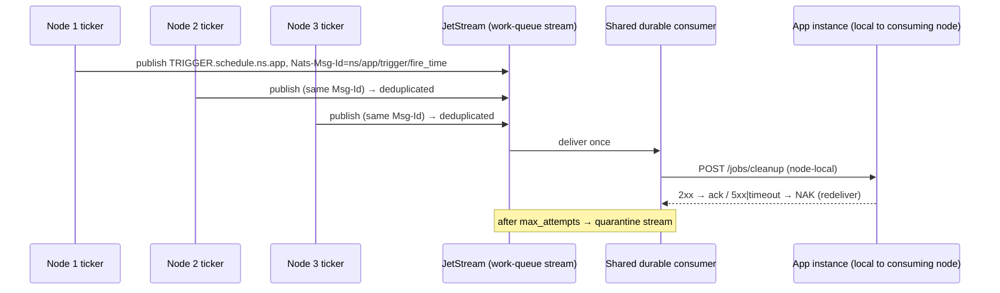
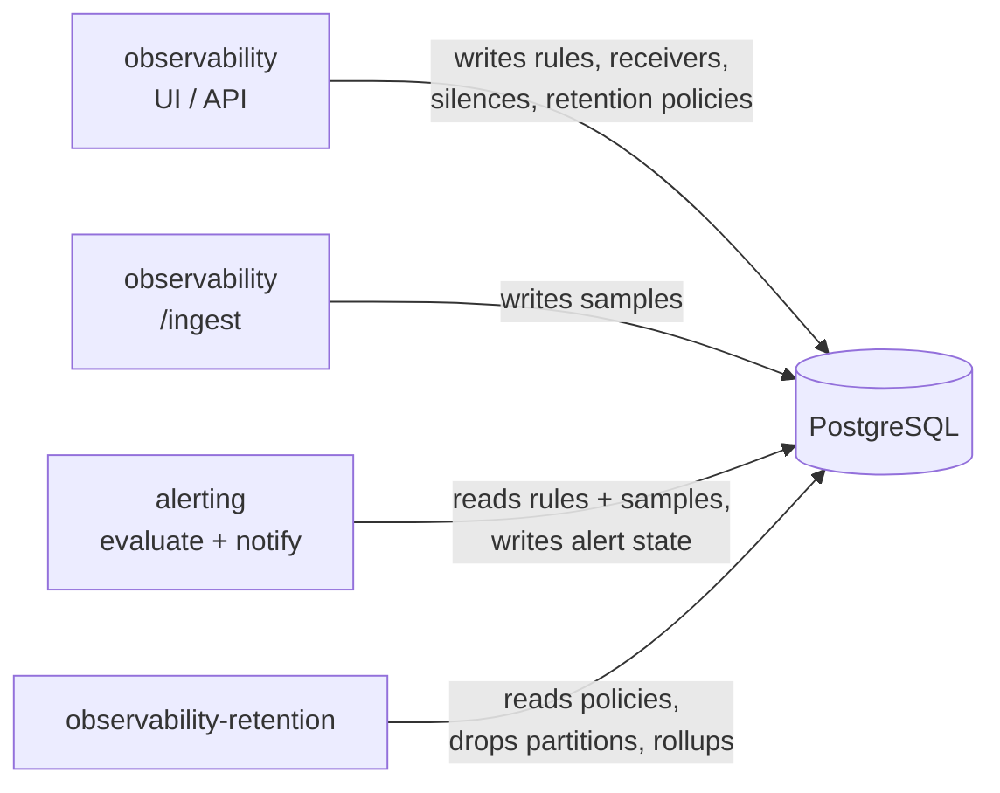
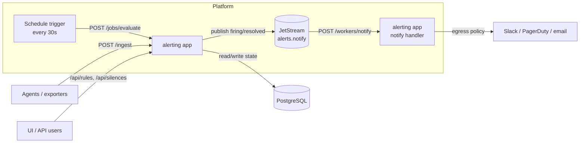

# Observability Application Design: Alerting, Retention, and Recurring Work

## Goal

Design an observability application (configuration UI/API, ingestion,
alerting, and data retention) that runs on this platform, and identify the
platform capabilities it needs beyond today's request-driven serverless model.

This document has two parts:

1. **Platform side**: how recurring actions, queue workers, and long-running
   workers can be added to a platform that today only manages
   cold-started, request-driven applications.
2. **Application side**: how the observability product should be split,
   structured, and operated on top of those capabilities.

Related documents:

- [`../50_AGENT_CONTROL_PLANE_AND_DURABLE_EXECUTION.md`](../50_AGENT_CONTROL_PLANE_AND_DURABLE_EXECUTION.md):
  broader scheduler / durable execution vision (Class D scheduled workloads).
- [`../08_NATS_MESSAGING.md`](../08_NATS_MESSAGING.md): JetStream usage.
- [`../12_SCALING.md`](../12_SCALING.md): instance pool and idle reaping.
- [`../../docs/internal-mesh.md`](../../docs/internal-mesh.md): node-local
  `.internal` mesh, `placement` and `local_dependencies`.
- [`../../docs/deploying-applications.md`](../../docs/deploying-applications.md):
  deployment manifest reference.

> Status: design proposal. Everything under `[[triggers.*]]` below is **not
> implemented** yet. Manifest snippets mark proposed fields explicitly.

---

## 1. Current Platform Capabilities (verified in code)

| Capability | State | Source |
|---|---|---|
| `wasi:http/incoming-handler` components (per-request, scale-to-zero) | Supported | `crates/runtime/src/executor.rs` (`ComponentExecutionModel::WasiHttpIncomingHandler`) |
| `wasi:cli/run` components (long-running socket server) | Supported | `crates/runtime/src/executor.rs` (`ComponentExecutionModel::WasiCli`) |
| Idle reaping | Always on; `idle_timeout_secs` must be `> 0` | `crates/supervisor/src/config_validator.rs`, `crates/supervisor/src/health_runtime.rs` |
| `min_instances` / always-on | **Not available** | — |
| Scheduler / cron / interval triggers | **Not available** | — |
| App-facing queue / worker triggers | **Not available** | — |
| NATS JetStream with durable consumers, ack/NAK redelivery, quarantine stream | Available, **platform-internal only** | `crates/messaging/src/lib.rs` (`JETSTREAM_STREAM_SUBJECT_SPECS`) |
| Outbound network policy | CIDR-based (`allowed_cidrs`, `denied_cidrs`, `allow_outbound_tcp`, `allow_dns`, ...) — **no hostname allowlist** | `crates/common/src/policy.rs` (`NetworkPolicy`) |
| PostgreSQL service microVM (local testbed) | Available | `scripts/vm/provision-postgres-service.sh` |
| Endpoint-scoped API keys | Available (`[[api_keys]]`) | `docs/deploying-applications.md` |
| Internal mesh | Node-local only (`<app>.<ns>.internal`, `placement.policy = "every_node"`) | `docs/internal-mesh.md` |

**Conclusion:** the platform can already host the request-serving part of the
observability product. Recurring actions (rule evaluation, retention) and
asynchronous workers (notification delivery, batched purges) need either an
external trigger source or new platform trigger features.

---

## 2. Platform Options for Recurring Actions and Workers

### Option 0: External scheduler (works today, zero platform changes)

An external system (systemd timer, Kubernetes CronJob, CI schedule) calls an
app route protected by an `[[api_keys]]` entry scoped to that path only.

```toml
[[api_keys]]
name = "scheduler"
key = { ref = "observability-scheduler-key" }
scopes = ["/jobs/"]
```

| Pros | Cons |
|---|---|
| No platform change | Scheduler is something else to operate |
| Preserves cold start / scale-to-zero | No platform-level retry, audit, or exactly-once tick |
| Same handler code as future triggers | Multiple external schedulers can double-fire |

When using this option across several nodes, protect each job with a
PostgreSQL advisory lock (`pg_try_advisory_lock`) to get single execution.

### Option 1 (recommended): Platform-delivered triggers mapped to HTTP

Applications stay plain HTTP handlers. The platform converts events into
HTTP requests, so scale-to-zero, per-request fuel/memory limits, policy,
and observability all keep working unchanged.

#### 1a. Scheduled triggers (proposed)

```toml
# PROPOSED — not implemented
[[triggers.schedule]]
name = "nightly-cleanup"
cron = "0 3 * * *"        # or: every = "30s" for sub-minute intervals
timezone = "UTC"
path = "/jobs/cleanup"
method = "POST"
overlap = "skip"          # skip | queue | allow
max_attempts = 3
```

**Exactly-once tick without leader election**, reusing JetStream:



- Every node runs the same deterministic ticker.
- `Nats-Msg-Id = <ns>/<app>/<trigger>/<fire_time>` and the JetStream
  duplicate window collapse N publishes into one message.
- A work-queue stream with a single shared durable consumer delivers it to
  exactly one node, which invokes the app **locally** (consistent with the
  node-local mesh rule; no cross-node forwarding).
- `2xx` → ack; `5xx`/timeout → NAK with backoff; after `max_attempts` →
  existing quarantine stream.
- `overlap = "skip"` requires a per-trigger in-flight marker (e.g. JetStream
  KV entry with TTL) so a slow tick does not overlap the next one.

#### 1b. Queue triggers (proposed)

```toml
# PROPOSED — not implemented
[[triggers.queue]]
subject = "orders.created"   # namespaced by the platform: APP.<ns>.orders.created
path = "/workers/order-created"
concurrency = 4              # bounded by fuel.max_instances
ack_timeout_secs = 30
max_attempts = 8
backoff = "exponential"      # base 1s, max 5m
```

- The platform consumes a per-namespace JetStream subject and POSTs each
  message body to the component.
- Same ack / NAK / quarantine semantics as scheduled triggers.
- Producers publish through a new authenticated **publish endpoint** on the
  gateway (or a host-side API), restricted to their own namespace's subjects.

#### Shared contract for both trigger types

| Aspect | Rule |
|---|---|
| Delivery semantics | **At-least-once.** Handlers must be idempotent. |
| Request headers | `X-Trigger-Id`, `X-Trigger-Name`, `X-Scheduled-At` (schedule), `X-Delivery-Attempt`, `X-Message-Id` (queue) |
| Authentication | Platform-signed identity on trigger requests; **not** a public API key |
| Exposure | Trigger paths (`/jobs/*`, `/workers/*`) are rejected at the public gateway |
| Limits | Normal per-request fuel quota, memory pages, timeouts |
| Observability | Each delivery produces a trace span and an audit record (trigger, attempt, status, duration) |

### Option 2: Long-running workers (only when truly needed)

`wasi:cli/run` components already run as long-lived processes. Making them
first-class workers requires:

- `min_instances` / `always_on` so idle reaping skips them;
- a CPU budget model suited to a process that never ends (CPU-time or
  rate-based instead of a per-request fuel quota);
- restart with backoff and crash-loop detection;
- placement and replica-count rules (how many copies, on which nodes).

| Pros | Cons |
|---|---|
| Persistent connections (stream consumers, websockets) | Loses scale-to-zero, highest cost |
| No per-message cold start | New lifecycle semantics in supervisor and scaling |

Reserve for workloads like long-lived stream consumers.

### Platform roadmap

| Order | Feature | Reason |
|---|---|---|
| 1 | Scheduled triggers (`cron` + `every`, `overlap`) | Covers "call an endpoint every X"; reuses JetStream + request path |
| 2 | Queue triggers + namespaced publish endpoint | Same machinery; enables async workers |
| 3 | Host-based egress allowlist or egress relay | Needed for SaaS notification receivers (see §6) |
| 4 | Always-on workers (`min_instances`) | Only when a concrete use case requires it |

Implementation touch points (indicative): manifest schema and validation in
`crates/common` / `crates/supervisor/src/config_validator.rs`, new JetStream
streams in `crates/messaging/src/lib.rs`, ticker and delivery in the node /
supervisor, trigger-path rejection in `crates/proxy` gateway, `ctl` support,
e2e tests in `crates/e2e`, documentation in `docs/`.

---

## 3. Observability Product: Application Split

It is **one product**. How many deployable apps it is split into is a choice.
All apps share **one PostgreSQL database**, and the database is the
integration contract.

### Option A: Single app (start here)

```text
observability
├── /api/*                    UI + configuration (rules, receivers, silences, retention policies)
├── /ingest                   metrics / events ingestion
├── /jobs/evaluate            schedule trigger — alerting
├── /workers/notify           queue trigger — alerting
└── /jobs/retention/*         schedule triggers — retention
```

- Simplest to build and deploy.
- Drawback: one DB role needs every privilege, including DDL (`DROP` partitions).

### Option B: Two apps (recommended for production)

| App | Contains | Why |
|---|---|---|
| `observability` | UI/API configuration, ingestion, alerting (evaluate + notify) | User-facing; DML only |
| `observability-retention` | Partition create/drop, rollups, purges | Only app with DDL/delete privileges; **no public routes**, triggers only |

### Option C: Three apps

Additionally split `observability-alerting` when:

- evaluation load needs independent scaling, or
- alerting must keep working while the UI/API is broken or being redeployed
  (fault isolation is valuable for alerting specifically).

### Integration through the database



- Configuration is data: the main app writes it, alerting and retention read
  it on every trigger, so changes apply on the next tick without redeploying.
- Each app has its own DB role and its own `[secrets]` references.
- If a direct call is ever needed (e.g. UI asks retention for a dry-run), use
  the internal mesh: `observability-retention.<namespace>.internal`, with
  `placement.policy = "every_node"` and `local_dependencies`. Never rely on
  cross-node `.internal` forwarding.

### Recommended path

1. Build as **Option A**, but keep alerting and retention in separate modules
   behind separate routes.
2. Split retention out (**Option B**) before production for privilege
   separation.
3. Split alerting (**Option C**) only when scale or isolation requires it.

Because code is already separated by route, each split is a deployment
change, not a rewrite.

---

## 4. Alerting Design

### Architecture



| Need | Mechanism |
|---|---|
| Ingest metrics/events | Normal HTTP route `/ingest` (cold start on demand) |
| Evaluate rules every N seconds | Schedule trigger, exactly-once tick cluster-wide |
| Alert state (pending → firing → resolved, `for` durations) | PostgreSQL (instances are stateless) |
| Notification delivery with retries | Queue trigger on `alerts.notify`, NAK + backoff on receiver failure |
| Silences, rules, receivers | Normal API routes behind gateway auth |
| Dead-lettered notifications | Quarantine stream after `max_attempts` |

### Manifest (alerting part)

```toml
[app]
name = "observability"
namespace = "observability"
version = "v1"
wasm_artifact = "./target/wasm32-wasip2/release/observability.wasm"
wasm_bind_port = 8080

[fuel]
max_instances = 10
idle_timeout_secs = 300

# PROPOSED — not implemented
[[triggers.schedule]]
name = "evaluate-rules"
every = "30s"
path = "/jobs/evaluate"
overlap = "skip"
max_attempts = 1          # a missed evaluation is superseded by the next tick

# PROPOSED — not implemented
[[triggers.queue]]
subject = "alerts.notify"
path = "/workers/notify"
concurrency = 4
ack_timeout_secs = 30
max_attempts = 8
backoff = "exponential"

[policy.network]
allow_inbound = true
allow_outbound_tcp = true
allow_dns = true
allowed_cidrs = ["10.0.0.0/8"]   # PostgreSQL + egress relay; see §6 for SaaS receivers
denied_cidrs = ["169.254.169.254/32"]

[secrets]
DATABASE_URL = { ref = "observability-postgres-url" }
```

### Design rules

1. **Keep a tick small.** Each trigger invocation runs under the per-request
   fuel quota. When evaluation grows, the tick only fans out one message per
   rule group to an `alerts.evaluate` queue and parallel instances evaluate.
2. **Idempotent state transitions.** Key alert state by
   `(rule_id, labels_hash)`. Use `X-Scheduled-At` as the evaluation
   timestamp, not the wall clock, so a redelivered tick produces the same
   result.
3. **Notification dedup.** Notification ID
   `<alert_fingerprint>/<state>/<transition_time>` is used both as the
   JetStream `Nats-Msg-Id` and as the receiver dedup key (e.g. PagerDuty
   `dedup_key`). Retries never double-page.
4. **Grouping and repeat logic is app logic.** `group_wait`,
   `group_interval`, `repeat_interval` (Alertmanager semantics) live in
   PostgreSQL and are driven from the evaluation tick.
5. **Watch the watcher.** If the platform, NATS, or the scheduler is down,
   alerting goes silent. Emit an external heartbeat (dead man's switch) to a
   receiver **outside** this platform and alert on its absence.
6. **Private trigger paths.** `/jobs/*` and `/workers/*` accept only
   platform-signed trigger requests.

### Suggested tables

| Table | Purpose |
|---|---|
| `alert_rules` | Rule definition, expression, `for`, labels, annotations, version |
| `receivers` | Notification targets (type, endpoint ref, secret ref) |
| `routes` | Label matchers → receiver, grouping config |
| `silences` | Matchers, start/end, author, comment |
| `alert_state` | `(rule_id, labels_hash)` → state, active_since, last_eval_at, fingerprint |
| `notification_log` | Notification ID, receiver, attempt, status, sent_at (partitioned) |
| `evaluation_runs` | Tick ID, scheduled_at, duration, rules evaluated, errors |

---

## 5. Retention Design

Retention is also scheduled work, but it is infrequent, potentially heavy,
and destructive — which changes the design.

### Partition, do not `DELETE`

```sql
CREATE TABLE samples (
  ts        timestamptz NOT NULL,
  series_id bigint      NOT NULL,
  value     double precision
) PARTITION BY RANGE (ts);

CREATE TABLE IF NOT EXISTS samples_2026_10_28
  PARTITION OF samples
  FOR VALUES FROM ('2026-10-28') TO ('2026-10-29');
```

| Approach | Cost | Fits per-request fuel? |
|---|---|---|
| `DELETE FROM samples WHERE ts < now() - interval '30 days'` | Scans millions of rows, table bloat, heavy vacuum | No |
| `DROP TABLE IF EXISTS samples_2026_09_27` | Near-instant, space reclaimed immediately | Yes |

Retention becomes two cheap operations:

- **pre-create** the next N partitions;
- **drop** partitions older than the retention window.

> Pre-creating partitions is as critical as dropping them: if the job stops
> and the next partition does not exist, ingestion fails. Keep at least two
> future partitions and alert when fewer exist.

### Triggers (retention app)

```toml
[app]
name = "observability-retention"
namespace = "observability"
version = "v1"
wasm_artifact = "./target/wasm32-wasip2/release/observability_retention.wasm"
wasm_bind_port = 8080

[fuel]
max_instances = 2
idle_timeout_secs = 60

# PROPOSED — not implemented
[[triggers.schedule]]
name = "partition-maintenance"
cron = "15 * * * *"          # hourly: pre-create + drop expired
path = "/jobs/retention/partitions"
overlap = "skip"
max_attempts = 3

# PROPOSED — not implemented
[[triggers.schedule]]
name = "rollups"
cron = "*/10 * * * *"
path = "/jobs/retention/rollup"
overlap = "skip"

# PROPOSED — not implemented
[[triggers.queue]]
subject = "retention.purge"
path = "/workers/retention/purge"
concurrency = 1

[policy.network]
allow_inbound = true          # trigger delivery only; no gateway routes declared
allow_outbound_tcp = true
allowed_cidrs = ["10.0.0.0/8"]  # PostgreSQL only

[secrets]
DATABASE_URL = { ref = "observability-retention-postgres-url" }
```

### Data classes and retention

| Data | Example retention | Method |
|---|---|---|
| Raw samples | 15 days | Drop daily partitions |
| 5-minute rollups | 90 days | Drop partitions |
| 1-hour rollups | 1 year | Drop partitions |
| Alert history / notification log | 180 days | Partitions, or batched delete |
| Per-tenant overrides (e.g. 7 days) | Variable | Batched delete (chained) |
| Rules, receivers, silences | Until user deletes | Never auto-purged |
| Retention audit log | Longest of all | Append-only |

### Chained batched purge (no long-running worker needed)

For data that cannot be dropped by partition (tenant-specific windows inside
shared partitions):

```text
/workers/retention/purge:
  DELETE FROM samples
   WHERE ctid IN (SELECT ctid FROM samples
                   WHERE tenant_id = $1 AND ts < $2
                   LIMIT 5000)
  if rows_deleted == 5000:
      publish retention.purge (same purge_id, advanced cursor)
  else:
      record completion in retention_audit
```

Each batch fits a single request's fuel budget; `concurrency = 1` bounds DB
pressure.

### Retention rules

1. **Rollup before drop.** Maintain a rollup watermark; never drop a raw
   partition newer than the watermark.
2. **Retention ≥ longest rule lookback.** If a rule uses
   `avg_over_time(...[7d])` or `for: 1h`, raw retention must exceed it.
   Validate when a rule or retention policy is saved, not when data vanishes.
3. **Holds.** Optionally skip partitions referenced by firing / recently
   resolved alerts, or under an incident or legal hold.
4. **Audit every deletion.** Record partition or range, row count, policy
   version, trigger ID, timestamp.
5. **Idempotent DDL.** `CREATE TABLE IF NOT EXISTS ... PARTITION OF`,
   `DROP TABLE IF EXISTS`. Retried or duplicated ticks are harmless.
6. **Monitor retention itself.** Alert when the oldest partition exceeds the
   window plus a margin, when disk keeps growing, when fewer than two future
   partitions exist, or when no successful maintenance ran for N hours —
   including via the external heartbeat.

### Least privilege

| App | DB role | Exposure |
|---|---|---|
| `observability` | DML on data tables, read on rollups and policies | Gateway routes + alerting triggers |
| `observability-retention` | Owner of partitioned tables (CREATE/DROP), write to audit table | Triggers only, no gateway routes |

A bug or compromise in the ingestion path cannot wipe history.

---

## 6. Platform Gap: Egress to SaaS Notification Receivers

`NetworkPolicy` allowlists **CIDRs**, not hostnames. Slack, PagerDuty, and
email providers use large, changing IP ranges, so CIDR allowlisting is
fragile and over-broad.

| Option | Description | Trade-off |
|---|---|---|
| A. Broad outbound | `allow_outbound_tcp = true`, empty `allowed_cidrs`, deny private ranges via `denied_cidrs` | Works now; weak isolation |
| B. Egress relay | Small relay (separate app or host service) with a hostname allowlist; observability apps may only reach the relay CIDR | Strong isolation; one more component |
| C. Platform feature | Hostname-based egress allowlist (SNI / DNS-pinned) in runtime policy | Best UX; new platform work |

Recommendation: **B** for production rehearsal, **C** on the platform roadmap.
Use **A** only for local development.

---

## 7. Overall Job Schedule

| Job | Frequency | Trigger | App |
|---|---|---|---|
| Rule evaluation | 30 s | schedule (`every`) | `observability` (or `-alerting`) |
| Notification delivery | Event-driven | queue `alerts.notify` | `observability` (or `-alerting`) |
| External heartbeat | 1 min | schedule | `observability` (or `-alerting`) |
| Rollups | 10 min | schedule | `observability-retention` |
| Partition create/drop | Hourly | schedule | `observability-retention` |
| Per-tenant purge | Chained batches | queue `retention.purge` | `observability-retention` |

---

## 8. Interim Plan (before platform triggers exist)

| Capability | Interim approach |
|---|---|
| Rule evaluation tick | External timer → `POST /jobs/evaluate` with path-scoped API key; PostgreSQL advisory lock for single execution |
| Notification delivery | Inline during evaluation; retry state and next-attempt time in `notification_outbox` table, drained on each tick |
| Retention | External hourly timer → `POST /jobs/retention/partitions`; advisory lock |
| Chained purge | Outbox table drained one batch per tick |

Handlers keep the same paths and contracts, so migrating to platform
triggers only changes the manifest and removes the external timer.

---

## 9. Build Checklist

### Platform

- [ ] Manifest schema + validation for `[[triggers.schedule]]` (`cron`, `every`, `timezone`, `overlap`, `max_attempts`)
- [ ] JetStream `TRIGGER` work-queue stream with duplicate window ≥ tick interval
- [ ] Deterministic per-node ticker publishing with `Nats-Msg-Id`
- [ ] Node-local delivery via supervisor; ack/NAK/backoff; quarantine on exhaustion
- [ ] `overlap = "skip"` in-flight marker
- [ ] Platform-signed trigger identity; gateway rejects trigger paths
- [ ] Trace spans + audit records per delivery
- [ ] `[[triggers.queue]]` + namespaced publish endpoint
- [ ] Hostname egress allowlist or documented egress relay pattern
- [ ] `ctl` support, e2e tests, docs

### Application

- [ ] PostgreSQL schema with partitioned time-series tables
- [ ] Ingestion route
- [ ] Rule/receiver/route/silence API
- [ ] Idempotent evaluation keyed by `X-Scheduled-At`
- [ ] Notification dedup ID and receiver dedup keys
- [ ] External dead man's switch heartbeat
- [ ] Separate retention module (then app) with its own DB role
- [ ] Rollup watermark, partition pre-creation, drop, audit
- [ ] Lookback-vs-retention validation on save
- [ ] Self-monitoring alerts for evaluation and retention health
