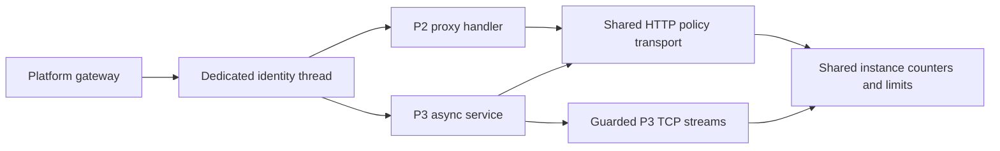

# Runtime Crate

## Overview

This crate provides a Wasmtime-based WebAssembly runtime for the Wasm Cloud Platform. It is responsible for the complete lifecycle of WebAssembly execution, from compilation to instance management:

- **Compilation**: Compiling raw `.wasm` binaries into AOT (ahead-of-time) artifacts for fast startup
- **Preparation**: Preparing stored artifacts for execution
- **Instance Spawning**: CLI/P2 HTTP hosting and WASI P3 asynchronous HTTP services
- **Resource Management**: Fuel metering, memory limits, and I/O resource tracking
- **Policy Enforcement**: Controlling network access, filesystem access, and other capabilities
- **DNS**: Virtual DNS resolution for Wasm instances

## Architecture

The runtime is built on top of [Wasmtime](https://wasmtime.dev/) and provides several layers of abstraction:

1. **Engine Layer** (`build_engine`): Configures and builds the Wasmtime `Engine` with appropriate settings for AOT compilation and WASI support.

2. **Module Preparation** (`PreparedModule`): Handles the compilation and caching of Wasm modules, making them ready for instantiation.

3. **Instance Management** (`RunningInstance`): Manages the lifecycle of running Wasm instances, including store state and execution tracking.

4. **Policy Layer** (`PolicyEnforcer`, `PolicyCounters`): Enforces security policies on Wasm instances, including network access control via CIDR-based rules and connection counting.

5. **Resource Tracking** (`MemoryLimiter`, `IoResourceTracker`): Tracks and limits memory consumption and I/O resources used by Wasm instances.

6. **Virtual Networking** (`VirtualDns`): Provides DNS resolution capabilities within the Wasm environment.

## Public API

### Core Types

| Type | Description |
|------|-------------|
| `WasmRuntime` | Main entry point for the Wasm runtime, managing engine configuration and module preparation |
| `PreparedModule` | A compiled Wasm module ready for instantiation |
| `RunningInstance` | A running Wasm instance with associated state and resources |
| `ExecutionStats` | Statistics about Wasm execution (fuel consumed, time elapsed, etc.) |
| `StoreState` | Internal state maintained within the Wasmtime store |

### Policy & Security

| Type | Description |
|------|-------------|
| `PolicyEnforcer` | Enforces security policies on Wasm instances |
| `PolicyCounters` | Tracks policy-related counters (active connections, etc.) |
| `VirtualDns` | Virtual DNS resolution for Wasm instances |

### Resource Management

| Type | Description |
|------|-------------|
| `MemoryLimiter` | Limits memory allocation for Wasm instances |
| `IoResourceTracker` | Tracks I/O resources used by Wasm instances |

## Sustained Load Review

The runtime now includes a repeatable Wasmtime load-review path for WSL/Linux:

- probe: `cargo run -p runtime --example wasmtime_load_probe -- --scenario baseline`
- full review: `bash scripts/run_wasmtime_load_review.sh`

The review uses the real `hello-axum` component, compares baseline vs cache vs pooling allocator scenarios, and records:

- cold vs warm compile latency
- repeated instantiation latency
- peak-live instance spawn latency
- process RSS after compile and after holding multiple live instances

The production template keeps pooling disabled by default. Enable it only if this review shows a material instantiation gain without unacceptable RSS growth for the workload you actually expect to run.

This review is the current evidence path for startup and instantiation latency. The repository does not currently publish a single end-to-end platform benchmark that substantiates a universal `sub-10ms cold start` claim across workloads and deployment shapes.

## Known Issues & Improvements

The connection limit is reserved with compare-and-swap, disconnect uses underflow protection, and instance teardown resets or releases its active reservations. Remaining limitations are:

- **`VirtualDns` is not the WASI resolver**: The type provides namespace-aware name mapping, while guest DNS uses Wasmtime's resolver subject to `allow_dns` and socket-address policy.
- **Filesystem activity accounting is incomplete**: Allowed paths are enforced with WASI preopens and the resource table is capped by `max_open_fds`, but per-operation file write accounting is not connected to wrapped WASI host calls.

### Removed Legacy Paths

The old `policy_wasi`, `ChannelPipe`, `MetadataInjectingStream`, and `wasi.rs` paths have been removed. `IoResourceTracker` remains as the I/O snapshot returned in execution statistics.

### Design Issues

- **WASI interface versions are checked explicitly**: P2 detection lists supported `wasi:cli/run` and `wasi:http/incoming-handler` 0.2 versions. P3 HTTP services exporting `wasi:http/handler@0.3` are checked against the pinned Wasmtime `ServicePre` contract before serving.
- **Policy counters are runtime-local data**: Running CLI and HTTP instances expose their counters, but this crate does not itself publish them to Prometheus.

## Security Considerations

### Filesystem Access

Only paths listed in `policy.filesystem.allowed_paths` are preopened. With an empty list the guest receives no host-directory preopen. Directory and file permissions are derived from the create/delete policy flags, and a missing configured path causes instance preparation to fail. The remaining limitation is that the current WASI integration does not feed every file write into `max_fs_write_bytes` accounting.

### Network Policy Enforcement

Wasmtime networking is enabled at the context level so permitted applications can use sockets, then constrained with protocol flags and the composed socket-address callback. The callback applies bind, CIDR, and connection-limit policy; DNS lookup has its own coarse toggle.

### CIDR Configuration

Normal `PolicyConfig::resolve()` validation rejects invalid CIDRs before instance creation. The runtime's lower-level parsers also warn and omit an invalid entry if a caller constructs an `InstancePolicy` directly and bypasses that resolution path.

### DNS Resolution

Guest name lookup uses Wasmtime's DNS path when `allow_dns` permits it and still passes resolved addresses through socket policy. `VirtualDns` is a separate mapping utility and is not installed as the guest's resolver.

## Outbound HTTP transport

### P3 HTTP services

The engine enables Component Model async and links P3 alongside P2, preserving
P2 imports used by Rust's `wasm32-wasip2` standard library. P3 services use a fresh
limited Store per request on the dedicated, supervisor-registered identity
thread. Outgoing P3 HTTP uses the same policy-controlled `WasiHttpHooks` transport
as P2: hostname/CIDR checks, TLS, quotas and deadlines remain authoritative.



P3 responses are buffered up to 16 MiB; incoming bodies are limited to 16 MiB.
The whole handler/body operation has a 30-second host deadline, in addition to
fuel, memory and resource-table limits. This path is for bounded service APIs,
not indefinite streaming. Native schedule triggers remain P2-only and are
rejected for P3 services. Reserved trigger routes and caller-supplied trigger
headers retain the ordinary-network boundary.

P3 raw sockets support outbound TCP connect, send and receive. Connect has a
10-second shared address-check/connect deadline; pending reads/writes have
30-second progress deadlines. TCP bytes consume the same aggregate egress quota,
and connection slots remain owned until the last socket/stream reference drops.
UDP creation and raw TCP bind are denied; other socket option operations are not
implemented by this adapter and fail closed. P2 socket behavior is unchanged.
The pinned Wasmtime P3 ABI is experimental; this is not a general WASI P3
conformance or production-support claim.

The `apps/http-p3-probe` component exercises this path. Build it explicitly for
`wasm32-wasip2`, then run `cargo test -p runtime --test p3_service -- --ignored --skip p3_postgres`.
For the database/quota test, set `WCP_P3_DATABASE_FILE` to a private file containing
an explicitly selected disposable PostgreSQL URL and run the same test binary
with the `p3_postgres` filter and `--ignored`. Credentials are not printed.

### Shared outgoing transport

The `WasiHttpHooks` implementation in `executor/http_policy.rs` resolves a
hostname once and applies the composed TCP policy and supervisor gate before
connecting to the resulting socket address. TLS verifies the original hostname;
redirects are not followed automatically. HTTP connection reservations use the
shared instance counters but have independent ownership from store teardown.
They release with the transport, including failure and cancellation paths.
Raw P2 TCP reserves at `start-connect` and releases on failed completion,
socket-resource destruction, or store teardown. Fresh platform instances use
host lifecycle accounting for raw and HTTP connections; the supervisor ignores
their delayed kernel close events for counter release. The older close-token
path remains for direct legacy counter consumers. eBPF workload identity is
still required by the platform's production admission contract.

HTTP wire writes enforce `network.max_egress_bytes`, including TLS framing and
headers. DNS denial, connection denial, active connections, and emitted bytes
feed `PolicyCounters`. P2 TCP payload reservations and accepted UDP payloads
share the HTTP wire-byte budget. `executor/socket_egress.rs` wraps connected and
accepted TCP output resources and the UDP send host call in both linkers.
TCP reservations remain charged on delegate failure because Wasmtime can send
a prefix or queue background work; UDP refunds the unsent batch suffix. These
counters are conservative guest-I/O accounting, not total host NIC traffic.
`AppConfig::resolve_instance_policy` intersects explicitly configured
`extended_limits.max_net_egress_bytes` and `max_outbound_connections` with
network policy ceilings. Missing fields preserve the legacy policy; zero bytes
adds no ceiling, while zero connections denies connects. The runtime, supervisor
policy inspection, and CLI deploy validation use the same resolution. Counters
are per instance and shared across its HTTP request stores; restarts reset them.
See [HTTP policy and host caps](../../docs/deploying-applications.md#outbound-wasi-http-policy)
for the fixed deadlines, response-size cap, and compatibility implications.

To exercise real outgoing-handler guest imports in WSL, build the fixture and
run the explicit integration test:

```bash
export CARGO_TARGET_DIR=/tmp/wasm-cloud-platform-target
cargo build --locked -p http-hello-component --target wasm32-wasip2
WCP_HTTP_PROBE_COMPONENT="$CARGO_TARGET_DIR/wasm32-wasip2/debug/http_hello_component.wasm" \
  cargo test --locked -p runtime --test http_outbound_component -- --ignored
```

The socket regression also needs the CLI echo fixture and exercises both
linkers, TCP/UDP writes, and accepted TCP responses:

```bash
cargo build --locked -p http-hello-component -p echo-service --target wasm32-wasip2
WCP_HTTP_PROBE_COMPONENT="$CARGO_TARGET_DIR/wasm32-wasip2/debug/http_hello_component.wasm" \
WCP_ECHO_PROBE_COMPONENT="$CARGO_TARGET_DIR/wasm32-wasip2/debug/echo-service.wasm" \
  cargo test --locked -p runtime --test socket_egress_component -- --ignored
```

The echo fixture's opt-in `RESOURCE_PROBE_MAX_REQUESTS` lets this test terminate
the guest after one response; omission keeps the normal long-lived service.
`executor/socket_deadlines.rs` installs host caps for raw connect/name lookup
(10 seconds), pending TCP/UDP readiness, blocking stream I/O, splice, and
network stream destruction (30 seconds). Cancelled polling cannot renew a
pending wait. Idle listeners remain untimed. Expiration traps the CLI invocation
or HTTP request store and closes its resources; other HTTP request stores can
continue. Fixed caps and migration semantics are documented in the
[socket deadline contract](../../docs/deploying-applications.md#socket-host-deadlines).

To validate the production caps with stalled local peers in both linkers:

```bash
WCP_HTTP_PROBE_COMPONENT="$CARGO_TARGET_DIR/wasm32-wasip2/debug/http_hello_component.wasm" \
WCP_ECHO_PROBE_COMPONENT="$CARGO_TARGET_DIR/wasm32-wasip2/debug/echo-service.wasm" \
  cargo test --locked -p runtime --test socket_deadline_component -- --ignored
```

Live-instance usage, denials and host-deadline counters are exported by the
supervisor; see [network metrics](../../docs/observability.md#network-policy-and-host-io-metrics).

This is a local runtime test, not a microVM/eBPF identity or production rehearsal.

## Restrictive network profiles

The operator contract and manifest examples live in
[restrictive profiles](../../docs/deploying-applications.md#restrictive-network-profiles).
The runtime distinguishes a checked HTTP connect from a raw socket connect:
`egress-allowlist` allows raw TCP only through explicit IP/port exceptions and
resolves only pre-authorized HTTP names. All restrictive profiles disable raw
WASI DNS/UDP; qualified `.internal` HTTP names map to the local gateway without
DNS. `mesh-only` restricts the entire destination address and port, not just the
loopback CIDR. CIDR and supervisor checks run after these profile constraints.


## Native periodic invocations

`HttpServerInstance::trigger_handle` is a native-only capability. Supervisor
uses it to deliver a declared schedule on the dedicated registered executor
thread with a fresh Store and shared instance policy counters. The runtime
validates the running declaration, bounds concurrency and response bytes, and
drops the guest Store on timeout or delivery cancellation. HTTP cannot invoke
the reserved trigger namespace, and ordinary requests lose all `X-Trigger-*`
headers. The [manual](../../docs/deploying-applications.md#periodic-triggers)
defines the complete contract and its delivery/cold-start limits.

From the repository root in Linux/WSL, reproduce the real-component checks:

```bash
export CARGO_TARGET_DIR=/tmp/wasm-cloud-platform-target
cargo build --locked -p http-hello-component --target wasm32-wasip2
export WCP_HTTP_PROBE_COMPONENT="$CARGO_TARGET_DIR/wasm32-wasip2/debug/http_hello_component.wasm"
cargo test --locked -p runtime --test schedule_component -- --ignored --test-threads=1
cargo test --locked -p supervisor --lib schedule_cold_start -- --ignored --test-threads=1
```

These tests cover native identity, forged HTTP requests, stale declarations,
timeout/cancellation cleanup, periodic cold start, skipped concurrent ticks,
config removal, undeploy, drain, and scheduler shutdown. They need neither a
model nor a microVM and do not establish production timing guarantees.
