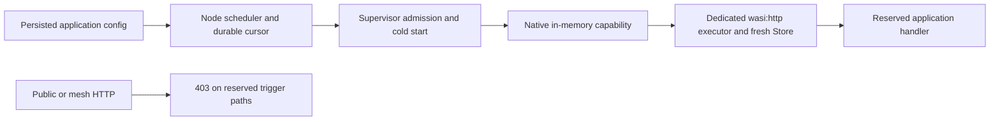

# Deploying Applications

This guide covers everything you need to deploy, configure, and manage Wasm applications on the platform.

## Table of Contents

1. [Deploying Your First App](#deploying-your-first-app)
2. [Deployment Manifests](#deployment-manifests)
3. [Remote Artifact Deploys](#remote-artifact-deploys)
4. [Per-Endpoint Security](#per-endpoint-security)
5. [Environment Variables & Secrets](#environment-variables--secrets)
6. [Managing Deployments](#managing-deployments)
7. [Zero-Downtime Updates](#zero-downtime-updates)
8. [Periodic Triggers](#periodic-triggers)

---

## Deploying Your First App

### Build a Wasm app

The platform expects a Wasm module compiled for the `wasm32-wasip2` target. Here's a minimal Axum app:

```bash
# Create a new Rust project
cargo new --bin hello-api
cd hello-api

# Add dependencies to Cargo.toml
# [dependencies]
# axum = "0.8"
# tokio = { version = "1", features = ["macros", "rt-multi-thread"] }

# Edit src/main.rs
```

```rust
use axum::{routing::get, Router};
use std::net::SocketAddr;

#[tokio::main]
async fn main() {
    let app = Router::new()
        .route("/", get(|| async { "Hello from Wasm!" }))
        .route("/health", get(|| async { "OK" }));

    let port: u16 = std::env::var("PORT")
        .unwrap_or_else(|_| "8080".to_string())
        .parse()
        .unwrap();

    let addr = SocketAddr::from(([0, 0, 0, 0], port));
    let listener = tokio::net::TcpListener::bind(addr).await.unwrap();
    axum::serve(listener, app).await.unwrap();
}
```

```bash
# Compile to wasm32-wasip2
cargo build --release --target wasm32-wasip2

# The artifact is at:
# target/wasm32-wasip2/release/hello-api.wasm
```

### Deploy via CLI

```bash
# Simple deploy
wasm-ctl deploy \
  --app hello-api \
  --version v1 \
  --wasm ./target/wasm32-wasip2/release/hello-api.wasm \
  --fuel 500000000 \
  --memory-mb 128 \
  --max-instances 5

# Deploy with environment variables
wasm-ctl deploy \
  --app hello-api \
  --version v1 \
  --wasm ./hello-api.wasm \
  --env LOG_LEVEL=info \
  --env RUST_LOG=debug

# Deploy into a specific namespace
wasm-ctl deploy \
  --app hello-api \
  --version v1 \
  --namespace production \
  --wasm ./hello-api.wasm
```

## Remote Artifact Deploys

You can deploy without uploading a local `.wasm` from the CLI host. In that mode, the CLI sends deploy intent to the platform deploy ingress endpoint, and the platform fetches the artifact directly, verifies the digest, stores it locally, and then the normal `DeployApp` flow continues.

Remote deploys use the deploy ingress URL, which can be configured separately from the node admin URL:

```bash
export WASM_CTL_DEPLOY_API=https://deploy.example.com
export WASM_CTL_AUTH_TOKEN=<deploy-ingress-bearer-token>
```

or per command:

```bash
wasm-ctl deploy \
  --deploy-api https://deploy.example.com \
  ...
```

The expected runtime shape is:

1. run one or more `wasm-deploy-ingress` processes as the control-plane ingress
2. point CI at `WASM_CTL_DEPLOY_API`
3. let nodes fetch artifacts from the deploy-ingress artifact server via signed transfer manifests

### Running deploy ingress

The deploy ingress is configured by environment variables and CLI flags, not by the node TOML config files.

Operator-facing examples are in:

- [`config/deploy-ingress.env.example`](../config/deploy-ingress.env.example)
- [`systemd/wasm-deploy-ingress.service`](../systemd/wasm-deploy-ingress.service)
- [`docs/deploy-ingress-operations.md`](./deploy-ingress-operations.md)

A typical production setup is:

1. install `wasm-deploy-ingress` on a control-plane host
2. create `/etc/wasm-cloud/deploy-ingress.env` from the example
3. provide a stable KEK via `WASM_DEPLOY_INGRESS_KEY_SOURCE`
4. expose the deploy API and artifact port behind your ingress or load balancer as needed
5. point CI at `WASM_CTL_DEPLOY_API`
6. provide a deploy-ingress bearer token to CI through `WASM_CTL_AUTH_TOKEN`

Do not leave `WASM_DEPLOY_INGRESS_KEY_SOURCE=generate` in production. That mode is only suitable for ephemeral test environments because stored artifact credentials become undecryptable after restart.

If you run more than one deploy-ingress instance:

- keep `WASM_DEPLOY_INGRESS_HA_ENABLED=true`
- give every instance the same KEK source
- point them at the same NATS / JetStream cluster
- put the deploy API and artifact port behind a stable ingress or load balancer

Only the current lease holder accepts mutating deploy requests. Followers stay hot, replicate artifacts, and take over when they acquire the leader lease.

### Deploy ingress auth in CI

Remote deploys use the same CLI auth token mechanism as other authenticated HTTP calls:

- `WASM_CTL_AUTH_TOKEN`
- or `--auth-token`

Recommended split:

- CI deploy jobs: write-capable token
- operator verification tooling: read-capable token

Minimal GitHub Actions shape:

```yaml
env:
  WASM_CTL_DEPLOY_API: https://deploy.example.com
  WASM_CTL_AUTH_TOKEN: ${{ secrets.WCP_DEPLOY_WRITE_TOKEN }}
```

Do not reuse a node bootstrap secret or a runtime app secret here. This token authenticates the CI caller to deploy ingress only.

### HTTP(S) artifact URL

```bash
wasm-ctl deploy \
  --app hello-api \
  --version v1 \
  --artifact-url https://artifacts.example.com/hello-api.wasm \
  --sha256 0123456789abcdef0123456789abcdef0123456789abcdef0123456789abcdef
```

### Private artifact with platform-managed credential

First store the fetch credential in the platform:

```bash
export WASM_CTL_DEPLOY_API=https://deploy.example.com
wasm-ctl secrets set-artifact-credential --key ghcr-reader
```

`set-artifact-credential` writes to the deploy-ingress credential store, not to node-local runtime secret storage.

By default the stored value is used as a bearer token. If you need an exact `Authorization` header, store it with the `authorization:` prefix, for example:

```text
authorization:Basic <base64(user:token)>
```

Then deploy:

```bash
wasm-ctl deploy \
  --app hello-api \
  --version v1 \
  --artifact-url https://artifacts.example.com/hello-api.wasm \
  --sha256 0123456789abcdef0123456789abcdef0123456789abcdef0123456789abcdef \
  --artifact-credential ghcr-reader
```

Remote artifact fetch is capped at `64 MiB` per artifact. Oversized remote payloads fail closed before deploy publication.

### OCI / GHCR reference

The platform accepts:

- digest-pinned refs such as `oci://ghcr.io/org/app@sha256:...`
- tag refs such as `oci://ghcr.io/org/app:v1`

Resolution happens on the node during deploy ingress. For tag refs, the node fetches the OCI manifest from the registry, resolves the blob digest, then downloads and verifies the blob.

Example:

```bash
wasm-ctl deploy \
  --app hello-api \
  --version v1 \
  --artifact-ref oci://ghcr.io/example-org/hello-api:v1 \
  --artifact-credential ghcr-reader
```

Digest-pinned form is also supported:

```bash
wasm-ctl deploy \
  --app hello-api \
  --version v1 \
  --artifact-ref oci://ghcr.io/example-org/hello-api@sha256:0123456789abcdef0123456789abcdef0123456789abcdef0123456789abcdef \
  --artifact-credential ghcr-reader
```

If you want hardened registry policy, deploy ingress can reject mutable OCI tag refs entirely:

- `WASM_DEPLOY_INGRESS_REQUIRE_OCI_DIGEST_REFS=true`

With that enabled, `oci://...:v1` deploys fail closed and callers must use
`oci://...@sha256:...`.

### Optional signed artifact metadata

Deploy ingress can require a signed metadata envelope for remote artifacts. The current implementation verifies an Ed25519 signature over:

- `sha256`
- `issuer`
- `identity`
- `repository`
- `namespace`

Example:

```bash
wasm-ctl deploy \
  --app hello-api \
  --version v1 \
  --artifact-ref oci://ghcr.io/example-org/hello-api@sha256:0123456789abcdef0123456789abcdef0123456789abcdef0123456789abcdef \
  --artifact-public-key <base64-ed25519-public-key> \
  --artifact-signature <base64-ed25519-signature> \
  --artifact-signature-algorithm ed25519 \
  --artifact-issuer https://token.actions.githubusercontent.com \
  --artifact-repository example-org/hello-api \
  --artifact-namespace production \
  --artifact-credential ghcr-reader
```

Cosign-style payload verification is also supported with a public key:

```bash
wasm-ctl deploy \
  --app hello-api \
  --version v1 \
  --artifact-ref oci://ghcr.io/example-org/hello-api@sha256:0123456789abcdef0123456789abcdef0123456789abcdef0123456789abcdef \
  --artifact-public-key <base64-ed25519-public-key> \
  --artifact-signature <base64-ed25519-signature> \
  --artifact-signature-algorithm cosign-ed25519 \
  --artifact-signature-payload '{"critical":{"identity":{"docker-reference":"ghcr.io/example-org/hello-api"},"image":{"docker-manifest-digest":"sha256:0123456789abcdef0123456789abcdef0123456789abcdef0123456789abcdef"},"type":"cosign container image signature"},"optional":{"issuer":"https://token.actions.githubusercontent.com","repository":"example-org/hello-api","namespace":"production"}}' \
  --artifact-credential ghcr-reader
```

This mode verifies a Cosign-style signed payload with the supplied public key and
maps its digest and identity claims into the existing deploy-ingress policy
checks. It is not full Fulcio/Rekor transparency-log integration.

For keyless Sigstore bundle verification:

```bash
wasm-ctl deploy \
  --app hello-api \
  --version v1 \
  --artifact-url https://artifacts.example.com/hello-api.wasm \
  --sha256 0123456789abcdef0123456789abcdef0123456789abcdef0123456789abcdef \
  --artifact-public-key <base64-ed25519-public-key> \
  --artifact-signature <base64-ed25519-signature> \
  --artifact-signature-algorithm sigstore-bundle \
  --artifact-signature-payload "$(cat artifact.sigstore.json)" \
  --artifact-identity user@example.com \
  --artifact-issuer https://github.com/login/oauth
```

This mode verifies a Sigstore bundle against Sigstore’s trust root. In the
current platform integration, the strongest policy binding for it is issuer +
identity.

Deploy-ingress policy knobs:

- `WASM_DEPLOY_INGRESS_REQUIRE_SIGNATURE=true`
- `WASM_DEPLOY_INGRESS_ALLOWED_ISSUERS=...`
- `WASM_DEPLOY_INGRESS_ALLOWED_IDENTITIES=...`
- `WASM_DEPLOY_INGRESS_ALLOWED_REPOSITORIES=...`
- `WASM_DEPLOY_INGRESS_ALLOWED_NAMESPACES=...`
- `WASM_DEPLOY_INGRESS_REQUIRE_OCI_DIGEST_REFS=true`

Verification records are stored by artifact digest and can be queried from deploy ingress with:

```text
GET /artifacts/{sha256}/verification
```

That endpoint requires a read-capable bearer token when deploy-ingress auth is enabled.

### Manifest-driven remote deploy

HTTP(S) source:

```toml
[app]
name = "hello-api"
version = "v1"
namespace = "production"
wasm_bind_port = 8080

[artifact]
url = "https://artifacts.example.com/hello-api.wasm"
sha256 = "0123456789abcdef0123456789abcdef0123456789abcdef0123456789abcdef"
credential_ref = "ghcr-reader"
```

OCI source:

```toml
[app]
name = "hello-api"
version = "v1"
namespace = "production"
wasm_bind_port = 8080

[artifact]
reference = "oci://ghcr.io/example-org/hello-api:v1"
credential_ref = "ghcr-reader"
```

### GitHub Actions example

This shape works with GitHub-hosted runners because CI only talks to deploy ingress:

```yaml
name: Deploy Wasm App

on:
  workflow_dispatch:

jobs:
  build:
    runs-on: ubuntu-latest
    permissions:
      contents: read
      packages: write
    steps:
      - uses: actions/checkout@v4
      - uses: dtolnay/rust-toolchain@stable
        with:
          targets: wasm32-wasip2
      - run: cargo build --release --target wasm32-wasip2 -p hello-axum
      - run: |
          sha256sum target/wasm32-wasip2/release/hello_axum.wasm | tee artifact.sha256
      - uses: actions/upload-artifact@v4
        with:
          name: hello-axum-wasm
          path: |
            target/wasm32-wasip2/release/hello_axum.wasm
            artifact.sha256

  deploy:
    needs: build
    runs-on: ubuntu-latest
    steps:
      - uses: actions/download-artifact@v4
        with:
          name: hello-axum-wasm
          path: dist
      - uses: actions/checkout@v4
      - uses: dtolnay/rust-toolchain@stable
      - run: cargo build -p ctl
      - name: Deploy through ingress
        env:
          WASM_CTL_DEPLOY_API: ${{ secrets.WCP_DEPLOY_API }}
          WASM_CTL_NATS_URL: ${{ secrets.WCP_NATS_URL }}
        run: |
          DIGEST="$(cut -d' ' -f1 dist/artifact.sha256)"
          target/debug/wasm-ctl deploy \
            --app hello-axum \
            --version v1 \
            --artifact-url https://artifacts.example.com/hello_axum.wasm \
            --sha256 "$DIGEST" \
            --artifact-credential ghcr-reader
```

Required secrets:

- `WCP_DEPLOY_API`
- `WCP_NATS_URL`

Optional deploy-time setup, done once on the platform:

- `wasm-ctl secrets set-artifact-credential --key ghcr-reader`

Runtime app secrets stay separate. CI should not send plaintext `DATABASE_URL`, JWT keys, or similar values in the deploy request.

### Add a public route

```bash
# Route external traffic to the app
wasm-ctl routes add \
  --host api.example.com \
  --app hello-api:v1

# The app is now reachable at:
curl http://api.example.com/
# → Hello from Wasm!
```

This is still useful for manual operations, but manifest deploys can now create
the public route bindings automatically.

---

## Deployment Manifests

For production deployments, use a **deployment manifest** — a single TOML file that describes everything about your application.

### Minimal manifest

```toml
# hello-api.toml
[app]
name = "hello-api"
version = "v1"
namespace = "default"
wasm_artifact = "./target/wasm32-wasip2/release/hello-api.wasm"
wasm_bind_port = 8080

[fuel]
quota = 500_000_000        # ~500ms CPU per request
memory_pages = 2048        # 128 MB
max_instances = 10
idle_timeout_secs = 300

[policy.network]
allow_inbound = true
```

### Deploy from manifest

```bash
wasm-ctl deploy --manifest ./hello-api.toml
```

If the manifest contains `gateway.host` or `[[gateway.routes]]`, the deploy
command now publishes the matching route bindings as part of the deploy flow.

### Full manifest with gateway config

```toml
# api-users.toml
[app]
name = "api-users"
version = "v2"
namespace = "production"
wasm_artifact = "./target/wasm32-wasip2/release/api-users.wasm"
wasm_bind_port = 8080

[fuel]
quota = 1_000_000_000
memory_pages = 4096
max_instances = 20
idle_timeout_secs = 300

[policy.network]
allow_outbound_tcp = true
allow_dns = true
max_outbound_connections = 50
allowed_cidrs = ["10.0.0.0/8"]

# Backward-compatible default route for "/"
[gateway]
host = "api-users.example.com"

# Additional host/path bindings published during deploy
[[gateway.routes]]
host = "api.example.com"
path_prefix = "/v2"
strip_prefix = false

[[gateway.routes]]
host = "api.example.com"
path_prefix = "/internal"
strip_prefix = true

# Auth: JWT + roles
[gateway.auth]
policy = "roles"
allowed_roles = ["user", "admin"]
client_id = "api-users"

# CORS
[gateway.cors]
allowed_origins = ["https://app.example.com", "https://admin.example.com"]
allow_credentials = true
max_age_secs = 3600

# Rate limiting
[gateway.rate_limit]
requests_per_second = 500
burst_capacity = 100
distributed = true

# Circuit breaker
[gateway.circuit_breaker]
failure_threshold = 5
reset_timeout_secs = 30

# Request transformation
[gateway.transform]
add_headers = [
    ["X-Api-Version", "2"],
    ["X-Platform-Region", "eu-west-1"],
]
remove_headers = ["X-Internal-Token"]

# Per-endpoint security overrides
[[gateway.endpoints]]
path = "/health"
methods = ["GET"]
auth = "none"                     # Public health check

[[gateway.endpoints]]
path = "/api/public"
methods = ["GET"]
auth = "api_key"                  # Requires X-Api-Key header
rate_limit = { requests_per_second = 200, burst_capacity = 40 }

[[gateway.endpoints]]
path = "/api/users"
methods = ["GET", "POST", "PUT"]
auth = "roles"
allowed_roles = ["user", "admin"]
required_scopes = ["read:users"]
rate_limit = { requests_per_second = 100, burst_capacity = 20 }

[[gateway.endpoints]]
path = "/api/admin"
methods = ["POST", "DELETE"]
auth = "roles"
allowed_roles = ["admin"]         # Stricter than route default
required_scopes = ["admin:users"]
rate_limit = { requests_per_second = 20, burst_capacity = 5 }

# Environment variables (non-secret)
[env]
LOG_LEVEL = "info"
DATABASE_POOL_SIZE = "10"

# Secrets (references — actual values injected by platform)
[secrets]
DATABASE_URL = { ref = "DATABASE_URL" }
JWT_SECRET = { ref = "JWT_SECRET" }

# API Keys for endpoint-level auth
[[api_keys]]
name = "mobile-client"
key_hash = "sha256$abc123..."     # Hashed key stored in redb
scopes = ["/api/public"]

[[api_keys]]
name = "partner-integration"
key_hash = "sha256$def456..."
scopes = ["/api/public", "/api/users"]
```

### Route bindings in manifests

Public ingress bindings can now be declared directly in the deploy manifest.

Supported shapes:

- `gateway.host = "app.example.com"` creates the default route for `/`
- `[[gateway.routes]]` creates explicit `host + path_prefix` bindings

Example:

```toml
[gateway]
host = "www.example.com"

[[gateway.routes]]
host = "api.example.com"
path_prefix = "/v1"
strip_prefix = false

[[gateway.routes]]
host = "api.example.com"
path_prefix = "/internal"
strip_prefix = true
```

Behavior:

- `Host: www.example.com` with any path routes to the app through `/`
- `Host: api.example.com` with `/v1/...` routes to the same app
- `strip_prefix = true` means the upstream app receives `/...` after the
  matched prefix is removed

Route declarations are validated during deploy:

- host must be non-empty
- duplicate `host + path_prefix` entries in one manifest are rejected
- path prefixes are normalized so `v1` becomes `/v1`

### Manifest overrides

CLI flags override manifest values:

```bash
# Use manifest but override namespace and memory
wasm-ctl deploy \
  --manifest ./api-users.toml \
  --namespace staging \
  --memory-mb 256
```

---

## Per-Endpoint Security

The platform supports fine-grained security rules at the endpoint level. Rules are evaluated **top-to-bottom**, first match wins.

### Auth policies

| Policy | Description |
|--------|-------------|
| `none` | No authentication required |
| `authenticated` | Valid JWT required |
| `roles` | Valid JWT + user must have one of the allowed roles |
| `api_key` | Valid `X-Api-Key` header required |
| `inherit` | Use the route-level default (useful for explicit fallback) |

Endpoint rules may also declare `required_scopes = ["..."]` when the JWT must carry specific scopes in `scope` or `scp`.

### Example: Public health check + protected admin

```toml
[gateway.auth]
policy = "authenticated"          # Default: require JWT

[[gateway.endpoints]]
path = "/health"
methods = ["GET"]
auth = "none"                     # Override: no JWT needed

[[gateway.endpoints]]
path = "/api/admin"
methods = ["POST", "DELETE"]
auth = "roles"
allowed_roles = ["admin"]
required_scopes = ["admin:users"]
```

**Behavior:**
- `GET /health` → **No auth** (passes immediately)
- `GET /api/users` → **JWT required** (inherits route default)
- `POST /api/admin` → **JWT + admin role + admin:users scope** required

### Example: Multiple endpoint rules

Use one `[[gateway.endpoints]]` block per endpoint rule. Rules are evaluated top-to-bottom and the first match wins.

```toml
[gateway.auth]
policy = "authenticated"

[[gateway.endpoints]]
path = "/health"
methods = ["GET"]
auth = "none"

[[gateway.endpoints]]
path = "/api/users"
methods = ["GET"]
auth = "authenticated"
required_scopes = ["read:users"]

[[gateway.endpoints]]
path = "/api/users"
methods = ["POST"]
auth = "roles"
allowed_roles = ["admin", "editor"]
required_scopes = ["write:users"]

[[gateway.endpoints]]
path = "/api/admin"
methods = ["POST", "DELETE"]
auth = "roles"
allowed_roles = ["admin"]
required_scopes = ["admin:users"]

[[gateway.endpoints]]
path = "/api/public"
methods = ["GET"]
auth = "api_key"
```

In that example:

- `GET /health` is public
- `GET /api/users` requires a valid JWT with `read:users`
- `POST /api/users` requires a valid JWT, one of `admin|editor`, and `write:users`
- `POST` or `DELETE /api/admin` requires `admin` plus `admin:users`
- `GET /api/public` requires an API key

### Managing API keys

The proxy can validate `ApiKeyRecord` entries stored by the platform, but the
current `wasm-ctl gateway` surface does not expose API-key creation, rotation,
or deletion. Provisioning those records therefore requires an operator-owned
integration with the storage/control-plane API. Do not place plaintext API keys
in deploy manifests.

---

## Environment Variables & Secrets

### Static environment variables

Set in the manifest `[env]` section or via CLI:

```bash
wasm-ctl deploy \
  --app my-app \
  --wasm ./my-app.wasm \
  --env LOG_LEVEL=debug \
  --env FEATURE_FLAG_X=true
```

### Secrets

Secrets are **never** stored in the manifest. They are referenced by name and injected by the platform at runtime.

```toml
[secrets]
DATABASE_URL = { ref = "DATABASE_URL" }
STRIPE_KEY = { ref = "STRIPE_KEY" }
```

The actual values are stored encrypted in the platform's `redb` database and injected as environment variables when the Wasm instance starts.

For restart persistence, configure a stable node seal-key source before setting
application secrets. The default `runtime.key_source = "generate"` keeps its
KEK only in memory: preserving redb alone cannot recover those secrets after
the node exits. A local test node can use a private raw 32-byte file:

```toml
[runtime]
key_source = "file"
key_file = "/etc/wasm-node/seal.key"
```

Protect that file with mode 0600 and preserve it together with the node's redb
state. The node persists the KEK and transport identity sealed by that source.
Other supported sources include command, Vault and AWS KMS; choose the managed
source appropriate to the deployment. Switching to a stable source after an
ephemeral key has already been lost cannot decrypt the old bundles: recovery
requires the original secret values and a controlled, backed-up reprovisioning.

Only keys listed in the application's `secret_keys` are resolved, under that
exact application identity, immediately before guest startup. A missing backend,
missing value, invalid environment key, or reserved platform name prevents
startup. Resolved values override a same-named static environment entry, remain
in memory, and are not copied into the persisted or exported application config.
Secret rotation invalidates warm instances; their replacements resolve current
values. Environment secret names use ASCII letters, digits and underscores
(at most 256 bytes); reserved names such as `APP_ID` and `PORT` are forbidden.

The current CLI uses each `[secrets]` table key for both lookup and environment
injection; alias remapping through a different `ref` value is not implemented.
Keep `ref` equal to that key and provision the secret using the same name.

The node's default `DATABASE_URL` is supplied only to applications explicitly
opting into its database proxy via `db_max_connections`, when neither an app
environment value nor a declared `DATABASE_URL` secret exists. Applications
that previously relied on the ambient default must now declare their database
secret, supply their own URL, or explicitly opt into the node proxy. Other
workloads receive no node database credential automatically.

**Set a secret:**

```bash
printf '%s' 'postgres://...' | wasm-ctl secrets set \
  --app api-users:v2 --key DATABASE_URL --value-file -
printf '%s' 'sk_live_...' | wasm-ctl secrets set \
  --app api-users:v2 --key STRIPE_KEY --value-file -
```

Secret values are intentionally not listed by the CLI. Track required secret
names in the application manifest and use `wasm-ctl secrets delete --app
api-users:v2 --key KEY` to revoke a value from every node in the authoritative
registry.

---

## Managing Deployments

### List all apps

```bash
# All apps
wasm-ctl app list

# Apps in a specific namespace
wasm-ctl app list --namespace production

# Output:
# Apps in namespace 'production':
#   api-users:v2 (5 instances)
#   payments:v1 (3 instances)
```

### View an app's effective manifest

```bash
wasm-ctl app manifest production/api-users:v2
```

This reconstructs the full manifest from the live config stored in redb, including any runtime changes.

### Remove an app

```bash
wasm-ctl remove production/api-users:v2
```

This sends a `RemoveApp` event to all nodes. Each node persists an undeploy
marker before waiting for cold starts already admitted, stops the resulting
instances, and removes their routes. Both cold starts and reuse of an existing
instance reject an undeployed revision. Instances whose shutdown times out
remain tracked and fenced until their exit is confirmed; a failed removal can
be retried. The CLI confirms publication, not completion on every node.

Artifacts and configuration remain during the storage GC grace period; removing
an application does not delete its external database records or object storage.
Redeploy the intended manifest and artifact to resume that revision. Application
checkpoints, activity leases and idempotency remain the application's responsibility.

Nodes persist the broker stream sequence of deployment/removal deliveries per
application. Older deliveries and completed duplicates are ignored, including
after a node process restart; a pending failed delivery can retry. These
ordering markers survive artifact GC and are scoped to the NATS stream creation
epoch so a recreated stream can start again at sequence one. This protects
deployment/removal ordering; it is not a transaction across independent route,
gateway and configuration streams, nor an exactly-once business-work guarantee.

### View instances

```bash
wasm-ctl instances
# → Shows running instances across the cluster
```

---

## Zero-Downtime Updates

The platform supports rolling updates with graceful drain:

### Update an app (new version)

```bash
# Deploy v2 alongside v1
wasm-ctl deploy \
  --manifest ./api-users-v2.toml \
  --version v2

# Point the host route at v2
wasm-ctl routes add \
  --host api-users.example.com \
  --app production/api-users:v2

# Once confirmed, remove v1
wasm-ctl remove production/api-users:v1
```

### How it works

1. **New version deployed** — Nodes compile the new Wasm artifact
2. **Instances spawn** — New instances start with the new config
3. **Route updated** — New requests go to v2 instances
4. **Old instances drain** — Existing requests finish, then old instances are killed
5. **Cleanup** — v1 artifact is garbage collected after the grace period

This is all handled automatically by the deployment protocol. No manual intervention required.

---

## Policy Profiles

Outbound WASI TCP clients (including PostgreSQL clients) may bind a local
ephemeral port (`0`) when `allow_outbound_tcp` is enabled. This does not authorize
listening on that port: `TcpListen` remains restricted to the assigned service
port and inbound policy. The supervisor permits an ephemeral client bind only
on an unspecified address or the instance's own address. Destination CIDRs,
namespace enforcement, connection limits, and any additional address checker
still apply when the client connects.

### Restrictive network profiles

Applications can opt into a restrictive profile in the deployment manifest.
This is separate from the legacy `--policy-profile http_api` presets; omitting
`policy.network.profile` preserves the legacy defaults outside protected
namespaces. Deploy all admitting nodes with support for these fields before
relying on them; older nodes do not enforce the new contract.

| `policy.network.profile` | Outbound authority |
| --- | --- |
| `isolated` | No outbound TCP, UDP, or DNS; inbound handling remains available |
| `mesh-only` | TCP to `127.0.0.1:9080` only; no raw DNS or UDP |
| `egress-allowlist` | HTTP to exact approved names **and** allowed resolved CIDRs; raw TCP only to explicitly listed IP/port endpoints; no raw DNS or UDP |

```toml
[policy.network]
profile = "mesh-only"
max_egress_bytes = 16777216
```

For restrictive profiles, literal `<app>.<namespace>.internal:9080` HTTP
requests map directly to the local gateway without consulting DNS. They never
resolve or forward to another node. Raw socket clients may use the literal
`127.0.0.1:9080` address. CIDR denies and operator policy still apply. Mesh and
egress profiles require the canonical gateway port 9080; admission rejects them
on a node configured with another internal gateway port. These profiles remain
subject to kernel-derived mesh caller attribution and namespace admission.

An HTTP model gateway can declare:

```toml
[policy.network]
profile = "egress-allowlist"
allowed_http_hosts = ["models.example.com"]
allowed_cidrs = ["203.0.113.0/24"] # illustrative; use the provider's actual ranges
max_egress_bytes = 67108864
```

Host entries are exact ASCII DNS names (use A-label/punycode for international
names), case-insensitive and normalized without one trailing dot. Wildcards,
URLs, ports, IP literals, and suffix matches are rejected. Each redirect is
checked again. DNS runs inside the HTTP transport only after hostname approval;
the guest's raw WASI resolver remains disabled, preventing arbitrary DNS queries
from bypassing the hostname list. A DNS result must also pass CIDR and supervisor
checks. HTTP IP-literal URLs are denied except the authorized mesh address.
To call the mesh from an egress profile, include `127.0.0.1/32` in allowed CIDRs;
qualified `.internal` HTTP names remain local and need no HTTP host-list entry.

A coordinator requiring PostgreSQL can instead grant an exact raw endpoint:

```toml
[policy.network]
profile = "egress-allowlist"
allowed_cidrs = ["172.20.0.20/32", "127.0.0.1/32"]
allowed_tcp_endpoints = ["172.20.0.20:5432"]
max_egress_bytes = 67108864
```

Raw endpoint entries are IP/port literals with nonzero ports, not names or
CIDRs. They deliberately grant transport access to that exact endpoint without
HTTP hostname binding; omit them from HTTP-only tools and gateways. An egress
profile requires nonempty allowed CIDRs and at least one HTTP name or raw TCP
endpoint. `/0` ranges and an unlimited egress budget are rejected. Defaults for
restrictive profiles declare a 16 MiB budget. Raw TCP payloads now consume that
budget, including responses written on accepted sockets by CLI services.

Restrictive profiles deny loopback except the exact mesh address, link-local,
unspecified, multicast, IPv4 `0.0.0.0/8` and `240.0.0.0/4`, and the metadata address
`100.100.100.200`; IPv4-mapped IPv6 addresses undergo the same checks. Private
service ranges are not universally prohibited because databases and other
services may legitimately use them. Operators must additionally deny their
actual control-plane/node/NATS ranges with the node policy below. Explicit app
allows cannot override these operator denies.

Configure each node before restoration or deployment:

```toml
[runtime.network_admission]
protected_namespaces = ["agents"]
denied_cidrs = ["172.20.0.10/32", "172.20.0.11/32", "172.20.0.12/32", "172.20.0.13/32"]
```

The addresses above are illustrative; derive them from the recorded environment
and keep service endpoints outside control-plane deny ranges. These settings
are startup-only. They apply on deploy/config-update admission, restoration,
and instance creation. A configuration's `namespace` must match its qualified
application ID; reconcile inconsistent legacy records through their manifests
before restoring them. The default-config helper now derives the namespace
from the ID rather than always assigning `default`. Protected namespaces require an explicit restrictive
profile; permissive defaults and attempts to re-enable raw DNS or UDP are
rejected. Node deny CIDRs apply to all supervised outbound TCP/UDP, including
HTTP, even outside protected namespaces.

Inspect the resolved declaration plus operator deny CIDRs through the existing
admin read authentication:

```bash
wasm-ctl --node-api http://127.0.0.1:9090 policy explain agents/model-gateway:v1
```

This calls `GET /admin/policy/explain?app_id=agents%2Fmodel-gateway%3Av1`.
Policy inspection uses HTTP only and does not connect to NATS. Supply the normal
admin read token through the CLI's authentication options.
The response reports the profile, CIDRs, hosts, raw endpoints, and remaining
metering limitations. `allowed_bind_ports` is a declaration template; the
supervisor substitutes the assigned instance port at spawn time.

### Outbound WASI HTTP policy

Both P2 `wasi:http/incoming-handler` and P3 async `wasi:http/handler` services
can be hosted. The latter use the pinned Wasmtime experimental P3 ABI, while
still compiling with Rust's `wasm32-wasip2` target. P3 preserves the same outgoing
HTTP policy transport and dedicated identity thread. Its request/response
bodies are bounded at 16 MiB and the complete handler/body execution at 30 seconds.
Responses are buffered, so indefinite streaming is not supported. P3 native
schedule triggers are rejected; existing P2 schedule applications keep working.

P3 raw networking currently supports outbound TCP with the same destination,
supervisor, connection-slot and byte-quota controls. Connect is bounded at
10 seconds and pending reads/writes at 30 seconds without progress. UDP creation
and raw TCP bind are denied; unsupported socket options fail closed. This is a
bounded HTTP/database hosting path, not full WASI P3 conformance. See the
[runtime implementation](../crates/runtime/README.md#p3-http-services).

`wasi:http` outgoing requests use the same TCP/CIDR policy and additional
supervisor address gate as WASI sockets. A hostname is resolved once; only an
address that passes both checks is connected. Mixed DNS results may connect to
an approved result, never a rejected one. IPv4-mapped IPv6 addresses use their
canonical IPv4 address for CIDR evaluation. In legacy policies, `allow_dns = false` rejects hostname
lookups, including `.internal` names; literal IP destinations do not need DNS.
Restrictive profiles use the approved-name HTTP resolver and local mesh mapping
described above; raw guest DNS stays disabled. Legacy guest resolution still
uses the node's configured resolver for `.internal` records.

HTTPS uses the original URI hostname for SNI and certificate verification and
the WebPKI root bundle. The transport derives `Host` from that same authority.
Redirects are returned to the guest; a subsequent hop is a new checked request.
Policies remain explicit: permissive legacy defaults do not automatically deny
platform NATS, metadata, private ranges, or external services. Use restrictive
profiles and operator deny ranges for those boundaries.

The HTTP transport currently has fixed host caps; a guest can shorten supported
request-option timeouts but cannot extend them:

| Limit | Host cap |
| --- | --- |
| DNS, policy gate, TCP connect, TLS, and HTTP handshake combined | 10 seconds |
| Request send through response headers | 30 seconds |
| Between consumed response-body frames | 30 seconds |
| Entire transport lifetime, including response I/O | 120 seconds |
| Response-body bytes, also for chunked responses | 16 MiB |

These are separate from the request-store epoch/fuel budget and from gateway
and front-door deadlines. Longer streaming or model requests require a future
configurable transport policy; increasing a guest timeout does not bypass these
caps.

`max_outbound_connections` shares the instance's active counter between sockets
and HTTP. Raw TCP reserves a slot at `start-connect`, releases it on failed
completion, socket-resource destruction, or store teardown, and retains it while
the guest holds a connected socket resource. HTTP reservations release on
transport close, connection failure, or cancellation. Both paths are owned by
the runtime; delayed eBPF close events do not decrement these counters again.
This works without kernel observation. The older per-port HTTP close-token
mechanism remains available to legacy direct counter consumers, but fresh
platform instances use resource-lifecycle accounting and retain no such tokens.
`max_egress_bytes` is enforced before HTTP transport writes, including HTTP
headers and TLS wire bytes. Successful HTTP wire writes are counted; in-flight
write reservations can conservatively deny concurrent writers. Raw P2 TCP and
UDP socket payloads share this same budget; see the accounting details below.

Explicit network fields in `[extended_limits]` add ceilings to
`[policy.network]`; the stricter value wins. They cannot raise a policy limit.
Omitting either field preserves its resolved network policy value, including
for existing applications without an `extended_limits` section. The numeric
defaults returned by `ExtendedLimitsConfig::to_limits()` do not implicitly add
network ceilings for omitted fields.

```toml
[extended_limits]
max_net_egress_bytes = 1048576
max_outbound_connections = 4
```

`max_net_egress_bytes = 0` adds no byte ceiling and cannot remove a finite
`policy.network.max_egress_bytes` limit. `max_outbound_connections = 0` denies
all outbound TCP and HTTP connections. The byte ceiling meters HTTP/TLS wire
writes and raw TCP/UDP payload commitments. The connection ceiling applies
to raw TCP and HTTP using the same active counter. For a `wasi:http` adapter
instance, counters are shared across request stores: a new request does not
refresh the byte budget. Restarting the instance starts new counters. These
are per-instance limits, not tenant-wide or application-wide budgets.

`wasm-ctl policy explain <app>` reports these combined ceilings along with
operator CIDR denies. This change activates previously ignored explicit
network fields in persisted configurations: review them before rolling out
the updated runtime. Roll out all nodes before relying on the new ceilings.

#### Raw socket byte accounting

The runtime wraps TCP output resources returned by `finish-connect` and
`accept` in both its synchronous CLI and asynchronous HTTP linkers. Every
payload write reserves budget atomically before delegation. This also covers
blocking writes, zero-filled writes, and `splice`. Handles and socket parent
ownership remain intact; quota failure is a WASI stream `last-operation-failed`
error rather than an instance trap.

TCP charges remain even when the delegated write fails: Wasmtime may have sent
a prefix already or scheduled background work. They are therefore conservative
payload reservations, not an exact measurement of bytes delivered to a peer.
Writers competing for the remaining budget can fail while another reservation
is in progress. UDP reserves a whole submitted batch before sending, retains
charges for the accepted prefix, and refunds the unsent suffix. A batch that
does not fit is rejected before any datagram is delegated, even if a smaller
batch would fit. Quota failure returns WASI socket `access-denied`.

`egress_bytes` combines these payload charges with outgoing HTTP/TLS wire
bytes. It excludes IP/TCP/UDP packet overhead, retransmissions, host DNS traffic,
and incoming HTTP responses served by the platform adapter. Raw TCP responses
from CLI services are included. This is an instance guest-I/O budget, not a
host NIC bandwidth meter.

Previously HTTP-only byte ceilings now also constrain raw socket writes.
Review finite budgets on existing CLI services and database clients before
rollout, including the 16 MiB restrictive-profile default. The authenticated
policy explanation reports `raw_socket_byte_metering = true`, identifies the
accounting model, and reports `raw_socket_host_deadlines = true` with the fixed
connect and I/O caps.

#### Socket host deadlines

Pending raw network I/O has host-side caps independent of Wasm fuel and epoch
interruption:

| Operation | Host cap |
| --- | --- |
| Raw TCP connect, including asynchronous supervisor checks | 10 seconds |
| Raw WASI name-resolution wait | 10 seconds |
| TCP/UDP pending read/write readiness | 30 seconds |
| Blocking stream reads, writes, zeroes, flush and splice | 30 seconds per host call |
| Network stream destruction waiting for outstanding I/O | 30 seconds |

The same guards run in synchronous CLI and asynchronous `wasi:http` linkers.
Pending deadlines persist when a poll is cancelled or wakes for another
pollable. Clock polling or re-subscribing therefore cannot renew a stalled
socket's budget. Successful readiness/progress completes the pending wait.
An idle listening socket has no I/O deadline until it accepts a connection;
clocks, files and standard I/O do not start network deadlines. An already
pending network deadline also bounds subsequent waits on other resources.

Expiration raises `WASI socket host <operation> deadline exceeded` as a fatal
trap for that CLI invocation or HTTP request store. Socket resources are
released; a timed-out HTTP request does not terminate its adapter or other
request stores. A CLI service processes requests in one invocation, so an
expired accepted connection terminates that CLI instance. Configure shorter
application/protocol timeouts when it should handle a stalled peer itself.
The host caps cannot be extended by guest timeouts. An in-flight system DNS
resolver job can finish separately after its guest wait is cancelled; restrictive
profiles keep raw DNS disabled.

Outgoing HTTP retains the connect/first-byte/idle/total caps in the table above.
These socket caps bound pending I/O, not the lifetime of a service or a total
per-application execution budget. Configurable request deadlines are separate
M8 work. The [observability manual](observability.md#network-policy-and-host-io-metrics)
documents per-instance usage, denials and timeout metrics.

The platform provides pre-defined WASI policy profiles for common use cases:

| Profile | Use case | Network | Filesystem |
|---------|----------|---------|------------|
| `http_api` | HTTP API servers | Outbound TCP, DNS | Minimal |
| `background_worker` | Background jobs | Outbound TCP, DNS | Moderate |
| `static_site` | Static file serving | No outbound | Minimal |
| `database_proxy` | DB connection proxies | Outbound TCP, DNS | Minimal |
| `unrestricted` | Development only | Everything | Everything |

```bash
wasm-ctl deploy \
  --app my-app \
  --wasm ./my-app.wasm \
  --policy-profile http_api
```

You can override individual policy fields:

```bash
wasm-ctl deploy \
  --app my-app \
  --wasm ./my-app.wasm \
  --policy-profile http_api \
  --policy-network-max-outbound-connections 100 \
  --policy-fs-max-open-fds 128
```


## Periodic Triggers

A `wasi:http` application can declare node-local periodic invocations. These
are generic execution capabilities: application workflows, database leases,
harness selection, and model access remain application responsibilities.

```toml
[[triggers]]
kind = "schedule"
id = "dispatch"
every = "2s"
route = "/_platform/triggers/dispatch"
method = "POST"
max_concurrency = 4
timeout = "25s"
```

Implement this POST handler in the component, then deploy the manifest with the
usual `wasm-ctl deploy --manifest ...` workflow. Public route bindings are not
required. Native `wasi:cli` applications cannot declare triggers. Existing JSON
configs without `triggers` default to an empty list; manifest export preserves
all trigger declarations. Unknown trigger kinds and options are rejected.

| Setting | Supported contract |
| --- | --- |
| `id` | Unique per application revision; 1-64 ASCII letters, digits, `_`, or `-` |
| `every` | Fixed integer duration, `ms`, `s`, or `m`; 100ms-24h |
| `route` | Exactly `/_platform/triggers/<id>` |
| `method` | `POST`, with an empty request body |
| `max_concurrency` | 1-32 in-flight deliveries per trigger on each node |
| `timeout` | 10ms-5m for guest execution and response draining |

There are at most eight triggers per application. Cron expressions and NATS
message triggers are not implemented in this increment.



The scheduler shares the application's node rate limiter and circuit breaker,
then uses Supervisor admission, the instance's dedicated registered thread,
and the same fresh-Store constructor, fuel, memory, network hooks, socket
checks, and policy counters as normal `wasi:http` execution. The egress byte
budget is cumulative across fresh Stores in a live instance: periodic HTTP
polling and credential renewal also consume it. Native triggers do not reset
that budget. Size finite budgets for the rehearsal duration or explicitly
rotate instances; exhaustion fails closed. This native
capability does not impersonate a mesh caller or authenticated user. HTTP
OIDC, endpoint user-authentication rules, endpoint rate buckets, distributed
HTTP rate limits, CORS, and request transforms are not applied to native
scheduler calls; use the application node rate limit and trigger bounds for
this entry point. Public and mesh requests retain their ordinary gateway
controls. Native execution timeout cancels the guest Store and drains at most
1 MiB of response data; only 2xx responses count as success.

Cold start is allowed to finish before cancellation so every started instance
reaches Supervisor ownership. `timeout` starts after admission/cold start;
it does not bound compilation or instance startup. The scheduler holds its
concurrency reservation throughout startup. It admits at most 256 deliveries
node-wide and never queues an interval when its trigger or global capacity is
exhausted. The existing idle accounting uses request start times; set
`idle_timeout_secs` above the longest trigger timeout to avoid reclaiming a
long invocation. An idle instance may still be reclaimed normally; later ticks
cold start it again. Removing a trigger, undeploying, or draining stops new delivery
after reconciliation and cancels active native requests. Draining pauses that
revision's triggers for the current node process; undeploy a retired revision
so it also remains inactive after restart. Node shutdown first stops deliveries
and finishes Supervisor ownership of cold starts, then shuts down instances.

Intervals align to Unix epoch milliseconds. The scheduler reconciles every
50ms with skipped timer ticks; this is a polling tolerance, not a latency SLO.
A new or changed schedule first records the current bucket and starts at the
next boundary. Its node-local high-water mark is committed in redb before
dispatch. After a restart or stall, older buckets are counted as missed and
only the current bucket is eligible. Clock rollback never replays an already
committed bucket for an unchanged declaration. There is no retry queue: a crash after cursor commit can lose
a delivery, and a partial application transaction can have side effects before
a timeout. Use periodic database sweeps, durable application state, leases,
and idempotency for business work. Trigger removal deletes its live cursor;
storage GC also removes cursor metadata for purged applications.

With `placement.policy = "every_node"`, **every eligible node fires**. Each
deployed revision has independent schedules, including revisions without public
routes. No leader election or exactly-once guarantee is provided. All replicas
receive the same logical ID for the same application revision, trigger, and UTC
bucket, allowing database deduplication. The platform supplies:

| Header | Meaning |
| --- | --- |
| `X-Trigger-Id` | `<app-id>:<trigger-id>:<scheduled-at-ms>`; excludes node identity |
| `X-Trigger-Name` | Manifest trigger `id` |
| `X-Trigger-Scheduled-At-Ms` | UTC bucket boundary in milliseconds |
| `X-Trigger-Node` | Origin platform node ID |

The capability never crosses an HTTP listener or becomes a guest environment
variable. The HTTP adapter returns 403 for the reserved trigger namespace,
including encoded, dot-segment, duplicate-slash, and case variants. Ambiguous
or excessively nested encodings fail closed. Gateways and the adapter remove
all caller-supplied `X-Trigger-*` headers from ordinary requests. Applications
must not expose an alternate public route to the same privileged handler.
This reserves a previously unallocated path and header namespace; migrate any
custom use of these names before upgrading. Upgrade every eligible platform
node before deploying triggers; older binaries do not provide this reserved
route and header boundary.

Changes to a declaration are checked against the running instance snapshot.
Use a new application revision for trigger changes; stale instances fail closed
until redeployed/restarted. See [schedule telemetry](observability.md#schedule-telemetry)
for skipped intervals, failures, and restart diagnostics.
