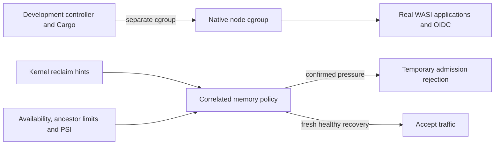

# Local memory isolation and validation

The memory policy applies to Linux platform nodes, including WSL development.
The platform does not place arbitrary operator services into cgroups: production
service placement and limits remain operator responsibilities. A node must be
in its intended dedicated cgroup before the eBPF loader resolves its identity.
See [the memory policy](ebpf.md#4-memory-pressure-monitor) for correlation,
thresholds and recovery, and [observability](observability.md) for metrics.

For the owned native development profile, the sibling harness controller now
provides the per-launch placement, exact lifecycle and bounded validation:
[controller operating guide](../../wasmcloud_platform_harness/docs/native-memory-isolation.md).
Its first launch uses --grant-node-cgroup as a separate bounded authorization;
--grant-ebpf-capabilities retains its existing meaning. The helper only creates
and removes recorded development leaves under /sys/fs/cgroup. A production
service should instead use its deliberately configured systemd/delegated
hierarchy; the local root-level layout is not a production deployment recipe.

The real-platform command is agentic-dev platform test-memory-isolation on an
idle owned real-Hub stack. It runs a durable WASI workflow during a fresh
compilation in another cgroup, then produces genuine bounded cgroup memory.high
pressure, verifies HTTP 503, restores the original settings, verifies recovery
and runs another workflow. It uses fixture generation and no paid model calls.

The separate ignored node test recovery_callback_publishes_from_foreign_thread
requires WASM_TEST_OWNED_NATS_URL from that owned local NATS. It invokes the
actual callback from a standard thread and requires receipt of its real NATS
publication. A compiled test alone is not recorded as a passed live test.

When backpressure is already active, `/readyz` and its `/health` alias report
503 without running dependency I/O probes first. This avoids a synchronous
database health write delaying the rejection response under memory pressure.
The report then contains the backpressure dependency; full dependency checks
resume when accepting traffic and remain available through detailed status.

Do not infer insufficient RAM from a reclaim event or HTTP 503 alone. In the
preceding local incident the node and builds shared /non-systemd, the group was
unlimited, and Linux reported substantial MemAvailable/cache with no OOM. Those
observations establish the shared attribution problem; they do not identify the
allocation responsible for every historical signal. Preserve the earlier
[analysis acceptance](../../wasmcloud_platform_harness/docs/general-analysis-acceptance.md)
as evidence for its recorded artifacts and outcomes.

Kernel interfaces: [cgroup v2](https://docs.kernel.org/admin-guide/cgroup-v2.html)
and [PSI](https://docs.kernel.org/accounting/psi.html). Soft throttling, hard
limits and time stalled are different observations; inactive cache and RSS are
not interchangeable measures.

## Accepted local rehearsal — 2026-11-03

[Versioned metadata](../INFRA_IMPL/AGENTIC/evidence/native-memory-isolation-2026-11-03.json)
records the real native node and controller artifact hashes.
The concurrent workflow **1f58d9ea-2dab-432a-a0f9-ab52eaf6fd6a** completed with
39 successful node/OIDC availability samples in the compilation phase. Cargo
ran in /non-systemd while the node ran in its separate recorded cgroup.

The active load requested at most 256 MiB and repeatedly touched its pages.
Measured memory.high events increased from **1521 to 3646**. The monitor entered
MEDIUM; node readiness and real OIDC returned 503. After the exact limit restore
and load termination, memory pressure returned to 0, backpressure cleared and
both endpoints returned 200. No cgroup OOM/kill counter increase occurred.
The recovered workflow **3889056d-95de-4032-a658-d938b49a6c80** completed too.
An independent slow-I/O degraded hint may outlive memory recovery for its own
cooldown; memory recovery deliberately does not clear that different cause.

The actual NATS callback test passed after invoking the real recovery callback
from a standard thread and receiving its publication. Native checks and strict
workspace Clippy passed in both repositories, including node/ebpf targets;
122 monitor tests and 85 node tests passed. The initially ignored callback was
then explicitly run against the owned NATS and passed. The platform's two
explicit WASI compatibility builds passed. No dependency/toolchain update was
needed and the unchanged OIDC WASI artifacts were reused.

Retained unsuccessful attempts include a wrong build-target environment, the
inline helper transport at the Windows/WSL boundary, and passive allocations
that were absorbed by cache/reclaim with insufficient PSI. The helper now uses
stdin and direct exec. A passive event count alone was not accepted as sustained
pressure; the final fixture repeatedly touches its bounded working set. These
failures are not counted as completed validation.

The final repetition includes the readiness fast-rejection correction. Workflow
**d744e8af-4fa5-41ae-b068-711a2b9a9b0b** completed during compilation with
**43** successful availability samples. With the final test-only soft cap of
192 MiB, memory.high events increased from **0 to 12129**; MEDIUM and real
node/OIDC 503 responses were observed. Two failed control reads were retried
within the deadline. Original limits were restored, OOM counters stayed unchanged,
and both memory pressure and degraded mode returned to normal. Recovered
workflow **db842bf1-a995-41f4-9dc3-197f64743d08** completed.

A final normal workflow **3661437e-b39b-4908-a6ff-63a88246d890** completed before
shutdown. The canonical controller stop then removed the exact recorded cgroup;
final status is stopped, not running, with no error or retained cgroup. Cleanup
waits at most 20 attempts for empty task lists/removal, revalidating the recorded
inode and owner each time and never forcing removal of an occupied group.
The metadata distinguishes the pressure-test controller hash from the subsequent
cleanup-only controller build. Private service data and credentials are retained.

The new readiness regression test passes, as do the 124 applicable proxy tests.
The full proxy suite also attempted its existing host-network NATS fixture:
that container listened successfully, but its port was unreachable from the
WSL test process, so that one test failed. Its exact container was removed;
the rerun filtered out only that test. This is retained as a failed fixture,
not counted as a passed test or confused with the separately passed actual
owned-NATS callback test.

On 2026-11-04 the NATS fixture was changed to explicit loopback port publication
with unique labelled ownership and exact-ID cleanup, including startup failure.
Its live start/stop/resume/removal test and the previously failing proxy
`test_health_transition_retries_after_publish_failure` both passed. This
supersedes the fixture limitation above without changing the earlier recorded
test outcome or the separate owned-NATS callback evidence.

This acceptance uses the explicit workflow model fixture and **zero paid model
calls**. It verifies native-platform WASI execution, identity, isolation and
admission/recovery behavior; it does not revalidate real-model semantics,
throughput across hardware, or production host failure behavior.

## Disk maintenance for the native development stack

The harness controller now provides `agentic-dev platform clean` (preview) and
`agentic-dev platform clean --yes` (apply) for its recorded stopped checkout.
The mutation lock, saved checkout ownership and PID/start-time checks guard the
operation. It removes the regenerable Wasmtime code cache and losslessly archives
known large logs; successful teardown also archives large node logs after node
exit. This does not purge `node.redb`, document objects, keys, audit history,
models or persistent Podman volumes, and does not compact the database or WSL.
A long running campaign can still grow its current log until stopped. Retained
archives and historical validation files have no automatic deletion policy.
See the sibling harness `crates/agentic-dev/README.md`, section **Offline storage
maintenance**, for the command contract and partial-archive recovery behavior.
Platform artifact GC remains separate from this local controller maintenance.